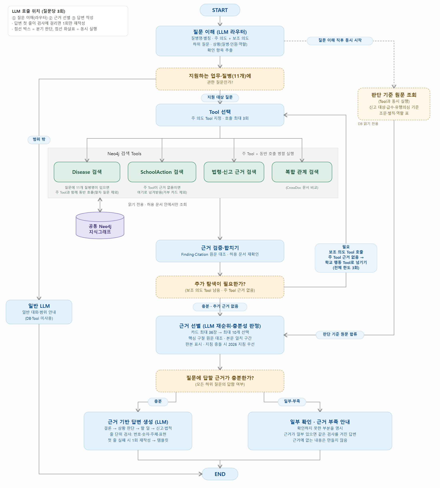

# 교육시설 감염병 근거 기반 대응 Q&A (GraphRAG)

학교 교직원이 감염병 의심·확진 상황을 만났을 때, **여러 공식 문서에 흩어진 학교 행동·담당자·질병별 기준·신고 근거**를 찾아 **문서·판본·PDF 쪽·원문 구절**까지 함께 보여 주는 질의응답 서비스입니다. 공식 PDF에서 학교 행동을 추출·정규화해 **하나의 Neo4j 지식그래프**에 담고, **하나의 메인 LangGraph**가 질문을 이해해 검색 Tool을 골라 근거를 모으고 답을 씁니다.

- 팀: 주승우(팀장) · 송수림 · 유종혁 / 발표 2026-11-09
- 서비스가 하지 않는 것: 진단·치료 판단, 등교·격리의 법적 자동 확정, 개인정보 처리, NEIS 연동
- 답은 근거 인용을 함께 보여 주지만 법적 판단이나 진단을 대신하지 않습니다.



## 목차

1. [프로젝트 소개와 목표](#1-프로젝트-소개와-목표)
2. [데이터 선정 이유와 구성](#2-데이터-선정-이유와-구성)
3. [전체 처리 흐름과 역할 분담](#3-전체-처리-흐름과-역할-분담)
4. [실행 환경·의존성·모델 설정·환경변수](#4-실행-환경의존성모델-설정환경변수)
5. [처리 순서: 전처리 → 추출 → 정규화 → Neo4j 적재 → 조회 실행](#5-처리-순서-전처리--추출--정규화--neo4j-적재--조회-실행)
6. [스키마·프롬프트·쿼리·검증 기록·시각화 위치](#6-스키마프롬프트쿼리검증-기록시각화-위치)
7. [대표 실행 결과](#7-대표-실행-결과)
8. [현재 한계와 개선 방향](#8-현재-한계와-개선-방향)
9. [팀원별 기여와 회고](#9-팀원별-기여와-회고)
10. [폴더 구조](#10-폴더-구조) · [개발 규칙](#11-개발-규칙) · [기준 문서](#12-기준-문서)

---

## 1. 프로젝트 소개와 목표

### 풀려는 문제
학교에서 환자가 생기면 교직원은 "등교중지는 며칠인가", "누가 무엇을 하나", "신고하지 않으면 어떻게 되나"를 그 자리에서 판단해야 합니다. 그런데 기준은 한 문서에 있지 않습니다.

- 교육부 매뉴얼(2023)·경기도 가이드북(2024)은 학교 대응 절차와 역할을 담지만, **질병별 지침은 해마다 바뀌어** 반영하지 못합니다.
- 신고 의무와 벌칙은 **별도 법령**에 있습니다.
- 같은 일을 문서마다 다르게 말하기도 합니다(예: 수족구 복귀 기준 — 학교 문서는 "수포 발생 후 6일 또는 가피 형성까지", 2026 지침은 "발열이 없고 수포가 마른 후").

### 목표
1. 공식 문서만 근거로 쓰고, 모든 답에 **문서·쪽수·원문 구절**을 붙입니다.
2. 같은 뜻의 행동을 **문서별로 섞지 않고 나란히** 비교합니다. 판본이 다르면 최신(2026 질병관리청) 지침을 결론에 두고 학교 문서 기준을 함께 보여 줍니다.
3. 근거가 없는 것은 만들지 않고 "확인하지 못한 부분"으로 밝힙니다.

### 왜 지식그래프인가
- **행동(SchoolAction)은 문서·표·쪽 단위로 따로** 두고, 같은 종류의 행동은 **행동 개념(ActionConcept)** 으로 묶습니다. 문서마다 표현이 달라도 한 번에 모아 비교할 수 있습니다.
- 답에 쓰인 경로(원문 청크 → 행동 → 담당 역할·개념·질병)는 실제 DB에 있는지, 방향이 맞는지 다시 확인합니다.
- 11/9 비교 실험에서 문서 간 같은 개념을 모으는 질문은 그래프가 있을 때 정답 근거를 더 많이 모았고, 역할·질병 나열 질문은 그래프 없이도 답이 같았습니다. 자세한 내용과 한계는 [지식그래프 유무 비교](notebooks/school/평가결과/20261109/지식그래프_유무_비교_20261109.md)에 있습니다.

### 사용자와 범위
- 사용자: 초·중·고·특수학교 교직원(학교장·보건교사·담임교사 등). 기본 시연 지역은 경기도입니다.
- 대상 감염병 **11종**: 성홍열·인플루엔자·수족구병·홍역·코로나19·수두·유행성이하선염·백일해·마이코플라스마 폐렴·유행성각결막염·결핵. 11종 밖 질병은 적재한 자료가 없어 다루지 않습니다. 잡담, 특정 학생의 진단·판정, 처방·투약 같은 개인 의료 상담은 검색 없이 범위 밖으로 안내합니다.
- 11종을 모두 같은 깊이로 처리하지는 않았습니다. 성홍열을 1차 수직 슬라이스로, 인플루엔자·수족구병·홍역을 대표 확장으로 두고 나머지는 질병명·문서 검색을 우선했습니다([계획서 1-1](교육시설_감염병_GraphRAG_프로젝트_계획서_v2.0.md)).

---

## 2. 데이터 선정 이유와 구성

### 선정 이유
- **현장이 실제로 따르는 기준 문서**(교육부 매뉴얼, 경기도 가이드북)를 중심에 둡니다. 단계별 대응과 역할 표가 있습니다.
- 그 문서들은 2023·2024판이라, **질병별 최신 지침(2026, 질병관리청)** 을 함께 넣어 판본 차이를 비교합니다.
- 신고 의무자·벌칙은 학교 문서에 없고 법령에 있어 **감염병예방법과 진단·신고기준**을 넣었습니다.
- 모두 **공식 문서**라서 쪽수 단위로 출처를 확인할 수 있습니다. 문서 전체가 아니라 학교와 관련된 절·표를 **선정 쪽수**로 정해 처리합니다.

### 공통 DB의 문서 10종 (`data/specs/source_manifest.csv`, 개수는 2026-11-09 DB 조회)

| document_id | 문서 | 판본 | 담당 | 청크 | 학교 행동 |
|---|---|---|---|---:|---:|
| `moe_school_manual_v3` | 학교 감염병 예방·위기대응 매뉴얼(교육부) | 제3차 개정판 2023.12 | 주승우 | 367 | 180 |
| `gyeonggi_school_guide_2025` | 경기도 학교 감염병 예방관리 실무 가이드북 | 2024.05 | 주승우 | 922 | 260 |
| `kdca_respiratory_2026` | 호흡기감염병 관리지침(성홍열 등) | 2026 일부개정판 | 송수림 | 286 | 2 |
| `kdca_flu_facility_2026` | 인플루엔자 관리지침(어린이집·유치원·학교용) | 2026 | 송수림 | 30 | 13 |
| `kdca_covid19_2026` | 코로나19 관리지침 | 2026 | 송수림 | 86 | 0 |
| `kdca_measles_2026` | 홍역 대응 지침 | 2026.05 | 유종혁 | 17 | 6 |
| `kdca_hfmd_2026` | 엔테로바이러스·수족구병 관리지침 | 2026 | 유종혁 | 4 | 1 |
| `kdca_vaccine_preventable_2026` | 예방접종 대상 감염병 관리 지침 | 확인 필요 | 유종혁 | 7 | 0 |
| `kdca_diagnosis_reporting_2026` | 법정감염병 진단·신고기준 | 2026.05 | 유종혁 | 9 | 0 |
| `moleg_infectious_disease_act_21521` | 감염병의 예방 및 관리에 관한 법률 | 제21521호 | 유종혁 | 20 | 0 |
| | **합계** | | | **1,748** | **462** |

- 계획서에 있던 결핵 지침(후순위)과 감염병 관리 사업 안내는 manifest에 없고 DB에도 적재하지 않았습니다. 결핵·코로나19 등 일부 질병은 학교 행동이 적거나 없습니다([한계](#8-현재-한계와-개선-방향)).
- 학교 행동이 적은 문서는 행동을 표 행에서 추출했기 때문입니다. 본문은 원문 그대로 검색·인용합니다.
- **원본 PDF와 중간 산출물은 저장소에 없습니다**(`data/raw/`, `data/interim/`은 Git 제외). 새 환경에서 추출부터 다시 하려면 공식 출처에서 받아 `data/raw/`에 두어야 하며, 문서 ID·판본·URL·선정 쪽수는 `source_manifest.csv`에 있습니다(일부 URL은 "확인 필요").

---

## 3. 전체 처리 흐름과 역할 분담

### 데이터를 만드는 흐름 (오프라인)

```
공식 PDF → Markdown → 청크(chunk_id, 쪽수 보존)
   ↓ LLM이 학교 행동 "후보" 추출 (구조화 출력)
   ↓ 사람이 원문과 대조해 승인 → 정규화(역할·질병·행동 개념 사전 매핑, ID 부여)
   ↓ 적재 패키지 검증 → 공통 Neo4j 적재(MERGE) → 청크 임베딩
```

### 질문에 답하는 흐름 (온라인, 메인 LangGraph)

```
질문 → 질문 이해(LLM 라우터) → Tool 선택 → Tool 실행(읽기 전용) → 근거 검증·합치기
     → 부족하면 다른 Tool 추가 호출(전체 최대 3회) → 근거 선별(LLM) → 답변 작성(LLM) → 줄 단위 검사 → 근거가 붙은 답
```

- **LLM은 세 곳에서만** 일합니다: 질문 이해, 근거 선별, 답변 작성(질문당 3회, 답변 첫 줄이 검사에 걸리면 1회 더).
- LLM은 근거를 만들지 못합니다. 라우터는 정해진 형식으로만 답하고, 근거 선별은 카드 번호 중에서만 고르며, 답변은 고른 근거에 있는 말로만 쓰고 모든 줄을 코드가 근거와 대조합니다.
- 질문 속 상황(질병·인원·질문자 역할)에서 필요한 **판단 기준 원문**(신고 대상 목록, 질병 급수, 유행의심 기준, 조문·벌칙)은 Tool과 동시에 DB에서 읽어 옵니다.
- 질문에 11종 질병명이 있으면 질병 Tool을 함께 호출하고, 주 Tool이 근거를 못 찾으면 학교 행동 Tool로 한 번 넘깁니다.
- 모든 조회는 `allowed_document_ids` 안에서만, 읽기 전용으로 합니다.

### 검색 Tool 4개

| Tool | 하는 일 | 담당 | 코드 |
|---|---|---|---|
| `action_search` (ActionSearchTool) | 학교 행동·담당 역할·단계와 원문 근거를 청크 검색(단어+벡터)과 그래프 관계로 찾음 | 주승우 | `src/rag/school/action_tool.py` |
| `disease_search` (DiseaseSearchTool) | 질병 사실(잠복기·전염기간·등교중지 등)과 원문 검색 | 송수림 | `src/rag/respiratory/disease_tool.py` |
| `legal_search` (LegalSearchTool) | 법령·신고 근거. 사람이 검증한 답 카드와 전문 검색 | 유종혁 | `src/rag/prevention_legal/tool.py` |
| `crossdoc_graph_search` (CrossDocGraphTool) | 같은 행동 개념을 문서별로 비교(`INSTANCE_OF` 경로) | 송수림(Cypher)·주승우(연결) | `src/rag/respiratory/crossdoc_tool.py` |

공개 경계는 메인의 `QueryInput → QueryOutput`, 각 Tool의 `ToolInput → ToolResult`입니다([공통 계약 v2.0](교육시설_감염병_LangGraph_공통계약_가이드_v2.0.md)). 메인 그래프는 [`src/rag/school/main_graph.py`](src/rag/school/main_graph.py), 화면은 [`src/rag/ui/`](src/rag/ui/)에 있습니다.

### 역할 분담

| 담당 | 역할 | 맡은 자료 | 맡은 Tool |
|---|---|---|---|
| 주승우 (팀장) | school · 메인 | 교육부 매뉴얼, 경기도 가이드북 | ActionSearchTool, 메인 LangGraph, 화면 |
| 송수림 (PM) | respiratory | 호흡기·인플루엔자·코로나19 지침 | DiseaseSearchTool, CrossDocGraphTool |
| 유종혁 (파트장) | prevention_legal | 예방접종·홍역·수족구·진단신고기준·감염병예방법 | LegalSearchTool, 계약·출처 검증 |

공통 계약·ID 사전·DB 스키마·기존 데이터 변경은 3인 공동 승인 대상입니다([AGENTS.md](AGENTS.md)).

---

## 4. 실행 환경·의존성·모델 설정·환경변수

### 환경
- Python 3.12, 패키지 관리 [uv](https://docs.astral.sh/uv/)
- 외부 서비스: **Neo4j Aura**(팀 공통 인스턴스), **OpenAI API**
- 의존성(`pyproject.toml`): `langchain`, `langchain-openai`, `langgraph`, `neo4j`, `pandas`, `python-dotenv`, `truststore` / 개발: `pytest`, `ruff`, `jupyterlab`, `ipywidgets`
- 화면: Streamlit(`uv run --with streamlit`으로 더함. 클라우드 배포용 의존성은 `src/rag/ui/requirements.txt`)

### 모델 설정
| 용도 | 모델 | 바꾸는 환경 변수 |
|---|---|---|
| 질문 이해·근거 선별·답변 작성·행동 추출·Text2Cypher | `gpt-6-luna`(코드 기본값) | `SCHOOL_ROUTER_MODEL`·`SCHOOL_RERANK_MODEL`·`SCHOOL_ANSWER_MODEL`·`SCHOOL_EXTRACTION_MODEL`·`TEXT2CYPHER_MODEL` |
| 청크·질문 임베딩 | `text-embedding-3-small`, 1536차원, cosine | 바꾸지 않는다(차원은 인덱스 생성 후 바꿀 수 없고, 질문과 저장 임베딩은 같은 모델이어야 함) |

### 환경 변수 (이름만, 값은 `.env`에서 직접 관리)
[`.env.example`](.env.example)을 `.env`로 복사해 채웁니다. `.env`는 Git에 올리지 않습니다.

| 이름 | 용도 | 필수 |
|---|---|---|
| `NEO4J_URI` `NEO4J_USERNAME` `NEO4J_PASSWORD` `NEO4J_DATABASE` | 공통 Neo4j 접속 | 필수 |
| `OPENAI_API_KEY` | LLM 호출과 임베딩 | 필수 |
| `OPENAI_MODEL` | 호흡기 추출기(`index.respiratory.extractor`) 모델 | 추출기 실행 시 |
| `SCHOOL_*_MODEL`, `TEXT2CYPHER_MODEL` | 모델 지정 | 선택 |
| `NEO4J_READONLY_USERNAME` `NEO4J_READONLY_PASSWORD` | Text2Cypher 시연용 별도 읽기 계정 | 선택 |
| `APP_PASSWORD` `DEV_PASSWORD` `DEV_ALLOW_OPEN` `QUERY_LOG` | 화면 비밀번호·개발자 화면·질문 이력 | 선택 |

### 설치와 실행
```bash
uv sync                                   # .venv 생성, 의존성 설치
cp .env.example .env                      # Windows PowerShell: Copy-Item .env.example .env  → 값 채우기

# 화면 (루트 .env 필요: Neo4j·OpenAI)
uv run --with streamlit streamlit run src/rag/ui/app.py

# 테스트 (DB·LLM 없이)
uv run pytest tests -q

# 문법·스타일
uv run python -m compileall -q src
uv run ruff check src
```
- Streamlit Community Cloud: Main file `src/rag/ui/app.py`, Python 3.12, 자격 증명은 앱 Secrets([예시](src/rag/ui/secrets.toml.example)).
- 개발자 화면(처리 흐름·질문 이력)은 주소에 `?dev=1`을 붙이고 `DEV_PASSWORD`를 입력하면 열립니다.
- 2026-11-09 기준 테스트: **492 passed · 3 failed · 3 skipped**. 실패 3건은 호흡기 담당 테스트로, Windows에서 한글 파일의 `cp949` 디코딩 오류와 파일 권한(0o600) 검사 때문에 실패합니다(코드 기능과의 관계는 확인하지 않았습니다). `ruff check src`는 기존 1건(`action_tool.py`)이 남아 있습니다.

---

## 5. 처리 순서: 전처리 → 추출 → 정규화 → Neo4j 적재 → 조회 실행

담당 영역마다 노트북과 모듈의 비중이 다릅니다. 모듈은 저장소 루트에서 `uv run python -m <모듈>`로 실행합니다.

| 단계 | 하는 일 | school (주승우) | respiratory (송수림) | prevention_legal (유종혁) |
|---|---|---|---|---|
| ① 전처리 | PDF→Markdown→청크. 표는 **행 하나=청크 하나**(제목·머리글 보존), 본문은 절 단위로 묶음. 쪽수는 PDF 순서 기준 | `src/preprocess/school/` (`chunks.py` `structure.py` `markdown_data.py`) | `preprocess.respiratory.md_to_blocks` | `src/preprocess/prevention_legal/pages.py`, 노트북 02·06·07 |
| ② 추출 | LLM이 학교 행동 **후보**를 구조화 출력으로 추출. 사람이 승인하기 전에는 후보일 뿐 | `src/preprocess/school/extract.py`, 노트북 `school_extract_rows`·`school_extract_roles`, 검수 화면(`review_web.py`) | `index.respiratory.extractor --doc <문서ID> --pages 116-118` | 노트북 04(프롬프트 v1·v2), `src/index/prevention_legal/prompts/` |
| ③ 정규화 | 원문 대조, 역할·질병·행동 개념을 사전으로 연결, ID 부여. 통과하지 못한 후보는 보류 | `src/index/school/normalize.py` `id_map.py` `ids_local.py`, 사전 `dictionaries/` | `index.respiratory.normalize` | 노트북 05·06·14 |
| ④ 적재 | 스키마·사전 노드 초기화 → 적재 패키지 검증 → MERGE 적재 → 실제 키 재조회 → 임베딩 | `schema_init.py` `bundle.py` `load.py` `embed.py`, 노트북 `school_load` | `index.respiratory.load [--check-db \| --apply \| --embed]` | `src/rag/prevention_legal/load_graph.py`(`confirm=True` 필요), 노트북 21·28 |
| ⑤ 조회 실행 | 질문 → 메인 LangGraph → 근거 있는 답 | `src/rag/ui/app.py`, 노트북 `school_query` | `rag.respiratory.disease_tool "질문"`, `rag.respiratory.crossdoc_tool "질문" --concept <ID>` | `uv run pytest tests/rag/prevention_legal -q` |

**school 새 데이터 순서(노트북):** `school_extract_rows`(추출·검수) → `school_normalize_bundle`(정규화·ID) → `school_chunks_full`(청크·적재 패키지) → `school_load`(적재·검증·임베딩) → `school_query`(질문 실행·평가). 파일별 설명: [school 파일 지도](notebooks/school/파일_지도_무엇이_어디에.md).

**일부 행동만 추가 적재(승인 후):**
```bash
PYTHONPATH=src uv run python -m index.school.load_extra_actions <명세.json> --apply    # 또는 --verify, --delete(명세의 행동만 삭제)
PYTHONPATH=src uv run python -m index.school.exclusion_table_actions <명세.json> <대조표.md>   # 표 칸에서 명세를 규칙으로 생성(DB는 읽기만)
```

**안전 장치**
- 적재는 `MERGE`로 여러 번 실행해도 같고, 한 트랜잭션에서 입력 행 수와 처리 행 수가 다르면 전부 되돌립니다. 적재 후 실제 키를 다시 읽어 대조합니다.
- 공동 DB를 바꾸는 단계(④)는 3인 승인 절차를 따릅니다. 승인 없이 쓰기·삭제·재적재를 하지 않습니다.
- 검색 단계는 읽기 전용이며 허용 문서 밖은 조회하지 않습니다.

---

## 6. 스키마·프롬프트·쿼리·검증 기록·시각화 위치

| 무엇 | 어디 |
|---|---|
| **스키마**: 노드 6종·관계 6종(방향 고정) | [온톨로지 v3.1](교육시설_감염병_GraphRAG_온톨로지_스키마_설명서_v3.1.md), 제약·인덱스 코드 `src/index/school/schema_init.py`, 호흡기 ERD [v0.2](notebooks/respiratory/Neo4j_ERD_v0.2.md), 실제 DB 관찰 구조 [text2cypher_schema.json](notebooks/respiratory/text2cypher_schema.json) |
| **사전**: 질병 11·역할 11·행동 개념 27 | `src/index/school/dictionaries/`(공통 사전 역할), `src/index/respiratory/dictionaries/`(호흡기 질병 4). 공통 DB에는 홍역 지침 행동용으로 추가된 역할 1(`SCHOOL_TEACHER_IN_CHARGE`)·개념 1(`REPORT_HEALTH_CENTER`)이 더해져 역할 12·개념 28입니다 |
| **추출 프롬프트** | `src/index/respiratory/prompts/`(v0·v1), `src/index/prevention_legal/prompts/`(v2), 학교 규칙 `src/preprocess/school/extract.py`(`SCHOOL_RULES`) |
| **답변 파이프라인 프롬프트** | `src/rag/school/router.py`(질문 이해), `rerank.py`(근거 선별), `answer_writer.py`(답변 작성·줄 검사), `checks.py`(판단 기준 원문 조회) |
| **조회 쿼리(Cypher)** | `src/rag/school/search.py`·`action_tool.py`(학교 행동), `src/rag/respiratory/`(질병·문서 비교·Text2Cypher), [visual_queries.cypher](notebooks/respiratory/visual_queries.cypher), [crossdoc_check.cypher](notebooks/respiratory/crossdoc_check.cypher) |
| **골든 질문·정답** | [data/specs/golden/](data/specs/golden/) (`school.json`·`school.md`, `respiratory.md`, `prevention_legal.md`) |
| **검증 기록** | 팀 진행 [docs/progress.md](docs/progress.md), school [평가결과](notebooks/school/평가결과/), 호흡기 [db_check_result.json](notebooks/respiratory/db_check_result.json)·[업무 현황](notebooks/respiratory/업무현황_25개_20261106.md), 예방·법령 [최종검증표](notebooks/prevention_legal/최종검증표_20261108.md), 테스트 `tests/` |
| **시각화** | 구조도(위 그림, [SVG](notebooks/school/평가결과/20261108/구조도_최종_20261108.svg)), Text2Cypher 그래프 시연 [사용법](notebooks/respiratory/Text2Cypher_시연_사용법.md)·[노트북](notebooks/respiratory/text2cypher_demo.ipynb), 화면 캡처 `notebooks/respiratory/captures/`·`notebooks/prevention_legal/화면캡처/` |
| **데이터 명세·manifest** | `data/specs/`(`source_manifest.csv` 등), [data/README.md](data/README.md) |

---

## 7. 대표 실행 결과

### 지식그래프 규모 (2026-11-09 DB 조회)
- 노드 **2,271**: Document 10 · Chunk 1,748 · SchoolAction 462 · ActionConcept 28 · SchoolRole 12 · Disease 11
- 관계 **3,098**: HAS_CHUNK 1,748 · SUPPORTED_BY 462 · DONE_BY 312 · INSTANCE_OF 293 · ABOUT 166 · FOR_DISEASE 117
- 행동 개념 하나에 여러 문서의 행동이 모입니다. 예: `등교중지 실시·통보` 개념에 문서 6종의 행동 14개가 연결됩니다.
- 11/8 호흡기 점검(공동 DB 스냅샷)에서 허용 밖 관계·근거 없는 행동·`basis` 없는 `DONE_BY`·임베딩 없는 청크는 0이었습니다([db_check_result.json](notebooks/respiratory/db_check_result.json)).

### 대표 질문과 답 (실행 1회 요약, 실행마다 문장은 달라질 수 있음)

| 질문 | 답의 핵심 | 근거 |
|---|---|---|
| 수족구병 등교중지 기간이 교육부·경기도·질병관리청에서 어떻게 다른가요? | 2026 지침은 "발열이 없고 수포가 마른 후 복귀", 교육부·경기도는 "수포 발생 후 6일 또는 가피 형성까지". 결론은 2026 지침, 학교 문서는 병기 | 수족구 지침 p30 · 교육부 p49 · 경기도 p157 |
| 전교생 중 5명이 코로나19에 확진됐는데 교장이 할 일은? | 코로나19는 제4급 감염병으로 학교장 신고 대상 목록에 없음. 학교감염병관리조직 활성화·전파 차단 조치 검토. 확인하지 못한 부분은 따로 표시 | 코로나19 지침, 교육부 매뉴얼 |
| 마이코플라스마 폐렴 전염기간은? | 증상 발현 2~8일 전부터 증상 발생 후 20일 이내 | 호흡기 지침 |
| 학교장이 홍역 의심 학생을 보건소에 신고하지 않으면? | 법 제12조제1항 신고를 게을리한 자는 200만원 이하 벌금(제81조 제3호) | 감염병예방법 |

### 평가 요약 (분모와 질문셋이 달라 합치지 않습니다)

| 평가 | 결과 | 읽을 때 주의 |
|---|---|---|
| 학교 골든 40문항, 메인 끝까지(11/8) | 라우팅 40/40 · 정답 근거 인용 28/34 · 기대 상태 일치 36~37/40 | 개발 중 본 문항. 실행 간 변동 정답 인용 ±2 |
| 상황형 질문 15문항 루브릭(11/7) | 52 → 73 / 75 | AI 1인 채점, 사람 확인 전 |
| 지침 전용 질문 16문항, 정답 쪽 인용(11/8) | 5 → 12 | 질문은 AI가 작성, 자동 판정+판독 |
| 학교 행동 추출 정밀도·재현율(11/7) | 정밀도 0.91 · 재현율 0.71 | 20개 청크 표본, 정답 주석 1인 |
| 지식그래프 유무 비교, 개념 비교 14문항(11/9) | Tool이 모은 정답 근거 6.3 vs 1.7, 그래프 없는 답이 있는 근거를 "없다"고 한 경우 7/28 vs 1/28 | 질문을 그래프를 보고 만들었고 정답이 그래프 기준 |
| 호흡기 골든 11문항 | 통과 5 · 부분 통과 4 · 실패 2 | 이미 사용한 질문셋([호흡기 README](notebooks/respiratory/README_respiratory.md)) |
| 예방·법령 골든(11/7 기준) | 회귀 7/7 · 독립 8문항 중 2/8 | 답 카드가 없는 질문은 근거가 DB에 있어도 답하지 못했음([예방·법령 README](notebooks/prevention_legal/README_발표초안_예방법령.md)) |

- 응답 시간은 질문당 약 11~14초(LLM 세 단계가 약 68%)이고, 법령까지 함께 찾는 질문은 16~22초입니다. 화면은 단계 진행과 검사를 통과한 줄을 바로 보여 줍니다.
- 자세한 개선 과정: [답변 품질 개선 과정](notebooks/school/평가결과/20261108/답변품질_개선과정_정리_20261107-08.md), [발표용 총정리](notebooks/school/평가결과/20261107/발표용_전체과정_검색품질_총정리_20261107.md).

### Text2Cypher 시연 (11/9)
질문을 넣으면 LLM이 Cypher를 만들고, 읽기 전용인지 검사한 뒤 실행해 그래프로 보여 줍니다(운영 서비스와 분리된 개발자용). 예: "등교중지 실시·통보 개념에 연결된 행동과 근거 문서를 그래프로 보여줘"는 3회 모두 14행·노드 33·관계 40이 나왔고, 서술형 질문은 검사에서 거부되기도 했습니다([점검 기록](notebooks/school/평가결과/20261109/시연_Text2Cypher_질문확인_20261109.md)). 결과는 근거 인용을 대신하지 않습니다.

---

## 8. 현재 한계와 개선 방향

### 한계
- **질병 범위:** 11종만 다룹니다. 질병에 연결된 학교 행동은 8종에만 있고 코로나19·마이코플라스마·유행성각결막염은 0개이며, 역할과 질병이 함께 붙은 행동은 없습니다. 이런 질병의 질문은 원문 검색으로 답하고 그래프 경로는 거의 타지 않습니다.
- **행동 추출 범위:** 학교 문서의 시나리오·역할 표 행에서 주로 추출했습니다. 질병별 감염병 특성 표(등교중지 기간 등)와 2026 지침 본문의 학교 관련 내용은 대부분 행동으로 만들지 않았습니다(수족구 3개만 예외로 추가). 지침 문서의 행동은 462개 중 22개입니다.
- **법령 Tool:** 사람이 만든 답 카드가 있는 질문에만 근거를 붙입니다(카드가 없으면 메인이 학교 행동 Tool로 넘깁니다).
- **갱신:** 법령·지침이 바뀌어도 자동으로 반영되지 않습니다. 새 문서를 같은 절차로 적재해야 합니다.
- **응답 시간:** 약 11~14초(LLM 3회).
- **평가의 한계:** 골든·상황형·지침 질문은 팀(또는 AI)이 만든 질문이고 개발 중 본 문항이 많으며, 판독은 대부분 1인입니다. 실제 교직원 사용 평가는 하지 않았습니다.
- **공통 계약과의 차이:** 메인은 "기본 1개 Tool, 부족 시 추가 호출"이 원칙이지만, 질병명이 있는 질문에서는 질병 Tool을 처음부터 함께 호출합니다(팀 공유 필요).
- **Text2Cypher:** 시연 계정은 읽기 전용 계정이 아니며, 프로그램의 쿼리 검사·읽기 트랜잭션으로 제한합니다.
- **환경:** 테스트 3건이 Windows에서 실패하고, 일부 문서의 판본·URL은 manifest에서 "확인 필요"입니다. 원본 PDF가 저장소에 없어 추출부터 다시 하려면 별도로 받아야 합니다.

### 개선 방향
- 질병별 등교중지 기간 표 행을 규칙으로 행동화(생성기 [`exclusion_table_actions.py`](src/index/school/exclusion_table_actions.py) 준비됨, 적재 전), 2026 지침 학교 관련 절의 추출·검수.
- 지침 청크와 질병 사이의 `ABOUT` 관계, 역할×질병 연결 보강(엔티티 링킹 후보).
- 문서 비교 Tool의 개념 선택과 "문서별 대표 근거 보장" 개선.
- 실제 교직원 대상 사용자 검증과 질문셋 확대.
- 본문 행동 추출과 검증 절차, 질병·문서 확대, 화면 기능(이어서 묻기 등).

---

## 9. 팀원별 기여와 회고

| 팀원 | 기여 | 회고·작업 기록 |
|---|---|---|
| **주승우** (팀장) | 교육부 매뉴얼·경기도 가이드북 청킹·행동 추출·검수·정규화·적재, 공통 DB 스키마·적재기·임베딩, ActionSearchTool, 메인 LangGraph(LLM 라우터·판단 기준 조회·근거 선별·답변 작성·줄 검사), Streamlit 화면, 평가·발표 | [답변 품질 개선 과정](notebooks/school/평가결과/20261108/답변품질_개선과정_정리_20261107-08.md) · [school 파일 지도](notebooks/school/파일_지도_무엇이_어디에.md) · [진행 현황](docs/progress.md) |
| **송수림** (PM) | 호흡기·인플루엔자·코로나19 지침 전처리·추출·정규화·적재, DiseaseSearchTool, CrossDocGraphTool(Cypher·시각화), 공동 DB 읽기 전용 점검, Text2Cypher 시연 | [호흡기 README](notebooks/respiratory/README_respiratory.md) · [업무 현황 25개](notebooks/respiratory/업무현황_25개_20261106.md) · [호흡기 코드 흐름](notebooks/respiratory/호흡기_코드_흐름_설명.md) |
| **유종혁** (파트장) | 예방접종·홍역·수족구·진단신고기준·감염병예방법 처리·적재(벌칙 조문 포함), LegalSearchTool·답 카드, 공통 계약·출처 검증, GitHub·공동 지시서 정리, 웹디자인·화면 개선 | [예방·법령 README](notebooks/prevention_legal/README_발표초안_예방법령.md) · [최종 결과 정리](notebooks/prevention_legal/최종결과_정리_초안.md) · [일정 관리](notebooks/prevention_legal/일정관리_prevention_legal.md) |

- 위 링크는 저장소에 이미 있는 작업 기록입니다. **개인 회고(배운 점·아쉬운 점)는 각자 작성해 이 표의 링크를 바꿔 주세요.**

---

## 10. 폴더 구조

```
mle-02-p2-team2/
├── README.md · AGENTS.md · CLAUDE.md      # 소개 · 공통 작업 규칙(에이전트 포함)
├── 교육시설_감염병_*.md · 팀_개발_지시서_v1.2.md   # 계획서·온톨로지·공통 계약·일정표(기준 문서)
├── docs/progress.md                       # 팀 진행·검증 현황판
├── data/
│   ├── raw/        # 원본 PDF·변환본 (Git 제외)
│   ├── interim/    # 추출·정규화 중간 산출물 (Git 제외)
│   └── specs/      # source_manifest.csv, 골든 질문, 데이터 명세 (Git 추적)
├── src/
│   ├── preprocess/ # ① 전처리: school · respiratory · prevention_legal
│   ├── index/      # ②③④ 추출·정규화·스키마·적재(사전·프롬프트 포함)
│   ├── rag/        # ⑤ 검색 Tool·메인 LangGraph·화면 (school · respiratory · prevention_legal · ui)
│   └── collect/ common/ eval/   # 자리만 있음(현재 코드 없음)
├── tests/          # 단위·계약 테스트 (DB·LLM 없이 실행)
├── notebooks/      # school · respiratory · prevention_legal 작업 노트북과 기록
├── .env.example · .python-version · pyproject.toml · uv.lock
```

## 11. 개발 규칙

- 작업 시작 전에 [AGENTS.md](AGENTS.md)와 [docs/progress.md](docs/progress.md)를 확인합니다. Claude Code는 `CLAUDE.md`에서 공통 `AGENTS.md`를 가져옵니다.
- 코드·데이터 명세·노트북·문서·평가 결과를 바꾸면 변경·검증·남은 일을 `docs/progress.md`에 갱신해 같은 PR에 포함합니다.
- 공통 계약·ID 사전·DB 스키마와 인덱스·기존 데이터 삭제와 마이그레이션은 3인 공동 승인을 따릅니다.
- `.env`·접속 정보·원본 비공개 자료는 커밋하지 않고, 진행 문서·로그에 출력하지 않습니다.
- 다른 사람의 미커밋 변경을 되돌리거나 함께 커밋하지 않습니다. `git add .` 대신 이번 작업 파일만 지정합니다.
- 노트북에서 재사용할 코드는 `src/`로 옮깁니다. 의존성은 `uv add <패키지>`로 추가해 `pyproject.toml`·`uv.lock`에 반영합니다.
- 코드 작성, 단위 테스트 통과, 실DB 실행, 골든 평가, 메인 통합을 구별해 기록하고, mock 성공을 실서비스 성공으로 보고하지 않습니다.

## 12. 기준 문서

[계획서 v2.0](교육시설_감염병_GraphRAG_프로젝트_계획서_v2.0.md) · [온톨로지 스키마 v3.1](교육시설_감염병_GraphRAG_온톨로지_스키마_설명서_v3.1.md) · [LangGraph 공통 계약 v2.0](교육시설_감염병_LangGraph_공통계약_가이드_v2.0.md) · [개발 일정표 v2.0](교육시설_감염병_GraphRAG_최종_개발일정표_v2.0.md) · [팀 개발 지시서 v1.2](팀_개발_지시서_v1.2.md)
