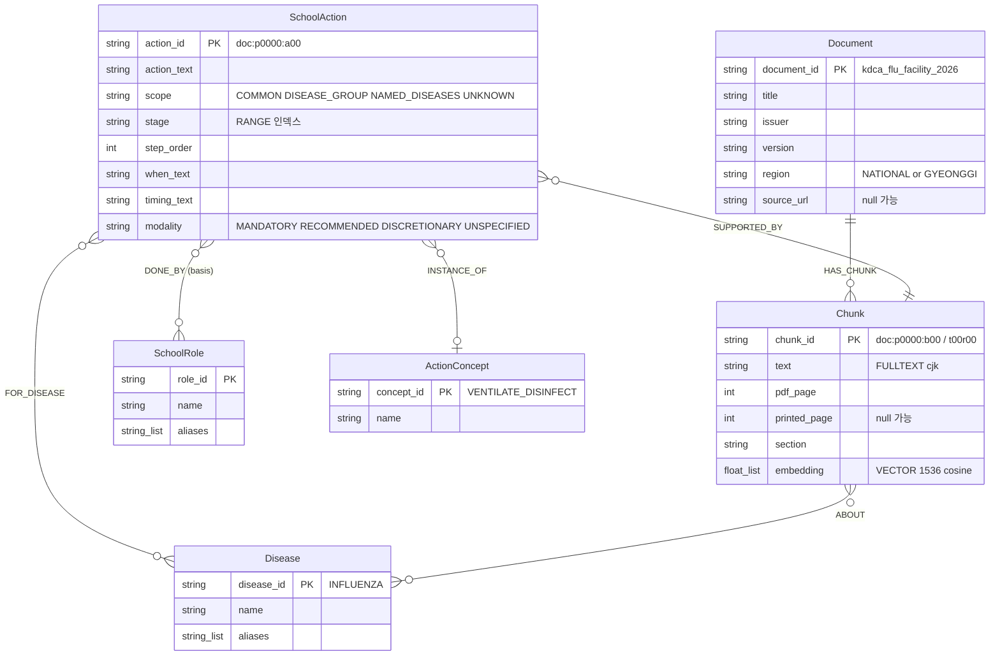

# Neo4j ERD(스키마 설계도) v0.1 — 2026-11-05 송수림

이 문서는 그림·요약이다.정의가 다르면 온톨로지 v3.1과 src/index/school/bundle.py가 우선
근거:온톨로지 v3.1,계약 가이드 v2.0,src/index/school/bundle.py(NODE_PROPERTIES·ALLOWED_EDGES)·schema_init.py,11/4 공동 Neo4j 확인값
스키마는 온톨로지 v3.1 그대로(노드 6·관계 6).v2.0 변경은 데이터 흐름 끝(메인 LangGraph+검색 Tool)만 반영

## 1. ERD



## 2. 관계 6종(방향 고정,이 밖의 관계는 적재 거부)

```
①Document-[:HAS_CHUNK]->Chunk          문서 1:N 청크
②Chunk-[:ABOUT]->Disease               그 청크가 실제 다루는 질병만
③SchoolAction-[:SUPPORTED_BY]->Chunk   행동의 근거 청크(필수,Citation 출처)
④SchoolAction-[:FOR_DISEASE]->Disease  scope=NAMED_DISEASES일 때만
⑤SchoolAction-[:DONE_BY{basis}]->SchoolRole  basis=EXPLICIT|EXAMPLE 필수
⑥SchoolAction-[:INSTANCE_OF]->ActionConcept  맞는 개념 없으면 안 만듦
```

## 3. 제약·인덱스(11/4 DB 확인값)

```
•유일 제약 6:document_id·chunk_id·action_id·disease_id·role_id·concept_id
•RANGE:위 6개 ID+action_stage·action_scope
•FULLTEXT chunk_text=키워드 검색
•VECTOR chunk_embedding(1536,cosine)=의미 검색
•전부 ONLINE.팀 승인은 회의결정 1·8번에 따라 보류 상태
```

## 4. 누가 무엇을 넣나

```
•사전 노드 Disease·SchoolRole·ActionConcept=공통(schema_init+dictionaries)
•Document·Chunk·SchoolAction=각자 자기 document_id 접두어로만
 school:moe_school_manual_v3·gyeonggi_school_guide_2025
 respiratory:kdca_respiratory_2026·kdca_flu_facility_2026·kdca_covid19_2026
 prevention_legal:kdca_measles_2026·kdca_diagnosis_reporting_2026·moleg_infectious_disease_act_21521(manifest 기준)
•적재=ID MERGE+허용 속성 SET(재실행해도 중복 0)
•임베딩=각자 자기 Chunk만
```

## 5. 데이터 흐름(v2.0)

```
PDF
↓
blocks.jsonl:청크(chunk_id 부여)
↓
steps_raw.jsonl:LLM 행동 추출(PENDING)
↓
steps_normalized.jsonl:원문 대조 판정(APPROVED·EXCLUDED)+사전 매핑
↓
bundle.json:validate_bundle(속성·ID·관계 패턴 검사)
↓
공통 Neo4j:load_bundle→verify_loaded_bundle→embed_chunks
↓
검색 Tool 4개(ToolInput→ToolResult,읽기 전용)
↓
메인 LangGraph:분류→Tool 선택→근거 평가→필요시 추가 Tool(최대 3회)→QueryOutput
```

## 6. Tool별 읽는 노드·관계

```
•action_search:SchoolAction-DONE_BY->SchoolRole,SchoolAction-SUPPORTED_BY->Chunk<-HAS_CHUNK-Document
•disease_search:Disease<-ABOUT-Chunk<-HAS_CHUNK-Document+FULLTEXT·VECTOR(별칭 인식)
•legal_search:법령·신고 Chunk(+신고 개념 SchoolAction)
•crossdoc_graph_search:ActionConcept<-INSTANCE_OF-SchoolAction-SUPPORTED_BY->Chunk<-HAS_CHUNK-Document,+DONE_BY
•GraphPath=위 관계를 실제 방향 그대로 직렬화(새 노드 아님)
```

## 7. 공동 DB 점검 결과(11/5 notebooks/respiratory/db_check.py,읽기 전용)

```
•노드 2,115:Document 9·Chunk 1,567·SchoolAction 488·ActionConcept 28·SchoolRole 12·Disease 11
•관계 2,985:HAS_CHUNK 1,567·SUPPORTED_BY 488·DONE_BY 344·INSTANCE_OF 305·ABOUT 166·FOR_DISEASE 115
•허용 6패턴 밖 관계 0,SUPPORTED_BY 없는 행동 0,HAS_CHUNK 없는 청크 0,basis 없는 DONE_BY 0,임베딩 없는 청크 0
•사전 노드 실제 속성:Disease(disease_id·name·aliases),SchoolRole(role_id·name·aliases),ActionConcept(concept_id·name)
 →ActionConcept.group은 DB에 없음(사전 검수용)
•제약 6·인덱스 12(RANGE 9·FULLTEXT 1·VECTOR 1·LOOKUP 2) 전부 ONLINE
•문서 간 공통 개념(3개 문서):CONTACT_GUARDIAN·ACTIVE_SURVEILLANCE·COOPERATE_HEALTH_AUTHORITY 등
```

## 8. 확인 필요

```
•ActionConcept 28=사전 27+REPORT_HEALTH_CENTER(사전 파일에 없음,kdca_measles_2026 행동 2건이 사용),SchoolRole 12=사전 11+1(무엇인지 미확인)
•kdca_hfmd_2026:DB엔 있고 source_manifest.csv엔 없음
•표 청크 규칙(회의 "문단 유지"↔v3.1 "행 단위",회의결정 5번).school 문서는 이미 표 행 청크 사용
```
