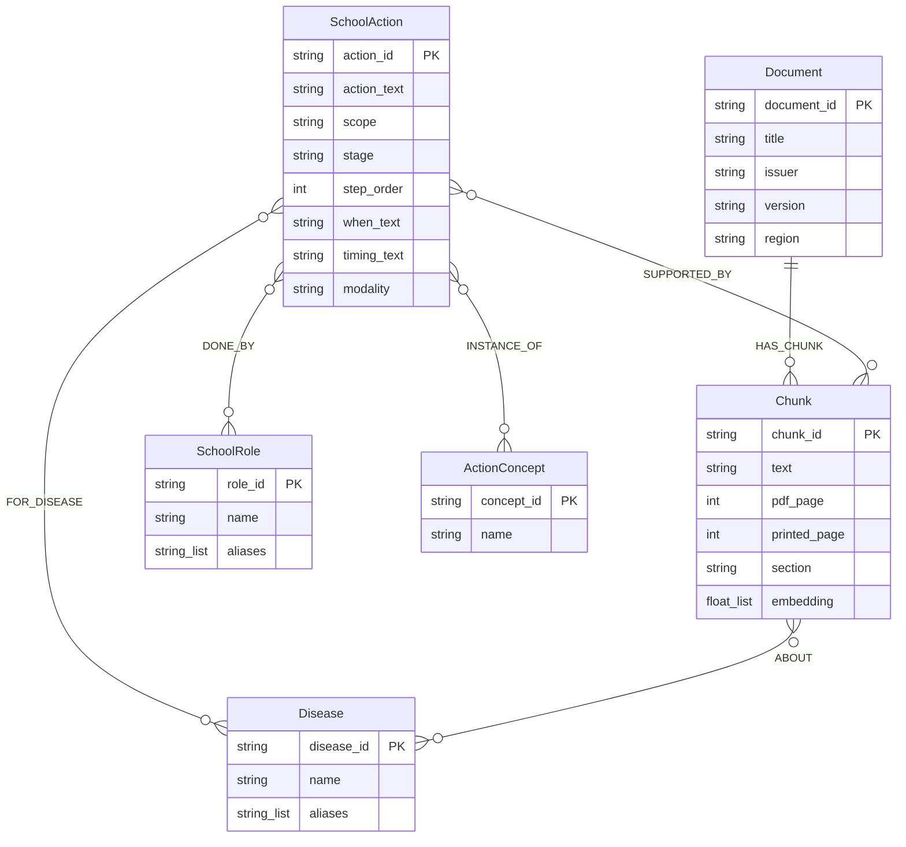
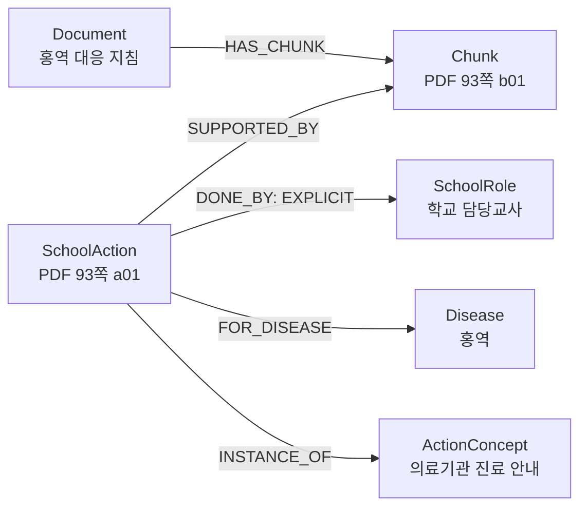

# 공동 Neo4j ERD v0.2 — 2026-11-06 읽기 전용 대조

이 문서는 기존 [호흡기 ERD v0.1](Neo4j_ERD_v0.1.md)에 예방·법령 담당 문서와 실제 관계 사례를 보완한 설명용 문서다. 스키마 변경·팀 승인이나 DB 쓰기를 뜻하지 않는다. 사용자 작업 폴더 바깥의 `Neo4j_ERD_v0.1.md`는 수정하지 않았다.

설계 기준은 [온톨로지 v3.1](../../교육시설_감염병_GraphRAG_온톨로지_스키마_설명서_v3.1.md)과 [공통 적재 검증 코드](../../src/index/school/bundle.py)다. 실제 DB의 속성·관계·인덱스는 [2026-11-06 읽기 전용 조회](erd_readonly_20261106.json)에서 확인했으며 이후 변할 수 있다. 코드의 허용 속성과 DB에 실제 존재하는 속성은 구분한다.

## 1. 공통 노드와 관계



그림의 연결 표시는 관계의 양 끝 노드 종류를 이해하기 위한 표현이다. 전체 데이터에 대해 관계별 최소·최대 개수를 제약으로 검증한 것은 아니다. 그림의 속성 타입은 설계 기준이며 실제 모든 값의 타입을 확인한 것은 아니다. 특히 `step_order`는 설계상 정수지만 예방·법령 적재 코드의 한 경로는 문자열로 만들기 때문에 현 DB의 타입별 대조가 필요하다. `Document.source_url`은 공통 코드의 허용 속성이지만 이번 실제 DB 속성 목록에는 없었다. 속성 목록은 라벨별 전체 노드의 속성 이름 합집합이므로 모든 노드에 해당 속성이 있다는 뜻도 아니다.

| 관계와 방향 | 의미 |
|---|---|
| `Document → HAS_CHUNK → Chunk` | 문서가 원문 조각을 포함 |
| `Chunk → ABOUT → Disease` | 조각이 다루는 질병을 관계로 연결한 경우 |
| `SchoolAction → SUPPORTED_BY → Chunk` | 행동의 원문 근거 |
| `SchoolAction → FOR_DISEASE → Disease` | 행동이 적용되는 특정 질병 |
| `SchoolAction → DONE_BY → SchoolRole` | 원문에 근거한 담당 역할. 관계 속성 `basis`로 명시·예시를 구별 |
| `SchoolAction → INSTANCE_OF → ActionConcept` | 서로 다른 문서의 유사 행동을 비교할 공통 개념 |

관계는 확인된 경우에만 그린다. 문서의 모든 청크에 질병·행동 관계가 있거나 모든 행동에 역할이 있다고 가정하지 않는다. `GraphPath`는 실제 노드·관계의 반환 형식이며 별도 DB 노드가 아니다.

## 2. 세 담당자의 문서가 들어가는 방식

세 담당자는 공통 노드와 관계를 사용하며, 담당자별로 별도 노드 라벨을 만드는 구조가 아니다. 다음은 [manifest](../../data/specs/source_manifest.csv)에 적힌 문서 범위다. DB 적재 여부와 범위는 별도 검증한다.

| 담당 | Document ID |
|---|---|
| 학교 | `moe_school_manual_v3`, `gyeonggi_school_guide_2025` |
| 호흡기 | `kdca_respiratory_2026`, `kdca_flu_facility_2026`, `kdca_covid19_2026` |
| 예방·법령 | `kdca_measles_2026`, `kdca_diagnosis_reporting_2026`, `kdca_hfmd_2026`, `kdca_vaccine_preventable_2026`, `moleg_infectious_disease_act_21521` |

예방·법령의 다섯 문서는 이번 조회에서 각각 Document와 연결된 Chunk가 확인됐다. 문서별 Chunk 수는 홍역 17, 진단·신고 8, 수족구 4, 예방접종 7, 법령 9다. 청크 수는 변경될 수 있고, 문서 전체가 적재됐다는 의미가 아니다. ([조회 결과](erd_readonly_20261106.json))

## 3. 종혁님 담당 실제 관계 사례

홍역 대응 지침의 PDF 93쪽에서 DB가 실제 반환한 사례 하나:

```text
Document:kdca_measles_2026
  -[:HAS_CHUNK]-> Chunk:kdca_measles_2026:p0093:b01
  <-[:SUPPORTED_BY]- SchoolAction:kdca_measles_2026:p0093:a01
    -[:DONE_BY {basis: EXPLICIT}]-> SchoolRole:SCHOOL_TEACHER_IN_CHARGE
    -[:FOR_DISEASE]-> Disease:MEASLES
    -[:INSTANCE_OF]-> ActionConcept:REQUEST_MEDICAL_VISIT
```

한 행동을 기준으로 뻗어 나가는 네 관계를 여러 줄로 나타낸 그림이다. 학교 담당교사라는 역할, 홍역이라는 질병, 의료기관 진료 안내라는 개념, 원문 청크가 어떤 행동을 통해 연결되는지 설명할 수 있다. 이 사례는 DB에 해당 관계가 존재한다는 확인이며 다른 문서나 법령에도 같은 관계가 모두 있다는 뜻은 아니다. ([실제 ID·관계](erd_readonly_20261106.json), [종혁님 적재 코드](../../src/rag/prevention_legal/load_graph.py))



이 그림은 위의 한 행동 a01에 대해 실제 DB에서 확인한 관계를 시각화한 것이다. 다른 행동의 경로까지 검증한 그림은 아니다.

법령 원문은 Document와 Chunk로 출처를 보존한다. 현재 [legal_search 어댑터](../../src/rag/prevention_legal/tool.py)는 Finding·Citation을 반환하지만 `graph_paths`는 빈 목록이다. 따라서 법령 Tool의 답변에 위 홍역 사례 같은 GraphPath가 있다고 단정하지 않는다.

## 4. 조회 시점의 DB 구조

| 확인 항목 | 조회 결과 |
|---|---|
| 노드 | Document 10, Chunk 1,731, SchoolAction 458, Disease 11, SchoolRole 12, ActionConcept 28 — 합계 2,250 |
| 관계 | HAS_CHUNK 1,731, SUPPORTED_BY 458, DONE_BY 312, INSTANCE_OF 289, ABOUT 166, FOR_DISEASE 113 — 합계 3,069 |
| 관계 패턴 | 위 여섯 방향만 반환됨 |
| 제약·인덱스 | 고유 제약 6개, 인덱스 12개(전문·벡터 포함) 확인; 인덱스 상태는 모두 ONLINE |

이 숫자는 11/6 해당 조회의 스냅샷이다. 이전 [DB 점검 결과](db_check_result.json)의 노드 2,119·관계 2,995는 이전 조회값으로, 서로 다른 시점의 기록을 덮어쓰지 않는다. 인덱스 옵션의 세부 값과 백업·복구 가능 여부는 이번 조회만으로 검증하지 않았다.

## 5. 설명용 데이터 흐름

```text
지침·법령 → 원문 청크(Document·Chunk) → 필요한 학교 행동 추출·정규화
         → 공통 Neo4j 노드·관계 → Tool이 근거 조회 → 메인 그래프가 답변과 인용 조립
```

모든 문서에서 행동을 추출한 것은 아니다. 원문 청크만 있는 문서도 있고, Tool은 허용된 문서 범위에서 근거를 조회한다. 예방·법령 담당의 카드 기반 응답과 호흡기 질병 검색·CrossDoc 검색은 세부 방식이 다르므로 발표 시 구별한다. ([법령 코드](../../src/rag/prevention_legal/tool.py), [호흡기 코드](../../src/rag/respiratory/disease_tool.py), [CrossDoc 코드](../../src/rag/respiratory/crossdoc_tool.py))

## 6. 재현과 남은 확인

- 저장소 루트에서 `uv run python notebooks/respiratory/erd_readonly_check.py`를 실행하면 Neo4j에서 읽은 결과를 JSON으로 표준 출력한다. DB 쓰기와 AI 호출은 없다.
- 법령 담당자에게 문서 범위·홍역 행동 관계 의미와 최신 반영 상태를 확인받아야 한다. 이 문서는 공동 승인 기록이 아니다.
- `source_url` 등 코드 허용 속성과 실제 속성 차이, 수막구균 Disease 노드, 데이터 마이그레이션·백업은 별도 검토한다.
