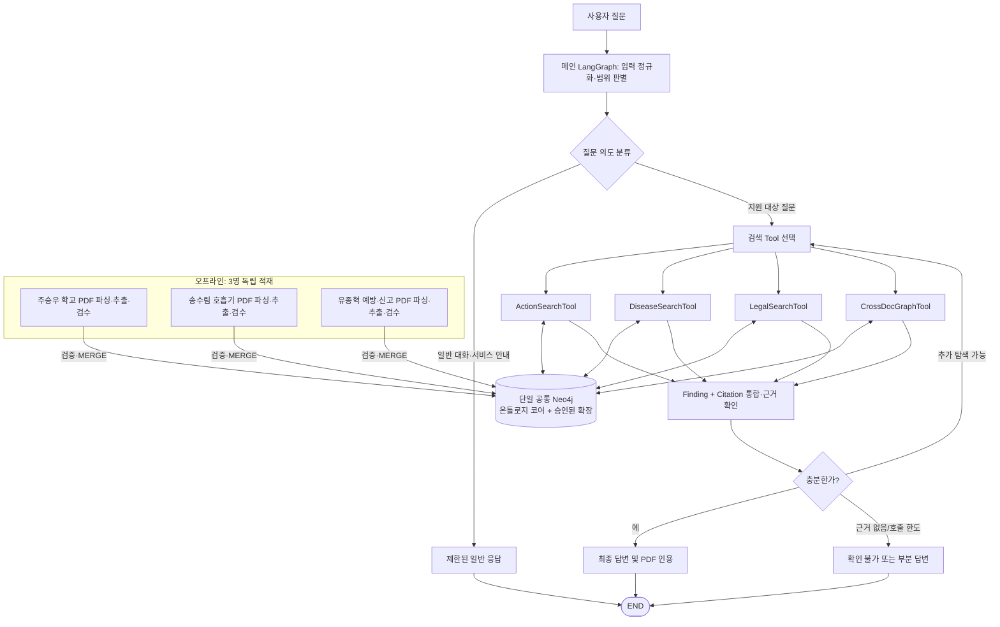
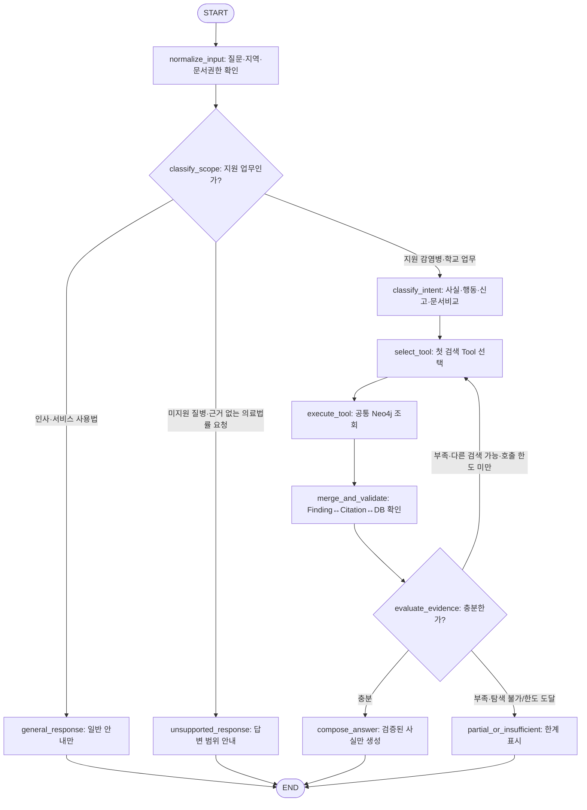

# 교육시설 감염병 근거 기반 대응 Q&A — 프로젝트 계획서 v2.0

> **공통 Neo4j + 단일 메인 LangGraph + 4개 전문 검색 Tool** 기반 개발계획서  
> **작성 기준:** 2026-11-05 | **개발·검증:** 2026-11-02~11-08 | **발표:** 2026-11-09(월) 오후  
> **전제:** 3인 협의로 본 아키텍처를 채택했을 때 적용하는 v2.0 통합안. 실제 승인·DB 반영 여부는 팀에서 확인한다.  
> **동반 문서:** `교육시설_감염병_LangGraph_공통계약_가이드_v2.0.md`, `교육시설_감염병_GraphRAG_최종_개발일정표_v2.0.md`, `교육시설_감염병_GraphRAG_온톨로지_스키마_설명서_v3.1.md`

## 0. v1.1 → v2.0 핵심 변경과 유지 사항

| 구분 | 기존 v1.1 | v2.0 |
|---|---|---|
| 질의 실행 | 3개 독립 전문 LangGraph를 라우팅·병렬 결합 | **메인 LangGraph 하나**가 질문을 분류하고 **검색 Tool 1개를 우선 호출**, 근거가 부족하면 다른 Tool을 추가 호출 |
| 개발 분담 | 각자 전문 QueryGraph | 각자 **전문 검색 Tool**(Action / Disease / Legal)을 소유·검증, CrossDoc은 공동 |
| GraphRAG 시연 | 여러 Graph의 답변 합성 중심 | **SchoolAction·SchoolRole·ActionConcept·Chunk·Document 등 실제 Neo4j 관계 탐색 경로**를 증빙 |
| 통합 계약 | 전문 Graph별 `QueryInput → QueryOutput` | 메인 `QueryInput → QueryOutput`, Tool별 `ToolInput → ToolResult` |
| 변하지 않는 것 | 공식 PDF·대상 질병·공통 DB·출처 추적 | **그대로 유지**: 원본 PDF 분담, 개체·관계 추출, 정규화, 통합 Neo4j, 인용·검수 원칙 |
| 완료한 작업 | 11/02~11/04의 PDF→Neo4j→단독 검색 | **재작성하지 않음.** 기존 검색기·코드는 Tool로 래핑/재사용 |

**변경 이유:** 실제 검토한 대표 질문 가운데 복수 전문 Graph 호출이 필요한 질문이 제한적이고, 기존 구조는 LangGraph의 흐름 제어보다 병렬 응답 합성에 치우쳤다. v2.0은 질문 유형에 따라 필요한 검색 경로를 선택하고, 근거 충족 여부를 평가하여 추가 탐색 여부를 결정한다. 단순한 질병 사실 질문에는 청크 검색으로 답하고, 학교 행동·담당·문서 간 차이는 **지식그래프 관계를 직접 활용**한다.

## 1. 서비스 개요와 범위

학교 교직원이 감염병 의심·확진 사례를 접했을 때 여러 공식 문서에 흩어진 **학교 행동, 담당자, 질병별 관리사항, 신고·보고 근거**를 찾고 문서·판본·PDF 쪽수까지 확인할 수 있도록 돕는 **근거 기반 Q&A** 서비스다.

| 항목 | 기준 |
|---|---|
| 주요 사용자 | 초·중·고·특수학교 교직원(학교장·보건교사·담임교사 등) |
| 기본 시연 지역 | **경기도 학교**. 전국 공통 자료와 지역 자료를 구별한다. |
| 핵심 화면 | 사용자 질문 → 근거 기반 답변 → 원문 출처 및 확인 필요 사항 |
| 핵심 기술 | PDF 개체·관계 추출, Neo4j GraphRAG, LangGraph 조건부 라우팅·검증·제한된 재탐색 |
| 데이터 정책 | **공통 Neo4j 하나**에 검증된 원문·학교 행동·역할·질병·공통 행동 개념 적재 |
| 서비스 밖 | 환자 진단·치료 판단, 등교/격리의 법적 자동 확정, 개인정보 처리, NEIS 직접 연동·자동 제출 |

### 1-1. 감염병 11종 및 구현 깊이

| 우선순위 | 대상 | 구현 깊이 |
|---|---|---|
| 1차 수직 슬라이스 | **성홍열** | 학교 대응·질병 근거·신고/보고 구분 및 검색 과정 시연 |
| 대표 확장 | **인플루엔자·수족구병·홍역** | 질병 정보, 학교 행동, 근거·출처의 대표 질문 |
| 기본 범위 | **코로나19·수두·유행성이하선염·백일해·마이코플라스마 폐렴·유행성각결막염·결핵** | 질병명·별칭·관련 문서 검색 우선, 검증된 행동만 점진 추가 |

11종 전부를 심층 처리하는 것이 필수 목표는 아니다. 결핵 674쪽 전체 추출이나 고급 법령 온톨로지 추가는 발표 이전의 필수 과제로 삼지 않는다.

## 2. 원천 자료 및 담당 분담

**원본 파일 전체 12개 PDF, 2,822쪽**(결핵 제외 11개 파일 2,148쪽). 쪽수는 원본 PDF 전체 분량이며, 실제 처리는 학교 관련 핵심 절·표부터 선택적으로 진행한다.

| 데이터 적재·검수 책임 | 자료 | 전체 쪽수 | 질의 Tool 담당 |
|---|---|---:|---|
| **주승우** | 교육부 「학교 감염병 예방·위기대응 매뉴얼」 230쪽, 경기도 학교 실무가이드북 414쪽 | **644** | `ActionSearchTool` + 메인 LangGraph(라우팅·State·UI) |
| **송수림** | 2026 호흡기감염병 관리지침 304쪽, 시설별 인플루엔자 32쪽, 코로나19 81쪽, 감염병 관리 사업 안내 229쪽 | **646** | `DiseaseSearchTool` + CrossDoc Cypher/Neo4j 시각화 |
| **유종혁** | 예방접종 대상 감염병 315쪽, 홍역 179쪽, 수족구병 68쪽, 법정감염병 진단·신고기준 237쪽, 감염병예방법 59쪽 | **858** | `LegalSearchTool` + Tool 계약·Citation·Finding 검증 |
| **송수림 (후순위)** | 2026 국가결핵관리지침 중 학교 관련 절 | **674** | 필수 기능 안정화 후 확장 |
| **3인 공동** | 단일 공통 Neo4j, `CrossDocGraphTool`의 탐색 기준·검수 | — | 송수림이 Cypher 구현, 주승우가 Tool 호출 연결, 유종혁이 출처 검증 |

자료를 적재한 담당자가 그 문서의 **소유·검수 책임자**인 것이지 다른 Tool의 조회를 막는 것은 아니다. **모든 Tool은 `allowed_document_ids`의 허용 범위 안에서 공통 DB 전체를 검색**할 수 있다. `preferred_document_ids`는 우선순위일 뿐 접근 권한이 아니다.

**자료 처리·원문 관리:** `source_manifest.csv`에 문서 ID·판본·발행기관·게시/시행일·지역·공식 URL·허용 범위·선정 페이지를 기록한다. 표는 행 제목과 열 머리글을 보존하고 PDF 뷰어 1-based 페이지와 인쇄 쪽수를 구분한다. 이미지형 PDF는 필요한 쪽만 OCR한다. 이용 권한이 불명확한 원본은 공개 저장소에 올리지 않는다.

## 3. v2.0 전체 아키텍처

### 3-1. 왜 '메인 LangGraph + Tool'인가

- 질문 대부분을 **하나의 검색 기능으로 처리**하고, 부족한 경우에만 다른 Tool을 호출한다.
- `ActionSearchTool`과 `CrossDocGraphTool`은 실제 그래프 관계를 따라 검색하므로 **복합 질문이 없더라도 GraphRAG를 시연**할 수 있다.
- 메인 LangGraph는 단순 분배기가 아니다. **범위 판별 → 검색 경로 선택 → 근거 평가 → 재탐색 여부 결정 → 종료**를 관리한다.
- 기존의 3개 QueryGraph 코드는 폐기하지 않는다. 검색 핵심 부분을 Tool 함수로 추출하거나, 기존 compiled Graph를 **Tool 래퍼에서 호출**할 수 있다. 별도 Subgraph 구축을 강제하지 않는다.
- 모든 Tool을 병렬 호출하는 것이 기본값이 아니다. **1개 Tool 우선**으로 시작해 결과에 따라 필요한 Tool만 추가한다.

### 3-2. 메인 LangGraph 권장 흐름

**운영 기본값(제안):** 최초 검색 1회 + 추가 검색 최대 2회(총 3회의 Tool 호출). 이미 호출한 Tool을 같은 조건으로 무한 재시도하지 않는다. 결과는 중복 없이 누적하고, 지원하지 않는 법률·의료 판단은 일반 LLM으로 우회해 생성하지 않는다. 일반 응답 분기는 인사·서비스 사용법·지원 범위 설명만 처리한다.

### 3-3. 4개의 검색 Tool

| Tool | 주요 탐색 대상 | 질문 예시 | 접근 방식 |
|---|---|---|---|
| `DiseaseSearchTool` | `Disease` ↔ `Chunk` ↔ `Document` | "인플루엔자의 잠복기는?" | 별칭 인식, 질병 관련 청크 검색·출처 확인. 벡터/전문/하이브리드 선택 가능 |
| `ActionSearchTool` | `SchoolAction` → `SchoolRole`·`ActionConcept`·`Chunk` | "감염병 의심 학생 발견 시 보건교사 역할은?" | **Cypher로 학교 행동·역할·단계·근거 관계 직접 탐색** |
| `LegalSearchTool` | 법령/신고 지침 `Document`·`Chunk`, 필요한 경우 학교 행동 | "성홍열 신고 주체와 학교 보고는 어떻게 다르지?" | **법률 조문 전용 노드 없이 청크 기반 검색**으로 시작, 신고 주체·수신처 구분 |
| `CrossDocGraphTool` | 공통 `ActionConcept`, `Disease`, `SchoolAction`, `Chunk`, `Document` | "두 학교 지침의 보호자 연락은 누가 담당하나?" | **동일 개념의 원문별 행동·조건·역할·근거를 횡단 조회** |

**중요:** `CrossDocGraphTool`은 '질문이 복합적일 때만' 사용할 수 있는 것이 아니라, **단일 관계 비교 질문의 1차 Tool**로도 사용할 수 있다. `ActionSearchTool` 내부에서도 관계 탐색이 일어나므로, GraphRAG 활용이 CrossDoc 호출에만 종속되지 않는다. 반대로 단순 사실 질문에 억지로 관계 탐색을 실행하지 않는다.

### 3-4. 대표 시연 3종

1. **질병 사실**: "인플루엔자의 잠복기는?" → `DiseaseSearchTool` → 원문 `Citation`.
2. **학교 행동 관계**: "감염병 의심 학생을 발견하면 담임·보건교사는 무엇을 확인하나?" → `ActionSearchTool` → `SchoolAction → DONE_BY → SchoolRole` 및 `SUPPORTED_BY → Chunk` 관계의 실제 결과와 PDF 쪽수.
3. **문서 횡단 비교**: "교육부 매뉴얼과 경기도 가이드북에서 '보호자 연락'의 단계·담당은 어떻게 다른가?" → `CrossDocGraphTool` → `ActionConcept ← INSTANCE_OF ← SchoolAction → SUPPORTED_BY → Chunk ← HAS_CHUNK ← Document`의 출처별 차이 표시.

성홍열 복합 질문은 **추가 탐색 루프 시연용 선택 사례**로 유지한다. **'2-Graph/3-Graph를 실행해야 성공'이라는 기준은 폐기한다.** 모든 시연 문장은 해당 PDF 원문을 확인한 뒤 확정한다.

## 4. 공통 Neo4j 온톨로지와 데이터 규칙

### 4-1. 코어 스키마: 6개 노드 · 6개 관계

| 노드 | 핵심 속성 | 의미 |
|---|---|---|
| `Document` | `document_id`, `title`, `issuer`, `version`, `region`, `source_url` | 공식 자료 및 판본 |
| `Chunk` | `chunk_id`, `text`, `pdf_page`, `printed_page`, `section` | 검색·인용 원문 |
| `Disease` | `disease_id`, `name`, `aliases` | 대상 질병 식별·별칭 |
| `SchoolRole` | `role_id`, `name`, `aliases` | 학교 내 수행 역할 |
| `SchoolAction` | `action_id`, `action_text`, `scope`, `when_text`, `timing_text`, `modality` | 특정 PDF에 근거한 학교 행동 |
| `ActionConcept` | `concept_id`, `name` | 문서 간 공통 행동 의미 |

| 관계 | 방향 |
|---|---|
| `HAS_CHUNK` | `Document → Chunk` |
| `ABOUT` | `Chunk → Disease` |
| `SUPPORTED_BY` | `SchoolAction → Chunk` |
| `FOR_DISEASE` | `SchoolAction → Disease` |
| `DONE_BY` | `SchoolAction → SchoolRole` |
| `INSTANCE_OF` | `SchoolAction → ActionConcept` |

**기준선은 v3.0이며**, **v3.1은 별도 승인 대상**이다. v3.1이 합의·실제 DB에 반영되었다면 `SchoolAction.stage`, `step_order`, `scope=DISEASE_GROUP`, `DONE_BY.basis` 필수, 표 청크·공통 ID 규칙 및 승인한 `Chunk.embedding`을 적용한다. **이 문서는 v3.1이 이미 DB에 적용되었다고 주장하지 않는다.** 11/05 첫 확인에서 실제 스키마·데이터·인덱스를 점검한 후 계약과 쿼리의 적용 버전을 기록한다.

**불변 원칙**

- 원문 충실성을 최우선으로 하며, 검증된 `SchoolAction`만 적재한다. 일반 질병 사실 및 의료기관 내부 의무는 `Chunk` 검색으로 처리한다.
- `SchoolAction`은 **출처별**로 유지한다. 서로 다른 문서의 행동을 하나로 뭉개지 않고 `ActionConcept`를 공통 연결점으로 사용한다.
- `scope=COMMON`을 특정 질병 모두에게 자동 상속하지 않으며, v3.1의 `DISEASE_GROUP`도 **질병 목록 자동 확장 근거가 아니다**.
- 신고·교육청 보고·학교장의 보건소 신고·의료기관 법정 신고를 혼동하지 않는다. 관련 법적 의무는 실제 적용 판본과 원문으로 확인한다.
- 문서 ID·청크 ID·행동 ID 및 표준 별칭은 공통 사전을 따른다. 문서별 판본·PDF/인쇄 페이지 매핑을 유지한다.
- `MERGE`·고유성 제약·재실행 중복 검증으로 공통 DB를 보호한다. 공통 DB 스키마/인덱스 변경은 공동 승인 및 롤백 계획이 필요하다.

### 4-2. 신규 스키마 확장 기준

**자유:** 개인 Tool의 Cypher, Retriever, 프롬프트, 랭킹, 메인 그래프 내부 State·노드 분기, 개인 개발 환경의 실험 인덱스.  
**공동 승인:** 공통 DB의 새 노드/관계/속성/인덱스, 표준 ID·별칭 사전 및 변경·삭제, 데이터 마이그레이션.  
**채택 절차:** 골든 질문 → 현행 스키마의 한계 기록 → 확장안 → 적용 전후 비교 → 승인 → 롤백 가능성 확인.

## 5. 공통 인터페이스와 근거 추적

세 검색 Tool은 서로 다른 내부 구현을 갖지만 **하나의 공통 `ToolInput → ToolResult` 계약**을 지킨다. 메인 LangGraph는 **하나의 `QueryInput → QueryOutput` 계약**으로 서비스와 연결한다.

| 객체 | 용도 | 핵심 필드 |
|---|---|---|
| `QueryInput` | 사용자가 요청한 질문과 검색 허용 범위 | `question`, `region`, `allowed_document_ids` (+ 선택값) |
| `ToolInput` | 메인 LangGraph가 선택한 Tool에 전달할 검색 작업 | `question`, `task`, `region`, `allowed_document_ids`, 선택적 우선 문서·엔티티 ID |
| `Finding` | PDF/그래프 탐색으로 확인한 **원자적 주장** | `claim`, `chunk_ids`, `action_ids`, `disease_ids`, `concept_ids` |
| `Citation` | 주장의 **실제 원문 위치** | `document_id`, `chunk_id`, `pdf_page`, `printed_page`, `excerpt` |
| `ToolResult` | 개별 Tool의 검색 결과 | `tool_name`, `status`, `findings`, `citations`, `graph_paths`, `warnings` |
| `QueryOutput` | 최종 사용자 답변 | `response_type`, `status`, `answer`, `findings`, `citations`, `action_ids`, `warnings`, `tools_used`, `search_rounds` |

**Finding은 내용, Citation은 근거다.** `Finding.chunk_ids`는 반환된 `Citation.chunk_id`에 실제로 존재해야 한다. `graph_paths`는 실제 Neo4j의 노드·관계 경로를 설명하는 **추가 증빙**이며 Citation을 대체하지 않는다. Tool이 반환한 문서·청크·행동 ID는 검증된 공통 DB의 ID여야 한다. `QueryOutput`의 자연어 답변은 **검증된 Finding/Citation만** 사용해 작성한다.

공통 계약의 정확한 TypedDict, 오류값, 예제, 검증 코드는 **`교육시설_감염병_LangGraph_공통계약_가이드_v2.0.md`**를 단일 기준으로 한다. 이전 v1.2의 전문 Graph별 `domain` 필드는 Tool별 `tool_name`으로 대체하며, `Finding`·`Citation`의 정의와 연결 규칙은 유지한다.

## 6. 개발 프로세스와 최종 산출물

### 6-1. 데이터 파이프라인(기존 작업 보존)

`PDF/표/선택적 OCR → 문단·표 행 Chunk → 학교 행동 후보 LLM 추출 → 사람 검수 → 질병·역할·ActionConcept ER/EL → 공통 ID → Neo4j MERGE → Cypher/인용 검증`

개별 담당 PDF로 적재·검수하는 원칙과 원본 검증 이력은 v1.1과 동일하다. **11/02~11/04 완료 작업은 사용자 보고에 따른 완료 구간으로 간주**하며, 11/05에는 새 코드를 개발하는 것이 아니라 **DB 실제 상태/버전 및 재사용 가능한 검색 함수 인터페이스를 확인**한다.

### 6-2. 질의 파이프라인(변경)

| 개발 단계 | 실행 항목 | 완료 산출물 |
|---|---|---|
| Q1 | 질문 범위·의도 분류, 질병명 없이도 학교 업무 질문 처리 | 메인 LangGraph의 라우팅 노드·테스트 |
| Q2 | 3개 전문 Tool을 각각 독립 함수/래퍼로 구현 | Action/Disease/Legal Tool 단독 실행 결과 |
| Q3 | ToolResult를 표준 Finding·Citation으로 검증·취합 | 공통 계약 검증 함수, 결과 샘플 |
| Q4 | Cypher 기반 CrossDoc 횡단 검색 구현 | 관계 경로와 출처를 보여주는 `graph_paths` |
| Q5 | 근거 충분성 판단 및 최대 2회의 추가 탐색 | 호출 이력·종료 로그·부분 답변 처리 |
| Q6 | 최종 답변 생성·문서명/판본/쪽수 UI 표시 | 단일 Q&A 화면 |
| Q7 | 대표 질문·출처·오류·중복·지원범위 회귀 검증 | 골든 질문 및 테스트 리포트 |

### 6-3. 필수 산출물

**수업 필수:** ① LLM 개체·관계 추출 프롬프트와 실행 코드·샘플 ② Neo4j 온톨로지/적재 코드/Cypher/시각화.  
**서비스 결과:** 메인 LangGraph 코드·Mermaid 구조도, `ActionSearchTool`·`DiseaseSearchTool`·`LegalSearchTool`·`CrossDocGraphTool`, `ToolInput/ToolResult` 및 `QueryInput/QueryOutput` 검증 코드, 단일 Q&A UI, 검증된 인용·그래프 탐색 로그·골든 질문·README·실행 백업.

**GraphRAG 직접 증빙:** 최소 1개 시연에서 `ActionConcept` 또는 `SchoolRole`·`SUPPORTED_BY`·`HAS_CHUNK`를 따라 **실제 Neo4j 관계 경로**와 **PDF의 출처별 차이**를 보여준다. 단순 벡터 검색 화면만으로 완료 판정하지 않는다.

## 7. 품질 평가 및 성공 기준

| 검증 영역 | 필수 테스트 |
|---|---|
| 지원 범위 분류 | 질병명이 없는 학교 행동 질문은 그래프로 라우팅; 일반 인사와 미지원 질병을 구분 |
| 단일 검색 | Disease/Action/Legal 3개 Tool 각각 정상 응답 및 인용, 근거 없으면 `NO_EVIDENCE` |
| 관계 검색 | CrossDoc이 실제 `ActionConcept`·학교 행동·담당·문서 근거 경로를 보여줌 |
| 재탐색 | 첫 Tool 결과가 불충분할 때 추가 Tool 호출; 충분하면 멈춤; 최대 호출 횟수 준수 |
| 원문 근거 | Finding ↔ Citation ↔ 실제 Chunk/PDF 페이지가 일치하며 법률·학교 행동 주체가 구분됨 |
| DB 품질 | MERGE 재적재 중복 없음, 관계 방향·전역 ID·출처 연결 일치 |
| 오류·미지원 | Tool 장애·근거 없음·자료 충돌 시 허위 확정답변 금지, 경고/부분 답변 |
| UI/재현 | 질문→Tool 호출→근거 답변을 재현 가능; 배포/시연 코드·데이터 백업 |

**골든 질문 권장 10~15개:** 질병 사실, 학교 행동/역할, 법령·신고, 여러 문서의 동일 행동 비교, 점진적 재검색, 지원범위 밖, 근거 없음, Tool 오류를 포함한다. **시연 필수 3종:** 단순 검색 1개 + 실제 그래프 관계 검색 1개 + 조건부 추가 탐색 1개.

## 8. 일정과 의사결정 게이트

| 날짜 | 작업 | 성공 게이트 |
|---|---|---|
| **11/02(월)~11/04(수)** | PDF 분담·파싱·추출·정규화·공통 Neo4j 적재·독립 검색 | **완료 구간으로 보존**(실행 증빙/DB 버전 11/05 확인) |
| **11/05(목)** | 3개 Tool 래핑·호출 계약·메인 LangGraph 첫 라우팅 | 질문→선택 Tool→공통 Neo4j→Finding/Citation |
| **11/06(금)** | CrossDocGraphTool·근거 평가·조건부 재검색 | 실제 그래프 경로 + 추가 호출/종료 로그 |
| **11/07(토)** | Q&A UI·10~15개 골든 질문·시연 질문 회귀 검증 | 검색 3유형 시연 및 오류 점검 |
| **11/08(일)** | 재실행·백업·발표자료·동결 | **18:00 개발 동결** |
| **11/09(월)** | 오전 리허설 / 오후 발표 | 검증된 동작만 시연 |

11/05의 첫 실행이 지연되면 **추가 PDF·질병 확대보다 메인 LangGraph의 한 개 Tool 호출**을 우선 복구한다. 11/06 CrossDoc이 지연되면 **ActionSearchTool이 실제 학교 행동/역할/근거 경로를 탐색하는 시연**을 우선 보호한다. 자세한 날짜별 책임·산출물은 일정표 v2.0을 따른다.

## 9. 위험·범위 통제

| 위험 | 대응 |
|---|---|
| 기존 QueryGraph를 Tool로 바꾸는 데 시간이 소요 | 전체 재작성 대신 기존 Retriever·Cypher를 래핑. 기존 단독 테스트 유지 |
| 라우터가 질병명 존재 여부로만 판단 | **질병명 없는 학교 업무·보고·등교 질문도 인식**하는 의도 분류 검사 |
| 임베딩/벡터 인덱스 미완성 | 임베딩은 필요 시 Tool 내부 실행, 완성된 전문검색/Cypher를 우선 활용 |
| Tool 루프 무한 반복 | 처음 1회 + 추가 최대 2회, 동일 조건 재호출 억제, 명시적 종료 |
| 법령·의료 사실을 일반 LLM이 추정 | 일반 LLM은 인사·서비스 안내에만 사용, 근거 없는 전문 답변 금지 |
| GraphRAG 시연이 청크 검색으로만 끝남 | Action 및 CrossDoc의 실제 Cypher 경로와 다중 문서 근거를 발표 필수 시연에 포함 |
| v3.1 스키마 승인/실DB 적용 불명확 | 11/05 실제 DB 검사, 승인 전 속성은 optional로 처리, 쿼리 호환성 테스트 |
| 일정 압박·시연 장애 | 11/08 18시 동결, 변경 후 회귀테스트, JSON/Cypher/화면 백업 |

## 10. 변경 관리·합의 기준

- **공통 고정:** 코어 Neo4j 온톨로지 6노드·6관계 의미, 표준 ID/원문 출처, 공통 `QueryInput/QueryOutput/ToolInput/ToolResult/Finding/Citation` 계약, 승인된 DB 변경 규칙.
- **개별 자유:** Tool 내부 검색·Cypher·프롬프트·모델·랭킹, 메인 Graph의 세부 State, 내부 함수·재시도 방식(외부 계약 및 호출 제한 내).
- **공동 승인 대상:** 공통 DB의 노드/관계/속성/인덱스·ID 사전, 외부 계약의 필수 필드·상태값·의미, 기존 데이터 삭제·마이그레이션.
- **수정 절차:** 요구 질문과 실패 재현 → 변경안·호환성·롤백 논의 → 공동 승인 → 계약·테스트·일정 동시 갱신.
- **재사용 원칙:** 11/04까지의 적재·추출·검색 결과는 그대로 보존한다. 과거 완주 실적을 새로운 Tool 구조 때문에 무효화하지 않는다.

> **책임 경계:** 서비스는 공식 문서 탐색 보조 도구다. 학교장 신고·교육청 보고·의료기관 신고 및 출결 관련 적용 여부는 공식 현행 기준과 해당 원문을 확인하며, 미확인 기준을 단정하지 않는다. 학생 이름·연락처 등 개인 건강정보를 입력받지 않는다.
