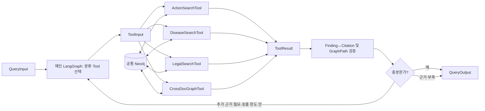
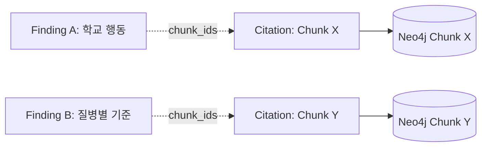

# 교육시설 감염병 GraphRAG — LangGraph·검색 Tool 공통계약 가이드 v2.0

> **대상:** 메인 LangGraph 및 `ActionSearchTool`(주승우), `DiseaseSearchTool`(송수림), `LegalSearchTool`(유종혁), `CrossDocGraphTool`(공동)  
> **작성:** 2026-11-05 | **적용 성격:** 3인 승인 후 채택하는 통합 계약안  
> **연결 문서:** 프로젝트 계획서 v2.0 / 일정표 v2.0 / 온톨로지 v3.0 코어 및 승인 시 v3.1 확장  
> **v1.2와의 관계:** `Finding`·`Citation`은 유지하고, **전문 Graph 간 호출 계약**을 **메인 Graph와 Tool 간 호출 계약**으로 변경한다.

## 0. 먼저 한눈에 보기

**우리는 단일 공통 Neo4j를 구축하고, 메인 LangGraph 하나가 필요할 때 4개의 전문 Tool을 선택·호출한다.** Tool이 반환한 사실/관계와 PDF 인용을 검증해 답하거나, 필요하면 다른 Tool을 추가 호출한다. 모두가 동일한 State나 노드 구조를 만들 필요는 없다.

| 객체 | 누가 만들고 누가 사용하는가 | 역할 |
|---|---|---|
| `QueryInput` | UI/API → 메인 LangGraph | 사용자 질문과 접근 허용 문서 범위 |
| `ToolInput` | 메인 LangGraph → 개별 검색 Tool | 이번 검색의 구체적 작업(`task`)·우선 문서·확정 엔티티 ID |
| `Finding` | 개별 Tool → 메인 LangGraph | **무엇을 확인했는지** 한 건의 검증 가능한 주장 |
| `Citation` | 개별 Tool → 메인 LangGraph → 최종 UI | **어디서 확인했는지** 문서·청크·PDF 쪽수·실제 발췌 |
| `GraphPath` | 주로 관계 검색 Tool → 메인 LangGraph | **어떤 실제 Neo4j 노드/관계를 따라 찾았는지**를 보여주는 보조 증빙 |
| `ToolResult` | 개별 Tool → 메인 LangGraph | 검색 결과 봉투. Finding·Citation·GraphPath·상태·경고 |
| `QueryOutput` | 메인 LangGraph → UI/API | 검증된 근거를 묶은 **최종 답변** |
| 메인 `MainState` | 메인 LangGraph 내부 | 의도·도구 선택·검색 이력·불충분 항목·최종 상태를 누적하는 작업 메모리 |

**한 줄:** `Finding`은 내용, `Citation`은 원문 증거, `GraphPath`는 그래프 탐색 경로, `ToolResult`는 Tool 보고서, `QueryOutput`은 최종 사용자 답변이다.



## 1. 왜 공통 계약이 필요한가?

Tool은 각자 다른 내부 기능·Cypher·검색기를 사용할 수 있다. 그러나 모두 같은 공통 Neo4j를 대상으로 하고, 메인 LangGraph가 **어떤 사실을 찾았는지, 그 근거를 검증할 수 있는지, 다음에 무엇을 검색해야 하는지** 판단해야 한다.

**계약이 없으면** Action Tool은 `{'actions':...}`, Disease Tool은 `{'data':...}`, Legal Tool은 `{'sources':...}` 같은 제각각의 값을 반환한다. 메인 LangGraph가 조건별 변환 로직과 임의의 LLM 재해석을 만들어야 하며, 특히 신고 주체·조건을 잃기 쉽다.

**계약이 있으면** 어느 Tool이든 `ToolResult`로 `findings[]`, `citations[]`, `graph_paths[]`, `warnings[]`를 보내고, 메인 Graph는 하나의 검증기·결과 결합기로 처리한다. 팀원별 내부 구현은 자유롭다.

### 1-1. v1.2와 달라지는 점

| v1.2 | v2.0 | 처리 방법 |
|---|---|---|
| 전문 Graph별 `QueryInput → QueryOutput` | **메인 Graph만 `QueryInput → QueryOutput`** | 상위 서비스 경계를 고정 |
| `QueryOutput.domain` | **`ToolResult.tool_name`** | 세 전문 Graph 대신 네 검색 Tool을 구분 |
| 전문 Graph의 `answer` 필드 | **Tool에서는 완성 답변 불필요** | 최종 답변은 메인 Graph에서 한 번만 생성 |
| `Finding`, `Citation`, `chunk_ids` | **정의 유지** | 기존 검증 코드/데이터 재사용 |
| 2/3개 Graph 병렬 결합 | **기본 1개 Tool, 근거 부족 시 추가 호출** | 불필요한 호출·복잡성 감소 |
| 결과 병합 | **ToolResult 누적 + 검증 + 제한된 재검색** | LangGraph의 조건부 흐름 활용 |

**기존에 작성한 전문 QueryGraph 코드가 있어도 버릴 필요는 없다.** 핵심 검색 함수 또는 compiled graph를 어댑터에서 호출하여 `ToolResult`로 변환하면 된다.

## 2. QueryInput — 서비스가 메인 Graph에 보내는 요청

### 2-1. 확정 제안 필드

| 필드 | 필수 | 타입 | 의미 |
|---|---|---|---|
| `question` | 예 | `str` | 사용자가 실제로 입력한 질문. 원문의 의미를 보존 |
| `region` | 예 | `"NATIONAL" | "GYEONGGI"` | 지역 맥락. 경기도 지침/전국 지침 구분 |
| `allowed_document_ids` | 예 | `list[str]` | 접근 가능한 **전체** 문서 목록. 데이터 적재 담당자와 관계 없음 |
| `request_id` | 아니오 | `str` | 실행 이력 상관관계 ID. 개인정보를 포함하지 않음 |
| `task` | 아니오 | `str` | 사전 생성한 검색 작업 힌트. UI 입력에서 일반적으로 생략 |
| `preferred_document_ids` | 아니오 | `list[str]` | 우선 검색할 문서 목록. 접근 제한 아님 |
| `context_entity_ids` | 아니오 | `list[str]` | 이전 호출/화면에서 확정한 공통 엔티티 ID |

`allowed_document_ids=[]`는 **허용된 문서가 없음**이다. 전체 공개 문서를 조회할 때는 `source_manifest.csv`에 등록된 실제 허용 ID를 모두 넣는다. `preferred_document_ids`는 반드시 허용 목록의 부분집합이어야 한다. UI가 `region`·허용 목록을 직접 받지 않는다면 **서비스 어댑터**가 정책에 따라 입력을 완성한다.

### 2-2. 서비스 호출 예시

```json
{
  "question": "경기도 초등학교에서 감염병 의심 학생 발견 시 보건교사는 무엇을 확인하나요?",
  "region": "GYEONGGI",
  "allowed_document_ids": [
    "moe_school_manual_v3",
    "gyeonggi_school_guide_2025",
    "kdca_respiratory_2026"
  ],
  "request_id": "demo-20261105-01"
}
```

**주의:** 위 질문·허용 목록은 호출 형식 예시다. 실제 검색은 허용된 전체 문서 목록을 기준으로 수행하고, 이 목록에 빠진 문서까지 검색해서는 안 된다.

## 3. ToolInput — 검색 Tool이 받는 작업 지시서

| 필드 | 필수 | 설명 |
|---|---|---|
| `question` | 예 | 원래 사용자 질문. 동일하게 유지 |
| `task` | 예 | **이번 Tool에서 확인할 세부 작업**. 예: "학교 행동 및 담당 근거 검색" |
| `region` | 예 | QueryInput의 지역 |
| `allowed_document_ids` | 예 | 동일한 접근 범위, Tool에서 반드시 강제 |
| `preferred_document_ids` | 아니오 | 검색 우선 문서 힌트 |
| `context_entity_ids` | 아니오 | 이전 Tool 검색에서 확인한 엔티티. 예 `Disease:SCARLET_FEVER` |
| `top_k` | 아니오 | 조회 결과 수의 소프트 상한(기본값은 Tool 내부 정의) |

**권장:** 각 Tool은 자신의 검색 전략에 따라 질문 임베딩을 생성/재사용한다. **질문을 입력받자마자 공통 임베딩을 만들거나 모든 Tool이 같은 임베딩을 사용해야 하는 것은 아니다.** 임베딩 모델과 인덱스 차원을 일치시켜야 하는 경우는 해당 Tool·DB 인덱스 범위에서 검증한다.

### Tool별 예시 `task`

| Tool | 예시 작업 |
|---|---|
| `action_search` | `학교가 수행하는 행동, 역할, 단계 및 근거 찾기` |
| `disease_search` | `성홍열 전문지침의 질병별 사실과 원문 근거 찾기` |
| `legal_search` | `학교 보고, 학교장의 보건소 신고, 의료기관 신고 주체를 구분해 근거 찾기` |
| `crossdoc_graph_search` | `CONTACT_GUARDIAN 개념에 속한 교육부/경기도 문서별 행동·담당·단계 비교` |

`context_entity_ids`는 혼합 타입 목록이므로 `노드라벨:전역ID`(예: `ActionConcept:CONTACT_GUARDIAN`)를 사용한다. 반면 `Finding.action_ids` 등 타입별 ID 목록은 `SchoolAction:` 같은 접두어를 붙이지 않는다.

## 4. Citation — 원문의 위치와 발췌

```python
class Citation(TypedDict):
    document_id: str
    chunk_id: str
    pdf_page: int
    printed_page: int | None
    excerpt: str
```

- `document_id`와 `chunk_id`는 **실제 공통 Neo4j**의 노드 ID다.
- `pdf_page`는 **PDF 뷰어 1부터 시작하는 실제 쪽수**다. `printed_page`는 인쇄된 쪽수 또는 `None`.
- `excerpt`는 **실제 원문 청크에서 검증한 발췌**여야 한다. 요약/의역/모델 생성 문장으로 채우지 않는다.
- UI는 `document_id → Document.title/version/issuer`를 조회해 문서명·판본·쪽수를 표시한다.
- 원문을 확인하지 못하면 **Citation을 추정해서 만들지 않는다**. 표 정규화 문장은 검수한 원문과 대응 규칙을 적용한다.

`Citation`은 `SchoolAction → SUPPORTED_BY → Chunk` 관계의 **종착지 근거**이지, 그 관계 자체가 아니다.

## 5. Finding — 원자적인 검증 주장

```python
class Finding(TypedDict):
    claim: str
    chunk_ids: list[str]
    action_ids: list[str]
    disease_ids: list[str]
    concept_ids: list[str]
```

- `claim`: 확인한 **한 가지** 사실, 행동, 주체 또는 문서 간 차이. 완성 답변 전체를 넣지 않는다.
- `chunk_ids`: 그 주장을 뒷받침하는 `Citation.chunk_id` 목록. 유효한 Finding이라면 **최소 하나**.
- `action_ids`: 실제 `SchoolAction` 노드 ID. 일반 질병·법률 사실이면 `[]` 가능.
- `disease_ids`: 공통 질병 ID. 근거로 특정할 수 없으면 `[]`.
- `concept_ids`: `ActionConcept`의 표준 ID. 해당 없는 사실이면 `[]`.

`Finding`은 **질의 실행 중 생성되는 일시적 결과**이며 Neo4j에 새로운 노드로 저장할 필요가 없다. `SchoolAction`은 문서별로 고유하게 보존하고, 의미가 비슷한 경우에만 공통 `ActionConcept`로 검색을 연결한다.

### Finding ↔ Citation 연결 규칙



1. `Finding.chunk_ids`의 모든 ID는 같은 ToolResult 또는 최종 QueryOutput의 `citations[].chunk_id`에 존재해야 한다.
2. Citation 목록에서 같은 `chunk_id`는 중복하지 않는다. 같은 청크가 여러 Finding의 근거가 되는 것은 가능하다.
3. 공통 엔티티 ID가 같더라도 원문별 역할·조건·시점·의무 강도가 다른 Finding을 임의 병합하지 않는다.
4. 신고·보고·통보와 의료기관 신고처럼 주체가 다른 정보는 별도 Finding으로 작성한다.

## 6. GraphPath — Neo4j의 실제 관계 경로(추가 증빙)

**`graph_paths`는 새 온톨로지 노드가 아니다.** 검색 Tool이 실제 Neo4j에서 얻은 관계를 화면/발표·검증에 사용할 수 있도록 직렬화한 결과다. 특히 `ActionSearchTool`과 `CrossDocGraphTool`에서 유용하다.

```python
class GraphEdge(TypedDict):
    source_ref: str            # 예: SchoolAction:<실제 ID>
    relationship_type: str     # 예: SUPPORTED_BY
    target_ref: str            # 예: Chunk:<실제 ID>

class GraphPath(TypedDict):
    edges: list[GraphEdge]     # 실제 Neo4j 관계 방향 그대로
```

예를 들어 다음과 같은 연결을 Tool에서 실제 조회할 수 있다.

```text
SchoolAction --INSTANCE_OF--> ActionConcept
SchoolAction --DONE_BY-----> SchoolRole
SchoolAction --SUPPORTED_BY--> Chunk <--HAS_CHUNK-- Document
```

- `edges`는 실제 공통 DB에서 존재하는 관계만 포함하고 **정방향**을 보존한다. 화면에서는 반대 방향으로 읽어도 실제 데이터의 방향은 바꾸지 않는다.
- Tool마다 `graph_paths` 필드를 반환한다. 경로를 반환할 필요가 없다면 빈 리스트 `[]`.
- `GraphPath`에 관계가 존재해도 내용 주장 `Finding`은 **실제 Chunk의 Citation**을 따로 가져야 한다.
- 기술 시연에서는 **Cypher, 실제 반환 관계, 원문 근거**를 함께 보여준다.

## 7. ToolResult — 4개 검색 Tool의 공통 결과

```python
class ToolResult(TypedDict):
    tool_name: Literal[
        "action_search", "disease_search",
        "legal_search", "crossdoc_graph_search"
    ]
    status: Literal["OK", "PARTIAL", "NO_EVIDENCE", "ERROR"]
    findings: list[Finding]
    citations: list[Citation]
    graph_paths: list[GraphPath]
    warnings: list[str]
```

| status | 의미 | 반환 규칙 |
|---|---|---|
| `OK` | 해당 Tool의 지정 작업에 충분한 근거 | Finding 1개 이상 + 유효 Citation |
| `PARTIAL` | 일부만 확인하고 나머지는 부족·불명확 | 확인된 Finding만 남기고 부족 원인을 warnings에 기록 |
| `NO_EVIDENCE` | 확인 가능한 근거 없음 | `findings=[]`, `citations=[]`, 이유 기록 |
| `ERROR` | DB·파서·모델·Tool 실행 실패 | 사실을 지어내지 않고 `findings=[]`, `citations=[]`, 오류 기록 |

**`ERROR`와 `NO_EVIDENCE`는 다르다.** Tool 실패를 근거가 없는 것으로 오인하지 않는다. 이미 확인된 사실이 일부 남아 있는 경우는 `PARTIAL`과 경고를 사용할 수 있다.

### 7-1. ToolResult 가상 구조 예시

> 아래 `demo_*` 내용은 **타입 설명을 위한 가상 데이터**로, 실제 지침의 행동이나 인용이 아니다. 공통 DB에 그대로 적재하거나 서비스 근거로 사용하지 않는다.

```json
{
  "tool_name": "action_search",
  "status": "OK",
  "findings": [
    {
      "claim": "[가상] 대응 단계 A에서 담당 역할 X에게 안내 행동 Y가 제시된다.",
      "chunk_ids": ["demo_manual:p0012:b01"],
      "action_ids": ["demo_manual:p0012:a01"],
      "disease_ids": [],
      "concept_ids": ["CONTACT_GUARDIAN"]
    }
  ],
  "citations": [
    {
      "document_id": "demo_manual",
      "chunk_id": "demo_manual:p0012:b01",
      "pdf_page": 12,
      "printed_page": 9,
      "excerpt": "[가상 원문] 대응 단계 A의 업무 예시"
    }
  ],
  "graph_paths": [
    {"edges": [
      {"source_ref": "SchoolAction:demo_manual:p0012:a01", "relationship_type": "SUPPORTED_BY", "target_ref": "Chunk:demo_manual:p0012:b01"},
      {"source_ref": "Document:demo_manual", "relationship_type": "HAS_CHUNK", "target_ref": "Chunk:demo_manual:p0012:b01"}
    ]}
  ],
  "warnings": []
}
```

## 8. QueryOutput — 메인 LangGraph의 최종 사용자 답변

```python
class QueryOutput(TypedDict):
    response_type: Literal["DOMAIN", "GENERAL", "OUT_OF_SCOPE"]
    status: Literal["ANSWERED", "PARTIAL", "INSUFFICIENT_EVIDENCE", "ERROR"]
    answer: str
    findings: list[Finding]
    citations: list[Citation]
    action_ids: list[str]
    warnings: list[str]
    tools_used: list[str]
    search_rounds: int
```

- **DOMAIN:** 학교 감염병 관련 사실·행동·신고 등을 공식 자료로 답변. `ANSWERED`/`PARTIAL`이면 Finding과 Citation이 반드시 존재한다.
- **GENERAL:** 인사·서비스 사용법처럼 전문 지침을 요구하지 않는 대화. 이때는 `findings=[]`, `citations=[]`가 허용된다.
- **OUT_OF_SCOPE:** 지원하지 않는 질환, 단독 진단·치료/법적 의무 자동 확정 요구 등. 공식 근거가 없는 확정 답변을 하지 않는다.
- `action_ids`는 모든 `Finding.action_ids`의 중복 제거 합집합이다.
- `tools_used`는 실제 호출한 Tool 이름을 **호출 순서대로** 기록한다.
- `search_rounds`는 **실제 Tool 호출 횟수**다(동일 Tool을 조건을 바꿔 호출하면 별도로 1회). 권장 한도 3회.
- 최종 `answer`는 검증된 Finding/Citation으로 작성하고, 서로 다른 문서에 다른 조건이 있다면 조건을 분리해 설명한다.

## 9. 그대로 복사해 사용할 Python 타입 정의

> Python 3.11+ `TypedDict`, `NotRequired` 기준. 아래는 **정적 타입 정의**이며 실행 시 검증은 별도다.

```python
from typing import TypedDict, Literal, NotRequired

Region = Literal["NATIONAL", "GYEONGGI"]
ToolName = Literal[
    "action_search", "disease_search",
    "legal_search", "crossdoc_graph_search"
]
ToolStatus = Literal["OK", "PARTIAL", "NO_EVIDENCE", "ERROR"]
AnswerStatus = Literal[
    "ANSWERED", "PARTIAL", "INSUFFICIENT_EVIDENCE", "ERROR"
]
ResponseType = Literal["DOMAIN", "GENERAL", "OUT_OF_SCOPE"]

class QueryInput(TypedDict):
    question: str
    region: Region
    allowed_document_ids: list[str]
    request_id: NotRequired[str]
    task: NotRequired[str]
    preferred_document_ids: NotRequired[list[str]]
    context_entity_ids: NotRequired[list[str]]

class ToolInput(TypedDict):
    question: str
    task: str
    region: Region
    allowed_document_ids: list[str]
    preferred_document_ids: NotRequired[list[str]]
    context_entity_ids: NotRequired[list[str]]
    top_k: NotRequired[int]

class Citation(TypedDict):
    document_id: str
    chunk_id: str
    pdf_page: int
    printed_page: int | None
    excerpt: str

class Finding(TypedDict):
    claim: str
    chunk_ids: list[str]
    action_ids: list[str]
    disease_ids: list[str]
    concept_ids: list[str]

class GraphEdge(TypedDict):
    source_ref: str
    relationship_type: str
    target_ref: str

class GraphPath(TypedDict):
    edges: list[GraphEdge]

class ToolResult(TypedDict):
    tool_name: ToolName
    status: ToolStatus
    findings: list[Finding]
    citations: list[Citation]
    graph_paths: list[GraphPath]
    warnings: list[str]

class QueryOutput(TypedDict):
    response_type: ResponseType
    status: AnswerStatus
    answer: str
    findings: list[Finding]
    citations: list[Citation]
    action_ids: list[str]
    warnings: list[str]
    tools_used: list[ToolName]
    search_rounds: int
```

### 9-1. 실제로 누가 무엇을 import할까?

- 주승우 `ActionSearchTool`은 `ToolInput`, `ToolResult`, `Finding`, `Citation`, `GraphPath`를 import.
- 송수림 `DiseaseSearchTool`도 **같은 타입** import. Cypher·벡터·전문검색은 자유.
- 유종혁 `LegalSearchTool`도 **같은 타입** import. 신고 주체·법령 처리 로직은 자유.
- 공동 `CrossDocGraphTool`도 **같은 타입** import. 실제 경로를 `graph_paths`에 추가.
- 메인 LangGraph는 `QueryInput`, `QueryOutput`, `ToolInput`, `ToolResult`를 사용하고, 내부 State는 별도로 정의한다.

## 10. MainState와 LangGraph 노드 계약

**공통 `MainState`는 메인 Graph의 상태일 뿐, 4개 Tool이 공유하는 전역 상태가 아니다.** Tool은 `ToolInput`을 받고 `ToolResult`를 반환하는 독립된 함수/객체이며, 필요하면 기존 QueryGraph를 어댑터로 감싸서 실행해도 된다.

```python
class MainState(TypedDict, total=False):
    request: QueryInput
    intent: str                # "DISEASE"/"ACTION"/"LEGAL"/"CROSSDOC" 등
    selected_tool: str
    tool_results: list[ToolResult]
    findings: list[Finding]
    citations: list[Citation]
    warnings: list[str]
    search_rounds: int
    unresolved: list[str]
    final_result: QueryOutput
```

**추천 노드와 책임**

| Node | 입력·출력 책임 |
|---|---|
| `normalize_input` | 문서 접근 범위, 지역, 질문 정규화·검증 |
| `classify_scope` | 일반 대화 / 지원 도메인 / 지원 불가 요청을 구분 |
| `classify_intent` | Disease·Action·Legal·CrossDoc 유형 및 질병별칭 판단(병명 부재≠일반 대화) |
| `select_tool` | 아직 해결되지 않은 작업에 최적인 Tool 하나 선택 |
| `execute_tool` | `ToolInput` 생성→Tool 호출→`ToolResult` 수신 및 타입 검사 |
| `merge_and_validate` | 인용 중복 제거, DB 근거 확인, Finding 추적·경고 누적 |
| `evaluate_evidence` | 충분/추가 검색/근거 부족, 남은 호출 한도 판단 |
| `compose_answer` | 검증된 Finding+Citation만 이용하여 응답 |
| `partial_or_insufficient` | 확인 가능한 부분만 응답하거나 부족한 근거 설명 |

`START → normalize_input → classify_scope → classify_intent → select_tool → execute_tool → merge_and_validate → evaluate_evidence → (compose_answer 또는 select_tool 재진입 또는 partial_or_insufficient) → END`를 권장한다.

**명확한 종료 조건:** 검색 완료, 검색 근거 없음, 추가할 Tool 없음, 호출 횟수 총 3회 도달, 복구 불가능한 Tool 오류. 같은 Tool을 같은 입력으로 반복 호출하지 않는다. 단순 대화와 범위 밖 요청은 별도 분기로 종료한다.

### 10-1. 검색 Tool 라우팅 권장값

| 질문 특징 | 첫 Tool |
|---|---|
| 잠복기·전파 경로·질병 특징 | `disease_search` |
| 학교에서 해야 할 일·누가 담당·등교중지·학교 대응 단계 | `action_search` |
| 신고 주체·기준·수신처·법령/보고 구분 | `legal_search` |
| 같은 행동의 문서별 담당·단계·근거 비교 | `crossdoc_graph_search` |
| 질문이 여러 영역을 요구 | 주된 의도에 가장 맞는 Tool 1개부터 시작하고 **근거 평가 후** 추가 호출 |
| 병명 없는 학교 업무 질문 | **`action_search` 가능. 일반 LLM으로 보내지 말 것** |
| 인사·서비스 기능 안내 | 일반 응답 분기. **의료/법률 사실을 생성하지 않음** |
| 지원 범위 밖의 질병/행위 | 범위 밖 또는 근거 부족 안내. 일반 LLM으로 근거 없는 전문 답변 생성 금지 |

## 11. 최소 런타임 검사와 DB 진위 확인

`TypedDict`만으로 실제 데이터·LLM 출력은 검증되지 않는다. **Tool 반환 직후 최소 런타임 검증**을 수행하고, 별도로 Neo4j 실재성·원문 충실성을 검사한다.

```python
def validate_tool_result(result: dict, request: dict) -> None:
    required = {
        "tool_name", "status", "findings", "citations",
        "graph_paths", "warnings"
    }
    if not required.issubset(result):
        raise ValueError(f"Missing ToolResult keys: {required - result.keys()}")

    tool_names = {
        "action_search", "disease_search", "legal_search",
        "crossdoc_graph_search"
    }
    if result["tool_name"] not in tool_names:
        raise ValueError("Unknown tool_name")
    if result["status"] not in {"OK", "PARTIAL", "NO_EVIDENCE", "ERROR"}:
        raise ValueError("Unknown status")

    allowed = set(request["allowed_document_ids"])
    if not set(request.get("preferred_document_ids", [])).issubset(allowed):
        raise ValueError("preferred docs are outside allowed docs")

    chunks = {}
    for citation in result["citations"]:
        if citation["document_id"] not in allowed:
            raise ValueError("Citation outside allowed documents")
        if not citation["chunk_id"] or citation["chunk_id"] in chunks:
            raise ValueError("Missing or duplicate chunk_id")
        p = citation["pdf_page"]
        if type(p) is not int or p < 1:
            raise ValueError("Invalid 1-based pdf_page")
        if not isinstance(citation["excerpt"], str) or not citation["excerpt"].strip():
            raise ValueError("Empty excerpt")
        chunks[citation["chunk_id"]] = citation

    for finding in result["findings"]:
        if not finding["claim"].strip():
            raise ValueError("Empty claim")
        ids = finding["chunk_ids"]
        if not ids or not set(ids).issubset(chunks):
            raise ValueError("Finding has missing Citation")

    if result["status"] in {"OK", "PARTIAL"} and not result["findings"]:
        raise ValueError("Successful/partial result needs verified Finding")
    if result["status"] in {"NO_EVIDENCE", "ERROR"} and (
        result["findings"] or result["citations"]
    ):
        raise ValueError("No unverified claims on missing/effectively failed result")
```

**별도 Neo4j·원문 검증(필수):**

- Document/Chunk/SchoolAction/Disease/Concept ID가 실제 존재하며 해당 문서에 속하는가?
- `Chunk.pdf_page`가 반환 Citation과 일치하는가?
- `excerpt`가 실제 청크 원문 발췌인가?
- `SchoolAction → SUPPORTED_BY → Chunk`가 원문 주장과 연결되는가?
- GraphPath의 관계 방향·타입·엔티티 ID가 실제 Neo4j 경로에 존재하는가?
- `scope`, `when_text`, `timing_text`, `modality`, v3.1의 `stage`/`basis`가 원문으로 확인되는가?
- 같은 Claim과 Citation이 서로 다른 문서에 존재하면 출처별 조건과 담당을 지우지 않고 보존하는가?

**검증기가 할 수 없는 일:** 단순 ID/형식 검사로 원문 해석이 맞는지, 법률상 의무인지, 학교에서 반드시 해야 하는 조치인지 판정하지 못한다. 원문 대조·사람 검수가 필요하다.

## 12. 메인 QueryOutput 생성 규칙

메인 Graph는 유효한 ToolResult를 누적한 후 **동일 `chunk_id`의 Citation 중복을 제거**하고 Finding을 보존한다. Tool 간 서로 다른 조건·대상·의무 강도가 있으면 동일한 문장으로 합치지 않는다.

**최종 상태 결정:**

| 상황 | `response_type` | `status` | 응답 정책 |
|---|---|---|---|
| 도메인 질문의 필수 부분에 근거 충분 | `DOMAIN` | `ANSWERED` | Citation을 포함해 답변 |
| 도메인 질문의 일부만 검증 | `DOMAIN` | `PARTIAL` | 확인 사실만 답하고 누락·조건을 경고 |
| 도메인 검색에서 검증된 사실 없음 | `DOMAIN` | `INSUFFICIENT_EVIDENCE` | 확정 답변 대신 부족 원인 안내 |
| 복구 불가 오류 및 검증된 사실 없음 | `DOMAIN` | `ERROR` | 오류·제한 표시, 근거 추정 금지 |
| 일반 인사 또는 서비스 사용법 | `GENERAL` | `ANSWERED` | 인용 없이 제한적 안내 가능 |
| 지원 밖 질문 | `OUT_OF_SCOPE` | `INSUFFICIENT_EVIDENCE` | 지원 범위 안내, 임상/법률 사실 생성 금지 |

`DOMAIN`의 `ANSWERED`/`PARTIAL`에서 Finding과 Citation은 모두 필수. `GENERAL`과 `OUT_OF_SCOPE`에서는 `findings=[]`, `citations=[]`, `action_ids=[]`가 원칙이다. Tool의 `NO_EVIDENCE`를 곧바로 전체 QueryOutput의 `ERROR`로 바꾸지 않는다.

## 13. 통합 테스트 — 최소 12개

| ID | 입력·상황 | 합격 기준 |
|---|---|---|
| T01 | 인플루엔자 잠복기 | `disease_search` 사용, 확인된 Chunk 인용 |
| T02 | 병명 없는 학교 의심학생 대응 | `action_search` 사용, 일반 응답으로 빠지지 않음 |
| T03 | 법정 신고 주체 질문 | `legal_search` 사용, 학교/의료기관 역할 오귀속 없음 |
| T04 | 교육부·경기도 보호자 연락 비교 | `crossdoc_graph_search` 사용, 실제 Concept/SchoolAction/Chunk/Document 경로 및 출처별 차이 |
| T05 | 단순 질문의 충분한 근거 | Tool 1회로 종료, 불필요한 추가 호출 없음 |
| T06 | 첫 Tool로는 근거 일부 부족 | 추가 Tool 호출 후 Finding·Citation 누적 |
| T07 | 보완 Tool도 불충분 | 최대 총 3회 이내 종료, PARTIAL 또는 INSUFFICIENT_EVIDENCE |
| T08 | 없는 `Chunk`를 Citation으로 반환 | 검증 실패, 최종 답변에서 사용 금지 |
| T09 | `GraphPath`의 존재하지 않는 관계 | DB 경로 검증 실패, 시연 경로로 표시 금지 |
| T10 | 미지원 질병 또는 진단 확정 요청 | 근거 없는 일반 LLM 전문 답변을 생성하지 않음 |
| T11 | Tool 연결·실행 장애 | `ERROR` 또는 다른 Tool을 이용한 제한적 답변, 실패 사실 기록 |
| T12 | 같은 PDF·청크를 두 Tool이 반환 | Citation은 중복 제거, Finding은 근거별 보존 |

**실제 골든 질문 목표 10~15개:** 질문별 정답뿐 아니라 **기대 Tool, 실제 Tool, Cypher·그래프 경로, 근거 청크·쪽수, 실패 원인**을 기록한다. 성능 숫자는 실제 테스트 없이 주장하지 않는다.

## 14. 담당자별 제출 단위 및 변경 관리

| 담당 | 필수 전달물 | 독립 완료 기준 |
|---|---|---|
| 주승우 | `ActionSearchTool`, 메인 Graph 노드/분기/최종 출력, UI | 행동·담당·출처 질의 1건 + 메인 Graph의 1-Tool 실행 |
| 송수림 | `DiseaseSearchTool`, `CrossDocGraphTool` Cypher/경로 결과, DB 조회 시각화 | 질병 질의 1건 + 실제 문서 횡단 경로 1건 |
| 유종혁 | `LegalSearchTool`, 공통 계약 검증 함수, 골든 질문·오답 검수 | 신고·법령 질의 1건 + 근거/오류 케이스 검증 |
| 3인 | Tool 호출·출처·횡단 경로·재검색 흐름 통합 테스트 | 메인 Graph 종단 간 실행·변경 승인 |

**담당자 자유:** Tool 내부 알고리즘·프롬프트·LLM·Cypher·검색기·개인 State.  
**3인 합의:** `QueryInput`, `ToolInput`, `ToolResult`, `QueryOutput`, `Finding`, `Citation`, `GraphPath` 공통 필드·의미, Neo4j 코어 스키마·ID·인덱스 변경.  
**계약 변경:** 실패 질문/재현 → 최소 변경(선택 필드 우선) → 버전 상향 → 코드·테스트·계획서·일정표 동시 갱신.

### 기존 v1.2 코드 마이그레이션 체크리스트

- [ ] 기존 전문 Graph의 검색 함수를 `ToolInput`을 받는 Tool로 래핑(필요시 기존 compiled Graph 내부 호출).
- [ ] 전문 Graph별 `QueryOutput`에서 `domain`·`answer` 중심 구조를 분리해 `ToolResult.tool_name`·`findings`·`citations`로 변환.
- [ ] `Finding`·`Citation` 및 Chunk/Action 전역 ID는 **유지**.
- [ ] 메인 Graph의 `QueryOutput`은 **`response_type`·`tools_used`·`search_rounds`를 포함**하도록 변경.
- [ ] Tool 단독 T01~T04, 메인 분기/루프 T05~T12를 회귀 테스트.
- [ ] 온톨로지 v3.1의 **팀 승인 여부와 실제 DB 적용 여부**를 확인하고 검색 쿼리를 호환시키기.

---

> **팀 합의 문구(그대로 전달 가능):** "우리는 PDF 적재 결과를 하나의 Neo4j에서 공유합니다. QueryGraph는 여러 개로 분리하지 않고 메인 LangGraph 하나가 질문을 분류하고 필요한 검색 Tool을 실행합니다. 주승우는 행동, 송수림은 질병, 유종혁은 신고·법령 검색 Tool을 개발하고, 문서 간 그래프 횡단 검색은 공동으로 만듭니다. 내부 구현은 자유롭게 하되, ToolInput/ToolResult 및 Finding/Citation·GraphPath는 동일한 계약을 지킵니다. 근거가 충분하면 종료하고, 부족하면 정해진 한도 안에서 추가 탐색합니다."
