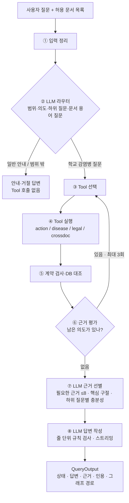

# 발표용 총정리 — 질문에서 답변까지의 과정과 검색 품질 변화 (11/04 ~ 11/07)

- 작성: 2026-11-07, school 영역(주승우). 작성 보조: Claude(코딩 에이전트).
- 범위: 학교 자료 · ActionSearchTool · 메인 LangGraph · Streamlit 화면. 팀원 Tool(disease·legal·crossdoc)의 내부 품질은 다루지 않고, 메인에서 함께 실행된 결과만 적는다.
- 수치 출처: 각 단계의 평가 기록 md(아래 9장 링크)와 로컬 원시 결과 JSON(`data/interim/school/`, Git 제외).
  - 표의 모든 Tool·메인 수치는 이번에 원시 JSON 29개를 **같은 계산식으로 다시 집계**한 값이다. 새로 실행한 것은 없다(DB·LLM 호출 없음).
  - 원래 기록과 다르면 이 문서의 재집계 값을 따른다. 다른 경우는 표 주석에 적었다.

---

## 0. 한눈에 보기

| 지표 (골든 정답 청크가 있는 34문항) | 처음(11/05 기준선) | 지금(11/07 최종) | 어떻게 바뀌었나 |
|---|---|---|---|
| 정답 근거를 1개 이상 인용한 문항 | 18/34 (53%) | **27~29/34 (79~85%)** | 행동 구조 검색, 넓게 찾기 |
| 정답 청크 회수율 (회수한 정답 / 전체 정답 64) | 23/64 (0.36) | **32~34/64 (0.50~0.53)** | 위와 같음 |
| 출력 인용 중 정답 비율 (정밀도 하한) | 0.09~0.11 (11/05~06 첫 측정) | **0.35** | LLM 근거 선별 |
| 문항당 인용 수 (중앙값) | 8.5~9 (11/05~06 첫 측정) | **2~3** | LLM 근거 선별 |
| 라우터: 골든 밖 새 질문(홀드아웃 2, 16문항) | 11/16 (규칙) | **15/16 (LLM)** | LLM 라우터 |
| 다듬은(LLM) 답변을 쓴 비율 | — (템플릿 나열) | **35/36** | 답변 작성기 + 줄 단위 검사 |
| 근거 없는 문장 (줄 단위 판독, 128줄) | 미측정 | **0/128** | 판독자 1인, 1회 실행 |
| 질문당 응답 시간 (중앙값) | 약 2.8초 (11/05 Tool 평균, LLM 없음) | 10.3초 (첫 줄은 스트리밍으로 먼저 표시) | LLM 3회 호출 |

**한 줄 요약:** "많이 찾아서 다 보여 주는" 검색에서 "넓게 찾고, LLM이 꼭 필요한 근거만 고르고, 근거에 있는 말만 답하는" 구조로 바꿨다. 그 결과 정답 근거 회수와 정밀도가 함께 올랐고, 대가로 응답 시간이 늘었다.

> 숫자를 볼 때 주의할 점 (자세한 내용은 8장)
> - 골든셋 34문항은 개발 중에 여러 번 본 문항이다. 처음 보는 시험셋 점수가 아니다.
> - 골든은 문항마다 대표 근거만 적는다. 그래서 정밀도 0.35는 **하한**이다(정답 목록에 없는 인용도 맞는 근거일 수 있다).
> - LLM 단계는 실행마다 조금씩 다르다. 같은 설정 2회가 27과 29로 나왔으므로 2문항 이내 차이는 개선이나 퇴행으로 보지 않는다.

---

## 1. 지금의 구조 — 질문이 답변이 되기까지

### 1-1. 전체 흐름



질문 하나에 LLM은 **3번** 호출한다(라우터, 근거 선별, 답변 작성). 이 밖에 질문 임베딩과 팀원 Tool 내부 처리가 있다.

### 1-2. 단계별 설명

| 단계 | 하는 일 | 왜 이렇게 했나 |
|---|---|---|
| ① 입력 정리 | 질문·지역·허용 문서(`allowed_document_ids`)를 정리한다. 빈 목록이면 "허용 문서 없음"이다 | 모든 조회에서 허용 문서를 강제하는 공통 원칙 |
| ② LLM 라우터 | 범위(학교 감염병 / 일반 안내 / 범위 밖)를 판단하고, 의도(학교 행동·질병·법령·문서 비교)별로 하위 질문과 **문서 용어 검색 문장**을 만든다. 예: "독감 걸린 학생은 며칠 쉬어야 해요?" → "감염병별 등교중지 기간". LLM이 실패하면 규칙 분류기로 되돌린다 | 규칙 분류기는 골든 표현에는 맞았지만 일상 표현에서 9/20이었다. 교직원 질문은 학교 행동과 질병 기준이 섞이는 경우가 많다 |
| ③ Tool 선택 | 의도 → Tool: 학교 행동 → `action_search`(주승우), 질병 → `disease_search`·문서 비교 → `crossdoc_graph_search`(송수림), 법령 → `legal_search`(유종혁) | 메인 그래프는 팀원 코드를 import하지 않고, 화면 서비스가 Tool 목록(registry)을 넘긴다 |
| ④ Tool 실행 | 공통 계약 `ToolInput → ToolResult`. 복합 질문이면 Tool마다 자기 몫의 하위 질문을, 단일 의도면 원 질문을 받는다. 학교 행동 Tool은 문서 용어 질문도 함께 받는다 | 공통 계약은 바꾸지 않는다 |
| ⑤ 계약 검사·DB 대조 | 근거·인용·그래프 경로가 공동 Neo4j에 실제로 있는지 다시 확인한다 | 가짜 ID·가짜 인용 차단 |
| ⑥ 근거 평가·재검색 | 보조 의도가 남았거나 Tool이 `[미해결] … 다른 Tool`을 남기면 다음 Tool을 부른다. 총 3회까지, 같은 Tool은 한 번만 부른다 | 복합 질문(예: 학교 조치 + 잠복기) 처리 |
| ⑦ LLM 근거 선별 | 모든 Tool의 인용을 카드(최대 36장)로 만들어 LLM에 한 번 보여 준다. LLM은 카드 ID 중에서만 최대 8개를 고르고, 근거마다 역할(직접 답·조건·전제 정정)과 원문 그대로의 핵심 구절을 낸다. 핵심 구절은 코드가 원문과 대조한다. 하위 질문마다 충분히 답했는지(충분·일부·없음)도 받는다 | 점수와 문턱으로는 "꼭 필요한 근거"를 고르지 못했다(출력 인용 중 정답 10%). 근거마다 LLM을 따로 부르지 않으려고 한 번에 처리한다 |
| ⑧ LLM 답변 작성 | 고른 근거만으로 답을 쓴다. 각 줄이 인용 번호·숫자·주체·강한 표현(의무·신고 등) 규칙을 통과해야 화면에 나간다(스트리밍). 걸린 줄은 빼고, 첫 줄이 걸리면 근거 목록 템플릿으로 되돌린다 | 근거 밖 숫자·주체·의무를 만들어 내는 것을 막는다. 다시 쓰게 하지 않아 시간을 고정한다 |

### 1-3. 학교 행동 Tool 안쪽 (`action_search`)

```
원 질문 ─┐                     ┌─ 청크에 붙은 학교 행동 (전부 후보)
         ├─ 각각 hybrid 검색 ──┤   (fulltext + vector, RRF)  → 합쳐서 후보 청크 30개
문서 용어 ┘   (동시 실행)       ├─ 질문한 역할의 행동 (최대 8)
질문                            └─ 행동 전체 훑기 점수 상위 (최대 6, 3점 이상)
        ↓
결정적 필터: 허용 문서 · 선정 쪽수 · 다른 질병/조치 제외 · 본문 직접 근거 우선 · 관계 재확인
        ↓
행동 근거(최대 16) + 행동이 없는 청크의 원문 인용(검색 순위대로 최대 12) → DB 대조 → ToolResult
```

- **hybrid 검색:** 낱말이 맞는 청크(전문검색)와 뜻이 비슷한 청크(벡터, `text-embedding-3-small`)를 순위 융합(RRF)으로 합친다.
- **문서 용어 질문을 함께 쓰는 이유:** "성홍열도 학교장이 신고해야 하나요?"로 검색하면 법정감염병 목록 청크가 60위였다. "학교장이 신고해야 하는 법정감염병 종류"로 검색하면 6~10위였다.

### 1-4. 데이터 (학교 문서 2개: 교육부 매뉴얼 · 경기도 가이드북)

```
PDF/Markdown 원문 → ① 청크(표 행·본문 항목) → ② 표 행에서 학교 행동 LLM 추출 → 사람 검수
→ ③ 정규화·ID 부여 → ④ 공동 Neo4j 적재·임베딩
```

| 시점 | 선정 쪽수 | 청크 | 학교 행동 | 비고 |
|---|---|---|---|---|
| 11/04 오전 | 일부 표 1행 | 4 | 6 → 42 | 첫 추출·검수·적재 |
| 11/04 오후 | 선정 쪽 전체 | 182 | 42 | 골든 v0(14문항) |
| 11/05 | 교육부 90쪽·경기도 118쪽 | 1,131 (DB 1,139) | 438 | 골든 v1(40문항) |
| 11/06 청킹 v3 | 같음 | 1,922 | 438 | 검수 반영. 본문이 조각나 검색 하락 |
| 11/06 청킹 v4 | 같음 | 1,339 | 438 | 항목을 200자까지 묶음 |
| **11/06 청킹 v4.1 (현재)** | 같음 | **1,289** | **438** | 원문자(①) 제목 처리 수정 |

---

## 2. 버전별 연대기 — 무엇을 왜 바꿨고 무엇이 달라졌나

| # | 날짜 | 버전 | 바꾼 것 | 왜 | 결과 (정답 1개 이상 /34) |
|---|---|---|---|---|---|
| 0 | 11/04 | **v0 SchoolGraph** | 청크 검색 → 행동 확장 → DB 검증. 고정 흐름, LLM 없음, 답변은 근거 나열 | 첫 동작 버전 | 골든 v0 14문항 status 14/14, hybrid Hit@5 5/9(dev), MRR 약 0.51 (질문·청크 수가 달라 이후 표와 비교 불가) |
| 1 | 11/05 오전 | **기준선 (v1.2)** | 데이터 1,131청크로 확대, 골든 v1 40문항 | 실제 범위로 확대 | **18** · 전부 인용 9 · hybrid Hit@5 19 |
| 2 | 11/05 | **v2 ActionSearchTool + 메인 그래프** | 공통 계약 Tool 구조. 역할 직접 조회(DONE_BY)와 행동 전체 훑기 경로 추가, 역할·문서별 고르게 뽑기 | 청크 글자 유사도만으로는 역할·단계 질문을 놓침 | Tool **25** · 전부 15 · 라우팅 40/40 |
| 3 | 11/05 | **v3 검색 적합성** | 질병명 속 '유행' 오인 방지, 다른 질병·조치 근거 제외, 행동+인용 합계 8개 상한(D06) | 특정 질문(유행성각결막염 휴업)의 잡음 제거 | Tool **24** · 전부 13 (퇴행) |
| 4 | 11/05 | **v4 D06 되돌림** | 행동 8 + 인용 4를 따로 상한, 행동 먼저 | v3 퇴행의 원인이 합계 상한이었다(정답이 5·8번째에서 잘림) | Tool **25** · 전부 16 · 인용 순서 MRR 0.30 → 0.45 |
| 5 | 11/05~06 | **M3·M4 Tool 4개 연결, 재검색 루프** | 팀원 Tool 3개를 registry로 연결, 조건부 재호출(최대 3회), 실DB 그래프 경로 | 일정표 M3·M4 | 메인 **23**, status 37/40 |
| 6 | 11/06 | **청킹 v3 → v4 → v4.1** | 사람 검수(표 64개·544행) 반영 → 본문이 조각남 → 항목 묶기로 수정 | 원문 정합성 | 원시 Hit@5 19 → 13 → 17 → 16. 메인 21~22 |
| 7 | 11/06 | **답변 다듬기 + Streamlit 화면** | LLM이 근거만으로 답을 쓰고 규칙 검사를 통과할 때만 사용 | 근거 나열은 읽기 어려움(1,056자) | 다듬은 답변 32/34, 길이 321자. 검색 품질은 그대로(21) |
| 8 | 11/06 | **진단** (코드 변경 없음) | 후보·점수·라우터 계측 | 화면 답변이 "근거는 많은데 필요한 근거가 아니다" | 출력 인용 중 정답 10%, 문턱 4점은 거의 걸러내지 않음, 규칙 라우터 일상 표현 9/20 |
| 9 | 11/06 | **① LLM 라우터** | 구조화 출력으로 범위·의도·하위 질문 | 진단 결과 | 일상 표현 9 → 20/20, 홀드아웃 12 → 19/20. 골든 21(변화 없음) |
| 10 | 11/07 | **신고 질문 라우팅 규칙** | 학교 신고 의무 → 학교 행동 먼저 + 법령, 법·처벌 → 법령만 | 법령만 부르면 카드가 없을 때 막다른 길 | 메인 **22**, status 39/40 |
| 11 | 11/07 | **② 넓게 찾기 + LLM 근거 선별** | 두 질의 hybrid·문턱 제거·인용 후보 완화 → LLM 1회 선별·충분성 판정 → 줄 단위 검사·스트리밍 | 정답은 후보에서 빠지고, 출력은 불필요한 근거로 채워짐 | 선별 전 **31**, 선별 후 **27~29**, 정밀도 0.35, 인용 2~3개 |
| 12 | 11/07 | **줄 단위 판독** (코드 변경 없음) | 최종 답변 128줄을 근거와 대조 | ③(답변 검사 보강) 방향 결정 | 근거 없음 0, 맥락 누락 7, 기존 검사 차단 6건 모두 오탐 |

테스트 수: 104(11/04) → 174(11/05) → 258(11/06 이행) → 311(라우터) → **343 통과·1 건너뜀(11/07)**.

---

## 3. 지표 정의 — 무엇을 어떤 분모로 쟀나

| 지표 | 뜻 | 분모 | 주의 |
|---|---|---|---|
| **Hit@k** (원시 검색) | 검색 상위 k개에 정답 청크가 1개 이상 있는 문항 수 | 34문항 | 검색 함수 단독. Tool 선별 전이다 |
| **MRR@10** (원시 검색) | 상위 10개 중 첫 정답 순위의 역수 평균. 못 찾으면 0 | 34문항 | |
| **정답 1개 이상 인용** | 최종 출력 인용에 정답 청크가 1개 이상 있는 문항 수 | 34문항 | **이 문서의 대표 지표**. 재현율 성격 |
| **정답 전부 인용** | 그 문항의 정답 청크를 모두 인용한 문항 수 | 34문항 | 엄격한 재현율 |
| **정답 청크 회수율** | 인용한 정답 청크 수 / 정답 청크 수 | 64 (문항·청크 쌍) | 청크 단위 재현율 |
| **정밀도 하한** | 인용한 정답 청크 수 / 출력 인용 수 | 출력 인용 전체 | 골든이 대표 근거만 적으므로 실제 정밀도보다 낮게 나온다 |
| **인용 순서 MRR** | 출력 인용 목록에서 첫 정답 순위의 역수 평균 | 34문항 | 인용 수가 적을수록 높게 나온다. 원시 검색 MRR과 비교하지 않는다 |
| **status 일치** | 최종 상태(답변 완료·일부 확인·근거 부족)가 기대와 같은 문항 | 40문항 | |
| **라우팅 일치** | 첫 Tool(또는 일반 안내·범위 밖)이 기대와 같은 문항 | 40문항 | |
| **라우터 정확도** | 주 의도가 허용 답에 있는 비율. 문항마다 LLM 2~3회 | 질문셋별 | Tool 실행 없이 분류만 잰다 |

- **Tool 단독과 메인 끝까지는 분모가 같아도 다르다.** 11/05 메인 실행에서는 팀원 Tool이 연결되지 않아 법령·문서 비교 문항(3개)이 0점이었다. 그래서 11/05까지는 Tool 단독 값을, 11/06 이후는 메인 값을 대표로 쓴다.
- **추출 품질(precision·recall)은 재지 않았다.** 행동 추출 정답 주석지(20청크)를 만들었지만 사람 주석이 끝나지 않았다. 이 문서의 수치는 모두 검색·인용 품질이다.

---

## 4. 검색 품질 — 전체 표

### 4-1. 원시 검색 (검색 함수 단독, 질문 1개, k=10, 34문항)

| 데이터 | Fulltext Hit@5 / @10 / MRR | Vector Hit@5 / @10 / MRR | **Hybrid Hit@5 / @10 / MRR** |
|---|---|---|---|
| v0 (11/04, 182청크, 14문항) | — | — | 5/9(dev) · — · 약 0.51 |
| v1 (11/05, 1,139청크) | 19 / 21 / 0.339 | 15 / 19 / 0.268 | **19 / 23 / 0.400** |
| 청킹 v3 (1,922청크) | 14 / 18 / 0.224 | 9 / 12 / 0.163 | **13 / 17 / 0.265** |
| 청킹 v4 (1,339청크) | 15 / 20 / 0.255 | 14 / 18 / 0.248 | **17 / 21 / 0.331** |
| 청킹 v4.1 (1,289청크, 현재) | 15 / 20 / 0.259 | 13 / 17 / 0.217 | **16 / 20 / 0.312** |

- 같은 검색 코드로 쟀으므로 차이는 **데이터(청킹) 차이**다.
- v3의 하락 원인은 본문이 `1)`·`①` 줄마다 끊긴 것이다(본문 중앙값 267자 → 46자, 상위 10개 중 80자 미만 청크 3% → 30%). 짧은 조각이 전문검색·벡터 점수에서 모두 유리해져 정답을 밀어냈다.
- v4.1이 v1보다 낮은 이유는 검수한 원문 표 제목에서 질병명이 빠졌기 때문이다(예: "홍역 역학조사 체크리스트" → "역학조사 협조를 위한 준비사항 체크리스트"). 원문 정합성을 위해 고치지 않았다.
- 11/07의 **두 질의 검색(원 질문 + 문서 용어 질문)은 이 표로 재지 않았다.** 효과는 4-2의 "넓게 찾기" 행(선별 전 31/34)으로 본다.

### 4-2. 최종 출력의 정답 인용 (34문항, 11/06부터는 메인 끝까지)

| 버전 | 기준 | 1개 이상 | 전부 | 청크 회수율 (/64) | 정밀도 하한 | 인용 중앙값 | 인용 순서 MRR | status (/40) | 평가용 1개 이상 (/11) |
|---|---|---|---|---|---|---|---|---|---|
| 기준선 v1.2 | SchoolGraph | 18 | 9 | 23 (0.36) | — | — | — | 34/36¹ | 4 |
| v2 | Tool | 25 | 15 | 35 (0.55) | — | — | — | — | 7 |
| v3 | Tool | 24 | 13 | 32 (0.50) | — | — | 0.303 | — | 7 |
| v4 | Tool | 25 | 16 | 36 (0.56) | — | — | 0.452 | — | 7 |
| v4 | 메인² | 22 | 15 | 31 (0.48) | 31/278 = 0.11 | 8.5 | — | 34/35 | — |
| M4 Tool 4개 | 메인 | 23 | 15 | 32 (0.50) | 32/294 = 0.11 | 8.5 | 0.428 | 37 | 6 |
| 청킹 v3 | 메인 | 21 | 13 | 28 (0.44) | 0.093 | 9 | 0.421 | 37 | 5 |
| 청킹 v4 | 메인 | 22 | 15 | 30 (0.47) | 0.099 | 9 | 0.448 | 37 | 6 |
| 청킹 v4.1 | 메인 | 21 | 14 | 28 (0.44) | 0.092 | 9 | 0.430 | 37 | 6 |
| ① LLM 라우터 | 메인 | 21 | 14 | 28 (0.44) | 0.092 | 9 | 0.430 | 37 | 6 |
| S-L01 기대 반영 | 메인 | 21 | 14 | 28 (0.44) | 0.092 | 9 | 0.430 | 38 | 6 |
| 신고 규칙 (v5) | 메인 | 22 | 14 | 29 (0.45) | 29/312 = 0.093 | 9 | 0.445 | 39 | 7 |
| 넓게 찾기 v1 (선별 없음) | 메인 | 25 | 15 | 37 (0.58) | 0.094 | 11.5 | 0.436 | 39 | 8 |
| 넓게 찾기 v1 + 선별 v1 | 메인 | 23 | 9 | 27 (0.42) | 0.351 | 2 | 0.569 | 33 | 7 |
| **넓게 찾기 v2 (선별 없음)** | 메인 | **31** | **19** | **42 (0.66)** | 42/633 = 0.066 | 19 | 0.489 | 39 | 10 |
| 넓게 찾기 v2 + 선별 v2 | 메인 | 27 | 14 | 31 (0.48) | 0.341 | 2 | 0.730 | 38 | 8 |
| **최종: 선별 v3, 1회차** | 메인 | **27** | 15 | 32 (0.50) | **32/92 = 0.348** | **2** | 0.696 | 37 | 9 |
| **최종: 선별 v3, 2회차** | 메인 | **29** | 15 | 34 (0.53) | **34/96 = 0.354** | **2.5** | 0.760 | 38 | 9 |
| 최종 + 답변 작성 (v6) | 메인 | 29 | 14 | 33 (0.52) | 33/97 = 0.340 | 2 | — | — | 9 |
| 최종 + 답변 작성 (v7, 재실행) | 메인 | 27 | 15 | 32 (0.50) | 32/98 = 0.327 | 3 | — | — | 9 |

¹ 기준선 status는 라우팅 전용 4문항을 뺀 36문항 기준이다.
² v4 메인은 팀원 Tool이 연결되기 전이라 법령·문서 비교 3문항이 0점이다. Tool 단독(25)과 직접 비교하지 않는다.

- **평가용 11문항**(골든 eval 중 정답 청크가 있는 문항)은 프롬프트·규칙 조정에 쓰지 않으려 했지만, S-Q03·S-L01은 11/07 신고 규칙 분석에 쓰였다. 깨끗한 시험 점수로 보지 않는다.
- 인용 순서 MRR이 0.70 이상으로 오른 것은 인용이 2~3개로 줄어든 영향이 크다. 품질 지표로 내세우지 않는다.

### 4-3. 그림으로 보는 재현율 · 정밀도

```
정답 1개 이상 인용 (/34)            정밀도 하한
기준선 v1.2    ██████████████████ 18     —
v4 (Tool)      █████████████████████████ 25     —
청킹 v4.1      █████████████████████ 21     0.09
신고 규칙 v5   ██████████████████████ 22     0.09
넓게 찾기 v2   ███████████████████████████████ 31     0.07   ← 후보는 많이 찾지만 출력이 19개
최종(선별 후)  ███████████████████████████▌ 27~29  0.35   ← 2~3개만 남김
```

**해석:** 넓게 찾기는 재현율(31)을, LLM 근거 선별은 정밀도(0.07 → 0.35)를 맡는다. 선별 과정에서 정답 2~4문항이 빠진다(31 → 27~29). 빠진 근거가 실제 손실인지, 정답 목록에 없는 다른 맞는 근거로 대체된 것인지는 사람 판독이 필요하다(미실행).

---

## 5. 라우터 품질 (Tool 실행 없이 분류만)

| 질문셋 | 문항 | 규칙 분류기 | LLM v1 | LLM v3 | LLM v5 | **LLM v6 (현재)** | 반복 일치 (v6, 3회) |
|---|---|---|---|---|---|---|---|
| 골든 | 40 | 40 | 39 | 40 | 40 | **40** | 40 |
| 일상 표현 | 20 | 9~10 | 20 | 20 | 20 | **20** | 20 |
| 교직원 실사용형 | 15 | 15 | 15 | 15 | 15 | **15** | 15 |
| 홀드아웃 1 | 20 | 12 | (v2) 20 | 19 | 19 | **20** | 20 |
| **홀드아웃 2 (깨끗한 셋)** | 16 | 11 | — | — | 15 | **15** | 15 |

- 분류 시간 중앙값: 1.63초(v3) → 2.05초(v5) → **1.84초(v6)**. LLM 실패로 규칙에 되돌린 경우 0회.
- **일상 표현 20문항은 프롬프트를 쓰기 전에 본 문항**이라 20/20은 과대평가다. 홀드아웃 1은 기대값 3개를 결과를 본 뒤 바꿨다. **신뢰할 수 있는 값은 홀드아웃 2의 15/16**이다.
- 놓친 문항: 예방접종 사실 질문("수두는 예방접종을 몇 번 맞아야 하나요?")을 범위 밖으로 보낸다. 홀드아웃 2를 보존하려고 고치지 않았다.
- 질문셋과 기대값은 모두 Claude가 작성했고 팀 검수 전이다.
- temperature 0이어도 같은 질문의 분류가 호출마다 달랐다(S-A04: 8회 중 2회 다름). 프롬프트에 "절차·방법만 묻는 질문은 학교 행동 하나"를 넣은 뒤 8회 중 8회 같았다.

---

## 6. 답변 품질

### 6-1. 답변 작성 (골든 40, 다듬기 대상 34~36문항)

| 실행 | 바꾼 것 | 다듬은 답변 사용 | 답변 길이 중앙값 | 비고 |
|---|---|---|---|---|
| 템플릿 (11/06 이전) | 근거 나열 | — | 1,056자 | |
| 다듬기 v1 | 최초 검사기 | 28/34 | | 오탐 4건(예: '학교 감염병'에서 '교감'을 인식) |
| 다듬기 v4 (11/06) | 낱말 경계·대표 이름·역할 소제목 검사 | 32/34 | 321자 | 되돌림 2건은 정당 |
| **최종 v6 (11/07)** | 근거 선별 + 줄 단위 검사·스트리밍 | **35/36** | 258자 | 3개 답변에서 4줄만 빼고 사용 |
| 재실행 v7 | 같음 | 34/36 | | 줄 판독용 |

| 지표 | 11/06 v4 | 11/07 최종 v6 |
|---|---|---|
| 정답 청크가 출력 인용에 있음 / 답변 글에 드러남 (/34) | 21 / 21 | **29 / 28** |
| status 분포 (40) | 답변 완료 35 · 근거 부족 5 | 답변 완료 31 · 일부 확인 6 · 근거 부족 3 |

### 6-2. 줄 단위 판독 (v7, 34문항 128줄, 판독자 Claude 1인, 사람 확인 전)

| 판정 | 줄 | 비율 |
|---|---|---|
| 근거 있음 | 121 | 94.5% |
| 맥락 누락 (조건·단계·모의훈련 시나리오 표시가 빠짐) | 7 | 5.5% |
| **근거 없음** | **0** | **0%** |

- 기존 줄 검사가 막은 6건(8줄)은 모두 **잘못 막은 것**이었다. 부정문("확인되지 않았습니다")에 주체 검사가 걸렸고, 담당 동의어(행정실↔행정지원팀)를 인식하지 못했다.
- 그래서 다음 작업(③)은 "검사를 더 엄하게"가 아니라 오탐 줄이기와 시나리오·단계 표시 보강으로 방향을 바꿨다.

### 6-3. 함정 질문 (질문의 전제가 원문과 다른 문항)

- S-T02("열 나서 온 학생은 바로 NEIS에 등록해야 하나요?", 기대 '일부 확인')는 11/05부터 계속 '답변 완료'로 나왔다. 11/07 근거 선별의 충분성 판정이 "열만으로 즉시 등록 기준은 근거에 없음"을 잡아 **처음으로 기대와 일치**했다.
- S-T01·T03은 답변 작성 이후 '반드시'·'보건교사가 직접' 같은 전제를 근거로 정정한다(판독).

### 6-4. 교직원 실사용형 질문 15개 (골든 밖, 정답 없음, Claude 판독)

| 항목 | 11/06 (선별 전) | 11/07 (선별 후) |
|---|---|---|
| 문항당 인용 | 8~12 | 1~6 |
| 다듬은 답변 | 11/15 | 14/15 |
| status | 답변 완료 15 | 답변 완료 7 · 일부 확인 7 · 근거 부족 1 |
| 대표 사례 | 학부모 항의 응대 질문에서 **근거에 없는 응대 문구**가 검사를 통과 | 지어낸 문구 없음. 확인되지 않는 부분은 "확인하지 못한 부분"으로 밝힘 |

---

## 7. 응답 시간

| 시점 | 질문당 시간 (중앙값) | 내역 |
|---|---|---|
| 11/05 Tool 단독 | 약 2.7~2.8초 | 검색·DB만, LLM 없음 |
| 11/06 답변 다듬기 | 6.3초 | 다듬기 2.8초 포함 |
| **11/07 최종** | **10.3초** (p90 13.0, 최대 16.3) | 분류 1.8 · Tool 3.7 · 근거 선별 2.6 · 답변 작성 2.1 |

- 학교 행동 Tool은 두 질의 검색을 동시에 돌려 3.6~4.6초 → 2.7~3.4초로 줄였다.
- 화면은 처리 단계 진행과 검사를 통과한 답변 줄을 바로 보여 준다. 첫 줄이 뜨기까지의 시간은 재지 않았다.

---

## 8. 한계와 주의 (발표에서 숫자를 말할 때)

1. **골든셋은 개발 중에 본 문항이다.** 40문항 중 평가용 14문항도 이전 분석에 노출됐다(특히 S-Q03·S-L01). 처음 보는 질문에서의 일반화 성능이 아니다.
2. **골든은 대표 근거만 적는다.** 정밀도 0.35는 하한이고, "정답 아님"으로 집계된 인용이 모두 틀린 근거는 아니다.
3. **LLM 단계는 실행마다 흔들린다.** 같은 설정의 2회가 27/29, status 37/38이었다. 보고할 때는 범위(27~29)로 말한다.
4. **비교 조건이 버전마다 다르다.** 11/05 이전(Tool 단독)과 11/06 이후(메인 끝까지)는 실행 경로가 다르고, 데이터(청킹)도 세 번 바뀌었다. 통제된 A/B 비교는 원시 검색 표(같은 검색 코드)와 ② 단계 내부 비교뿐이다.
5. **사람 검수 전인 자료가 있다.** 일상 표현·홀드아웃·교직원 질문, 그 기대값, 답변 판독은 모두 Claude가 했다.
6. **재지 않은 것:** 행동 추출 precision·recall(주석지 미완료), 두 질의 검색의 원시 Hit@k, 첫 줄 표시 시간, Streamlit Cloud 배포 후 지연, 선별이 버린 정답 근거의 실제 손실 여부.
7. **팀원 Tool의 품질은 각 담당자 기록을 따른다.** 법령 Tool은 회귀 7/7·독립 2/8(유종혁 11/07 기록)로 카드 범위 밖 질문에 답하지 못한다. 그래서 메인에서도 법령 질문이 '근거 부족'으로 끝날 수 있다.

---

## 9. 발표에 쓸 핵심 메시지 (제안)

1. **문제:** 검색은 근거를 많이 찾았지만, 화면에 나온 근거 10개 중 정답은 1개꼴이었다(정밀도 하한 0.09).
2. **원인(측정으로 확인):** 점수 문턱 4점은 거의 걸러내지 못했다. 정답의 일부는 원문 인용 필터에서 후보 단계부터 빠졌다. 규칙 라우터는 골든 밖 표현에서 절반 가까이 틀렸다.
3. **해결:** LLM 라우터(질문 분해 + 문서 용어 질문) → 넓게 찾기(두 질의 hybrid) → LLM 1회 근거 선별(ID 중에서만 고르고, 핵심 구절은 코드로 원문 대조) → 근거에 있는 말만 쓰는 답변(줄 단위 규칙 검사).
4. **결과:** 정답 근거 인용 18 → 27~29/34, 정밀도 하한 0.09 → 0.35, 인용 9 → 2~3개, 근거 없는 문장 0/128. 깨끗한 홀드아웃 라우팅 15/16.
5. **대가와 정직함:** 응답 시간 약 3초 → 10초(스트리밍으로 완화). 근거가 부족하면 '일부 확인'과 '확인하지 못한 부분'을 밝힌다.
6. **교훈:** 청킹 v3 사례처럼 "원문에 더 충실한" 변경이 검색을 떨어뜨릴 수 있다(Hybrid Hit@5 19 → 13). 지표로 바로 확인하고 원인을 데이터로 찾아 되돌렸다.

---

## 10. 근거 문서와 재현

| 단계 | 기록 |
|---|---|
| 11/04 v0 | [파일 지도](../파일_지도_무엇이_어디에.md), `school_query.ipynb` |
| 기준선·v2·v3 | [기준선 v1 (2차·3차 포함)](평가_20261105_기준선_v1.md), [검색 적합성 v3](평가_20261105_검색적합성_v3.md), [v3 퇴행 인수인계](Claude_인수인계_검색적합성_수정결정과_퇴행분석_20261105.md) |
| v4 | [D06 수정 v4](평가_20261105_D06수정_v4.md) |
| M3·M4 | [M3 Tool 4개 연결](M3_메인그래프_Tool4개_연결_20261105.md), [M4 재검색 루프](M4_재검색루프_GraphPath_20261106.md) |
| 청킹 | [서비스 DB 이행(v3)](서비스DB_검수청크_이행결과_20261106.md), [청킹 v4·v4.1](청킹v4_항목묶기_재이행_20261106.md) |
| 답변·화면 | [UI·답변 다듬기](UI_답변다듬기_20261106.md) |
| 진단 | [라우터·후보 선별 진단](라우터_후보선별_진단_20261106.md) |
| 라우터 | [LLM 라우터](LLM라우터_20261106.md), [S-L01 반영](골든_S-L01_반영_20261106.md), [신고 규칙·S-Q03](라우터_신고규칙_S-Q03_20261107.md) |
| ② 선별 | [근거 재순위·스트리밍](근거재순위_스트리밍_20261107.md) |
| 답변 판독 | [줄 단위 판독](답변_줄단위_판독_20261107.md) |

**재집계에 쓴 원시 결과 (로컬 전용, Git 제외, `data/interim/school/`)**
- 기준선 `eval_20261105_baseline.json` · v2 `eval_tool_final.json` · v3 `eval_relevance_20261105/` · v4 `eval_tool_d06fix.json`, `eval_main_d06fix.json` · M4 `eval_main_m4_alltools.json`
- 청킹 `service_migration_20261106T021438_207504Z/eval/`(v3), `…T024909_496350Z/eval/`(v4), `…T030252_317651Z/eval/`(v4.1)
- 라우터 `router_eval/`(golden_main_rule·router·router_v3·after_legal·v4·v5, router_v1~v6)
- ② `rerank_eval/`(golden_retrieval_only·v2, golden_rerank_v1·v2·v3a·v3b) · 답변 `answer_polish/`(eval_v4·v6_final·v7_review)

**재현 명령 (프로젝트 루트)**

```powershell
# 메인 끝까지 (4개 Tool, LLM 라우터, LLM 근거 선별)
.venv/Scripts/python.exe -X utf8 notebooks/school/평가결과/golden_eval_main.py <결과.json> --all-tools --router --rerank
# 답변 작성까지
.venv/Scripts/python.exe -X utf8 notebooks/school/평가결과/answer_polish_eval.py <결과.json>
# 라우터 분류만 (문항마다 3회)
.venv/Scripts/python.exe -X utf8 notebooks/school/평가결과/router_eval.py <결과.json> 3
```

재집계 계산식: 정답 청크가 있는 34문항에서 `hit ≥ 1`(1개 이상), `hit == total`(전부), `Σhit / Σtotal`(회수율, Σtotal = 64), `Σhit / Σ출력 인용 수`(정밀도 하한), `mean(1/첫 정답 인용 순위)`(인용 순서 MRR, 없으면 0).
