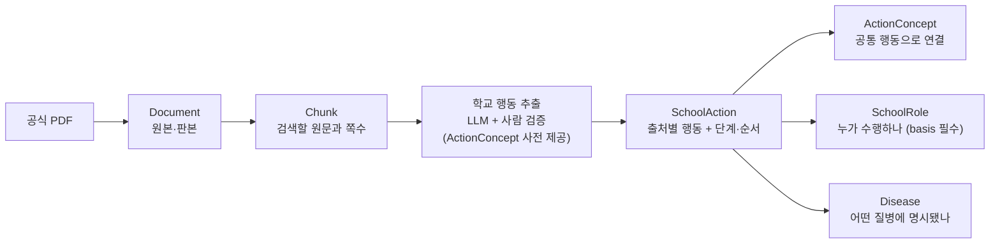
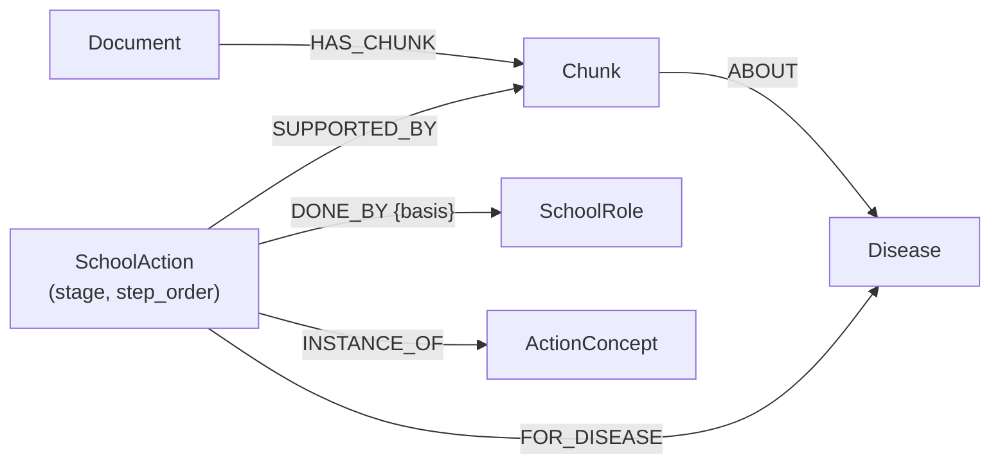

# 교육시설 감염병 GraphRAG — 온톨로지·스키마 설명서 v3.1

> **기준: 온톨로지 v3.1 (개정 제안안)** | 노드 6종 · 노드 의미 속성 27개 · 관계 6종 (+ 인덱스용 속성 1개)  
> 작성일: 2026-11-03 | 이전 판: v3.0 | 상태: **3인 공동 승인 전 제안안**  
> **목적:** 팀원들이 PDF 데이터를 어떻게 그래프에 저장하고, 질문에 어떻게 활용하는지 이해하기 위한 안내서  
> **적용 시점:** M3(추출 프롬프트) 이전에 확정하여, 11/4 공통 Neo4j 적재부터 적용

---

## 0. v3.1 변경 요약

v3.1은 **v3.0의 6개 노드·6개 관계와 그 의미를 그대로 유지**하고, 계획서 v1.1의 확장 정책에 따라 **가산형(additive) 변경만** 반영한다. 기존 노드·관계의 삭제나 의미 변경은 없다.

| # | 변경 | 종류 | 해결하려는 문제 |
|---|---|---|---|
| C1 | `SchoolAction.stage` 추가 | 신규 속성 | 학교 문서의 행동이 대응 단계별로 조직되어 있으나 단계로 필터링할 수 없음 |
| C2 | `SchoolAction.step_order` 추가 | 신규 속성 | 원문 절차의 순서를 답변에서 재현할 수 없음 |
| C3 | `scope`에 `DISEASE_GROUP` 값 추가 | 허용값 확장 | "등교중지가 필요한 감염병", "호흡기 전파 감염병" 같은 범주 조건이 `UNKNOWN`에 쌓임 |
| C4 | `DONE_BY.basis` **필수화** | 관계 속성 규칙 변경 | 원문 역할표 대부분이 "예시"인데 의무처럼 안내될 위험 |
| C5 | **ActionConcept 초기 사전**을 추출 전에 확정 | 운영 규칙 | 신고·보고·통보의 혼동, 사후 정규화 부담 |
| C6 | **전역 ID 규약** 단일화 | 운영 규칙 | 설명서와 계약 가이드의 ID 예시 형식이 서로 다름 → MERGE 중복 위험 |
| C7 | `Chunk.embedding` 및 인덱스 명시 | 인덱스용 속성 | "Chunk 검색 우선" 정책에 필요한 인덱스가 스키마에 없음 |
| C8 | **표 청크 규칙** 명시 | 운영 규칙 | 여러 질병이 한 표에 있으면 `ABOUT` 연결이 부정확해짐 |

**호환성:** 공통 입출력 계약 v1.2는 수정 없이 사용 가능하다. C6은 계약 v1.2의 ID 표기를 해석하는 규칙을 명확히 할 뿐 필드를 바꾸지 않는다.

---

## 1. 온톨로지를 왜 이렇게 설계했을까?

이 프로젝트는 감염병 백과사전을 만드는 것이 아니라, **학교 교직원이 공식 지침을 바탕으로 필요한 대응 정보를 찾는 서비스**다. 모든 문장을 복잡한 그래프 규칙으로 바꾸지 않는다.

- **단순한 사실 질문**(예: "인플루엔자의 잠복기는?"): 해당 지침의 **원문 `Chunk`를 찾아 답변**한다.
- **학교 업무 질문**(예: "학생이 감염병에 걸렸을 때 학교에서 확인할 일은?"): **학교 행동·대응 단계·담당 역할·근거를 그래프로 연결**한다.
- **문서 간 비교 질문**(예: "보호자 연락에 대해 각 지침은 어떻게 설명하나?"): **공통 행동 개념을 중심으로 여러 문서의 표현을 비교**한다.

**중요한 경계:** 보건소·교육청의 *내부 업무*는 그래프화하지 않는다. 다만 학교가 이 기관에 **보고·신고·통보하거나 협조하는 행동**은 학교의 업무이므로 포함한다. 의료기관의 법정 신고는 학교 행동이 아니므로 `SchoolAction`으로 만들지 않고 `Chunk` 근거로만 제시한다.

---

## 2. PDF 한 문장이 답변이 되기까지



1. **문서 준비:** PDF마다 `Document`를 만들고, 필요한 문단·표 행을 `Chunk`로 분리한다. 표는 **행 단위로 쪼개고 제목·열 머리글을 각 행 청크에 반복**한다(5-2절).
2. **행동 추출:** 원문 중 **학교가 하는 일**만 `SchoolAction` 후보로 추출한다. 이때 LLM에 **ActionConcept 초기 사전(7절)과 단계 허용값(4-5절)을 함께 제공**하여, 추출과 동시에 개념·단계 후보를 고르게 한다.
3. **검증과 연결:** 후보를 원문과 대조한 뒤, 질병(`Disease`)·학교 담당(`SchoolRole`)·공통 행동 개념(`ActionConcept`)에 연결한다.
4. **답변:** 먼저 관련 청크를 검색한다. 학교 행동·담당·문서 간 비교가 필요한 질문이면 그래프 조회를 **추가**한다.

---

## 3. 노드 6종 · 의미 속성 27개 한눈에 보기

| 노드 | 속성 | 개수 | v3.0 대비 |
|---|---|---:|---|
| `Document` | `document_id`, `title`, `issuer`, `version`, `region`, `source_url` | 6 | 동일 |
| `Chunk` | `chunk_id`, `text`, `pdf_page`, `printed_page`, `section` | 5 | 동일 (+인덱스용 `embedding`) |
| `Disease` | `disease_id`, `name`, `aliases` | 3 | 동일 |
| `SchoolRole` | `role_id`, `name`, `aliases` | 3 | 동일 |
| `SchoolAction` | `action_id`, `action_text`, `scope`, `stage`, `step_order`, `when_text`, `timing_text`, `modality` | 8 | **+2** |
| `ActionConcept` | `concept_id`, `name` | 2 | 동일 |
| **합계** | | **27** | +2 |

`Chunk.embedding`은 의미 정보가 아니라 **검색 인덱스를 위한 값**이므로 27개 의미 속성에 포함하지 않는다(5-3절).

---

## 4. 노드별 상세

### ① `Document` — "어느 자료의 어느 판본인가?" (6개)

같은 제목이어도 개정판이 다르면 다른 `Document`다. 오래된 기준을 최신 기준처럼 사용하지 않도록 출처를 구분한다.

| 속성 | 의미·예시 |
|---|---|
| `document_id` | 원본의 고유 ID. 6절의 규약을 따른다. 예: `gyeonggi_school_guide_2025` |
| `title` | 공식 문서 제목 |
| `issuer` | 발행 기관. 예: 경기도교육청 |
| `version` | 사용한 판본. *게시 연도와 실제 개정 연도는 구별* |
| `region` | 문서의 적용 지역 범위: `GYEONGGI` / `NATIONAL` |
| `source_url` | 원본을 다시 확인할 공식 주소. 확인된 경우 저장 |

`region`은 **문서의 범위**이지, 문서에 실린 모든 조치가 해당 지역의 모든 학교에 무조건 적용된다는 뜻은 아니다.

> **판본 차이 실례:** 교육부 매뉴얼과 경기도 가이드북은 등교중지 출석인정 근거로 「학교생활기록 작성 및 관리지침」의 서로 다른 훈령 번호를 인용한다. 두 행동을 하나로 합치지 않고 출처별로 보존해야 하는 이유다.

### ② `Chunk` — "답의 근거가 되는 정확한 문장" (5개 + 인덱스용 1개)

| 속성 | 의미·예시 |
|---|---|
| `chunk_id` | 원문 조각의 고유 ID. 예: `gyeonggi_school_guide_2025:p0166:b02` |
| `text` | 추출한 원문. 표라면 제목·머리글·행 내용이 함께 이해되도록 기록 |
| `pdf_page` | PDF 뷰어 기준 **1부터 시작하는** 실제 페이지 번호 |
| `printed_page` | 책 본문에 인쇄된 쪽수. 없으면 `null` |
| `section` | 장·절 경로. 예: `제3장 > Ⅱ. 학교의 대비 및 대응 > 대응 제2단계` |
| *(인덱스용)* `embedding` | 벡터 검색용 임베딩. 의미 속성 아님 |

**왜 두 페이지 번호를 쓸까?** 표지·목차 때문에 PDF 쪽과 인쇄 쪽이 다르다. 둘 다 있으면 근거 확인이 쉽다.

### ③ `Disease` — "어떤 질병인가?" (3개)

11개 대상 질병을 **일관된 이름으로 식별**한다. 증상·잠복기·등교중지 기간은 속성으로 넣지 않고 원문 `Chunk`에서 검색한다.

| 속성 | 의미·예시 |
|---|---|
| `disease_id` | 질병의 고유 ID. 예: `MUMPS` |
| `name` | 공식 표준명. 예: `유행성이하선염` |
| `aliases` | 다른 표현. 예: `["볼거리", "Mumps"]` |

**표준 ID 사전 (11종)**

| `disease_id` | `name` | 대표 별칭(초안) |
|---|---|---|
| `SCARLET_FEVER` | 성홍열 | Scarlet fever |
| `INFLUENZA` | 인플루엔자 | 독감, Flu |
| `HFMD` | 수족구병 | 손발입병, Hand-foot-mouth disease |
| `MEASLES` | 홍역 | Measles |
| `COVID19` | 코로나바이러스감염증-19 | 코로나19, 코로나, COVID-19 |
| `VARICELLA` | 수두 | Chickenpox |
| `MUMPS` | 유행성이하선염 | 볼거리, Mumps |
| `PERTUSSIS` | 백일해 | Pertussis |
| `MYCOPLASMA_PNEUMONIA` | 마이코플라스마 폐렴균 감염증 | 마이코플라스마 폐렴 |
| `EKC` | 유행성각결막염 | 눈병, 아데노바이러스 결막염 |
| `TUBERCULOSIS` | 결핵 | TB |

> `name`의 공식 표기는 「2026 법정감염병 진단·신고기준」의 질병명으로 최종 확인한 뒤 확정한다.

### ④ `SchoolRole` — "학교 안에서 누가 하는가?" (3개)

직책을 하나로 정리해 문서마다 다른 표현을 연결한다. 보건소 공무원이나 교육청 내부 담당자는 만들지 않는다.

| 속성 | 의미·예시 |
|---|---|
| `role_id` | 역할 고유 ID. 예: `HOMEROOM_TEACHER` |
| `name` | 통일한 역할명. 예: `담임교사` |
| `aliases` | 다른 표현. 예: `["담임", "담임(담당)교사"]` |

**표준 ID 사전 (초안)**

| `role_id` | `name` | 별칭 예 |
|---|---|---|
| `PRINCIPAL` | 학교장 | 교장 |
| `VICE_PRINCIPAL` | 교감 | |
| `HEAD_OF_ACADEMIC_AFFAIRS` | 교무부장 | 교무 |
| `GRADE_HEAD` | 학년부장 | |
| `HOMEROOM_TEACHER` | 담임교사 | 담임, 담임(담당)교사 |
| `HEALTH_TEACHER` | 보건교사 | 보건(담당)교사, 보건 |
| `SUBJECT_TEACHER` | 교과교사 | 교과 |
| `COUNSELOR` | 상담교사 | 상담 |
| `ADMIN_OFFICE` | 행정실 | |
| `DISCOVERING_STAFF` | 발견 교직원 | 유증상자를 발견한 교직원 |
| `INFECTION_MGMT_TEAM` | 학교 감염병 관리조직 | 보건안전팀, 비상대책팀, 발생감시팀, 학사·인력관리팀, 교수학습운영팀 |

팀 명칭은 문서마다 "예시"로 제시되므로 개별 팀을 별도 역할로 늘리지 않고 `INFECTION_MGMT_TEAM`의 별칭으로 둔다. 특정 팀명 자체가 필요하면 `action_text`에 원문대로 남긴다.

**주의:** 원문이 담당자를 명시하지 않았다면 임의로 연결하지 않는다.

### ⑤ `SchoolAction` — "원문에서 학교가 무엇을 하라고 하는가?" (8개)

**가장 중요한 노드**다. 추상적인 행동명이 아니라, **특정 문서의 특정 근거에 나타난 학교 행동**을 뜻한다. 조건·시점·단계가 다르면 같은 행동이라도 별개로 남긴다.

| 속성 | 필수 | 의미·예시 |
|---|:---:|---|
| `action_id` | ✅ | **출처별 행동** 고유 ID. 예: `gyeonggi_school_guide_2025:p0166:a03` |
| `action_text` | ✅ | 실제 학교 행동. 예: `보호자에게 연락하여 의료기관 진료 요청` |
| `scope` | ✅ | 적용 범위: `COMMON` / `DISEASE_GROUP` / `NAMED_DISEASES` / `UNKNOWN` |
| `stage` | ✅ | **v3.1 신설.** 원문이 배치한 대응 단계 (아래 표) |
| `step_order` | 선택 | **v3.1 신설.** 같은 출처·같은 단계·같은 역할 안에서 원문 번호 순서(1부터). 원문에 순서가 없으면 생략 |
| `when_text` | 선택 | **언제 적용하는지**, 원문 조건을 문장으로 보존 |
| `timing_text` | 선택 | **언제까지·얼마 동안인지**, 기산점까지 원문 표현으로 보존 |
| `modality` | ✅ | 원문으로 확인된 강도: `MANDATORY` / `RECOMMENDED` / `DISCRETIONARY` / `UNSPECIFIED` |

#### `stage` 허용값 (C1)

| 값 | 원문상 의미(요약) |
|---|---|
| `PREVENTION` | 예방단계(평상시 대비) |
| `RESPONSE_1` | 대응 제1단계: 학교 내 감염병 유증상자의 발견 및 확인 |
| `RESPONSE_2` | 대응 제2단계: 의료기관 진료 결과 감염병 (의심)환자 발생 확인 후, 유행 의심 여부를 확인 |
| `RESPONSE_3` | 대응 제3단계: 학교 내 유행 확산 차단 |
| `RECOVERY` | 복구단계: 유행 종결 및 복구 |
| `ALL_STAGES` | 원문이 "모든 단계"로 명시한 행동(예: 학교장 총괄) |
| `NATIONAL_CRISIS` | 국가위기경보(관심·주의·경계·심각) 상황의 대응. **학교 내 대응 단계와 다른 축**이므로 섞지 않고, 경보 수준은 `when_text`에 원문대로 보존 |
| `UNSPECIFIED` | 원문이 단계를 밝히지 않은 행동(예: 질병별 지침의 학교 관련 조치, 출결 처리 절차) |

**규칙**
- `stage`는 **원문이 그 행동을 어느 단계 아래에 배치했는가**를 기록한다. 사용자 상황이 몇 단계인지 시스템이 자동 판정하는 데 쓰지 않는다. 답변에서는 단계 정의가 담긴 원문 `Chunk`를 함께 제시한다.
- 한 행동이 원문에서 여러 단계에 반복 등장하면 **단계별로 별도의 `SchoolAction`**을 만든다(원문 위치가 다르므로 `action_id`도 다르다). 같은 의미라면 같은 `ActionConcept`에 연결한다.

#### `scope` 허용값 (C3)

| 값 | 사용 조건 | `FOR_DISEASE` |
|---|---|---|
| `COMMON` | 질병과 무관한 공통 절차임이 원문에서 확인될 때 | 연결하지 않음 |
| `DISEASE_GROUP` | **질병명이 아닌 범주 조건**으로 적용될 때. 예: "등교중지가 필요한 감염병으로 확진된 경우", "호흡기 전파 감염병의 경우". 범주 조건은 `when_text`에 원문대로 보존 | **연결하지 않음** (범주에 어떤 질병이 속하는지 추론 금지) |
| `NAMED_DISEASES` | 원문이 특정 질병명을 직접 언급할 때 | 언급된 질병에만 연결 |
| `UNKNOWN` | 범위가 애매하여 검토가 필요할 때 | 연결하지 않음 |

#### `modality` 규칙

문장 어미("~함", "~권장함", "~할 수 있음")를 참고하되 **법률상 의무로 단정하지 않는다.** 원문에서 강도를 확인할 수 없으면 `UNSPECIFIED`를 쓴다. 다수의 행동이 `UNSPECIFIED`가 되는 것은 정상이다.

### ⑥ `ActionConcept` — "여러 문서에서 같은 종류의 행동인가?" (2개)

`SchoolAction`을 문서별로 유지하면서도, 같은 행동을 함께 찾기 위한 **공통 이름표**다.

| 속성 | 의미·예시 |
|---|---|
| `concept_id` | 통일된 개념 ID. 예: `CONTACT_GUARDIAN` |
| `name` | 공통 행동명. 예: `보호자 연락` |

v3.1에서는 개념을 추출 후에 만들지 않고, **7절의 초기 사전을 추출 프롬프트에 제공**하여 LLM이 목록 안에서 고르도록 한다. 목록에 맞는 개념이 없으면 `NEW_CONCEPT_CANDIDATE`로 표시해 검수표에 남기고, 3인 승인 후 사전에 추가한다.

---

## 5. 데이터 구성 규칙

### 5-1. 관계 6종

| 관계 | 연결 방향 | 질문에서 하는 일 | 관계 속성 |
|---|---|---|---|
| `HAS_CHUNK` | Document → Chunk | "이 원문은 어느 문서에서 왔지?" | — |
| `ABOUT` | Chunk → Disease | "이 문단은 어떤 질병을 설명하지?" | — |
| `SUPPORTED_BY` | SchoolAction → Chunk | "이 행동의 원문 근거는?" | — |
| `FOR_DISEASE` | SchoolAction → Disease | "어떤 질병에 **명시적으로** 적용되지?" | — |
| `DONE_BY` | SchoolAction → SchoolRole | "학교에서 누가 하는 일이지?" | **`basis` 필수** |
| `INSTANCE_OF` | SchoolAction → ActionConcept | "다른 문서의 어떤 행동과 같은 종류지?" | — |



#### `DONE_BY.basis` 필수화 (C4)

| 값 | 사용 조건 |
|---|---|
| `EXPLICIT` | 원문이 해당 역할의 수행을 명시하고, 예시·자율 조정이라는 단서가 없음 |
| `EXAMPLE` | 원문이 역할 배정을 **예시**로 제시하거나 학교 상황에 따라 조정 가능하다고 밝힘 |

교육부 매뉴얼과 경기도 가이드북의 역할표에는 조직 구성과 구성원 역할이 예시이며 학교 상황에 따라 자율적으로 정할 수 있다는 단서가 반복된다. 따라서 **이 두 문서에서 나온 역할 연결은 기본적으로 `EXAMPLE`**이며, 개별 행동에 대해 원문이 따로 명시한 경우에만 `EXPLICIT`으로 둔다. 답변에서 `EXAMPLE` 역할은 "원문은 ○○를 담당 예시로 제시"처럼 표현한다.

관계가 **없다는 사실만으로** 어떤 의무가 없다고 판단하지 않는다.

### 5-2. 표 청크 규칙 (C8)

- 표는 **행 단위로 청크**한다. 각 행 청크의 `text` 앞에 **표 제목과 열 머리글을 반복**해 단독으로 읽어도 의미가 통하게 한다.
- 여러 질병이 한 표에 있는 경우(예: 질병별 등교중지 기간 표) 각 행 청크는 **그 행의 질병에만** `ABOUT`을 연결한다.
- 행 청크의 `chunk_id`는 `t{표번호}r{행번호}` 형식을 쓴다(6절).
- 표 전체를 보여줄 필요가 있으면 별도로 표 단위 청크를 만들 수 있으나, 이 청크에는 `ABOUT`을 연결하지 않는다.

### 5-3. 인덱스와 제약 (C7)

`embedding`과 인덱스는 공통 DB 설정이므로 **공동 승인 대상**이다. 아래는 권장 초안이다. 벡터 차원은 팀이 선택한 임베딩 모델에 맞춰 확정한다.

```cypher
// 고유 ID 제약
CREATE CONSTRAINT document_id IF NOT EXISTS FOR (n:Document) REQUIRE n.document_id IS UNIQUE;
CREATE CONSTRAINT chunk_id IF NOT EXISTS FOR (n:Chunk) REQUIRE n.chunk_id IS UNIQUE;
CREATE CONSTRAINT disease_id IF NOT EXISTS FOR (n:Disease) REQUIRE n.disease_id IS UNIQUE;
CREATE CONSTRAINT role_id IF NOT EXISTS FOR (n:SchoolRole) REQUIRE n.role_id IS UNIQUE;
CREATE CONSTRAINT action_id IF NOT EXISTS FOR (n:SchoolAction) REQUIRE n.action_id IS UNIQUE;
CREATE CONSTRAINT concept_id IF NOT EXISTS FOR (n:ActionConcept) REQUIRE n.concept_id IS UNIQUE;

// Chunk 검색용
CREATE FULLTEXT INDEX chunk_text IF NOT EXISTS FOR (c:Chunk) ON EACH [c.text];
CREATE VECTOR INDEX chunk_embedding IF NOT EXISTS
FOR (c:Chunk) ON (c.embedding)
OPTIONS { indexConfig: {
  `vector.dimensions`: 1536,          // 사용하는 임베딩 모델에 맞춰 변경
  `vector.similarity_function`: 'cosine'
}};

// 단계·범위 필터용
CREATE INDEX action_stage IF NOT EXISTS FOR (a:SchoolAction) ON (a.stage);
CREATE INDEX action_scope IF NOT EXISTS FOR (a:SchoolAction) ON (a.scope);
```

### 5-4. 검증 정보의 위치

`review_status`, 추출 모델·프롬프트 버전, 오류 로그, `NEW_CONCEPT_CANDIDATE` 등은 **중간 JSONL·검수표**에서 관리한다. 원문 근거가 검증된 행동만 Neo4j에 적재한다. 그래프에 없는 행동을 '의무가 존재하지 않음'으로 해석하지 않는다.

---

## 6. 전역 ID 규약 (C6)

3명이 각자 적재해도 같은 대상이 같은 ID를 갖도록, **아래 형식 하나만** 사용한다. v3.0 설명서의 `guide_p164_b02` 형식 예시는 폐기한다.

| 대상 | 형식 | 예시 |
|---|---|---|
| `Document` | `{발행처}_{문서약칭}_{판본}` (소문자 snake_case) | `moe_school_manual_v3`, `gyeonggi_school_guide_2025`, `kdca_respiratory_2026` |
| `Chunk` (문단) | `{document_id}:p{pdf_page 4자리}:b{블록번호 2자리}` | `moe_school_manual_v3:p0045:b02` |
| `Chunk` (표 행) | `{document_id}:p{pdf_page 4자리}:t{표번호 2자리}r{행번호 2자리}` | `gyeonggi_school_guide_2025:p0130:t01r07` |
| `SchoolAction` | `{document_id}:p{pdf_page 4자리}:a{행동번호 2자리}` | `gyeonggi_school_guide_2025:p0166:a03` |
| `Disease`, `SchoolRole`, `ActionConcept` | 대문자 UPPER_SNAKE_CASE, 표준 사전에 등록된 값만 | `SCARLET_FEVER`, `HOMEROOM_TEACHER`, `CONTACT_GUARDIAN` |

**규칙**
- `pdf_page`는 **PDF 뷰어 기준 1부터 시작하는 쪽수**를 쓰고, 인쇄 쪽수를 ID에 쓰지 않는다.
- `SchoolAction`의 `pdf_page`는 해당 행동의 **주 근거 청크가 있는 쪽**이다. 행동이 여러 쪽에 걸치면 첫 쪽을 쓴다.
- 블록·표·행동 번호는 **같은 쪽 안에서 위에서 아래 순서**로 매긴다. 재적재 시 같은 입력이면 같은 번호가 나와야 한다.
- 전체 문서 ID 목록은 `source_manifest.csv`가 기준이며, 새 문서 ID는 매니페스트 등록과 함께 확정한다.

**계약 v1.2와의 관계**
- `Finding.disease_ids`, `concept_ids`, `action_ids`, `chunk_ids`처럼 **타입이 정해진 목록에는 접두어 없는 ID**를 넣는다. 예: `"SCARLET_FEVER"`.
- `QueryInput.context_entity_ids`처럼 **여러 타입이 섞이는 목록에만** `노드라벨:ID` 형식을 쓴다. 예: `"Disease:SCARLET_FEVER"`, `"SchoolAction:gyeonggi_school_guide_2025:p0166:a03"`.

---

## 7. ActionConcept 초기 사전 (C5)

추출 프롬프트에 그대로 제공하는 **폐쇄 목록 초안**이다. 원문 학교 문서의 대응 절차에서 반복되는 행동을 기준으로 묶었다. 3인 검토 후 확정한다.

### 7-1. 신고·보고·통보 — 혼동 금지 개념

계획서의 "신고 정확성" 기준을 위해, 법적 의미가 다른 행동은 **반드시 서로 다른 개념**에 연결한다.

| `concept_id` | `name` | 무엇인가 | 연결하면 안 되는 것 |
|---|---|---|---|
| `REPORT_EDU_OFFICE` | 교육청 발생 보고 | 학교가 교육(지원)청에 감염병 발생을 보고하는 행동. NEIS 감염병 환자 등록·보고 제출 포함 | 보건소 신고 |
| `NOTIFY_HEALTH_CENTER_LEGAL` | 학교장의 보건소 법정 신고 | 학교장이 관할 보건소장에게 하는 신고. 경기도 가이드북은 감염병예방법상 그 밖의 신고의무자에 해당하는 대상 감염병 8종을 제시 | 교육청 보고, 의료기관 신고 |
| `COOPERATE_HEALTH_AUTHORITY` | 방역당국 협조 | 역학조사 협조, 방역당국 지시에 따른 조치 등 | 신고 |
| `INFORM_GUARDIANS_NOTICE` | 보호자 대상 발생 안내 | 가정통신문, 비상 연락망 등으로 발생 현황을 알리는 행동 | 개별 학생 보호자 연락 |
| `CONTACT_GUARDIAN` | 개별 보호자 연락 | 유증상·환자 학생의 보호자에게 연락하여 인계·진료 요청 등 | 전체 안내 |

> **중요:** 의료기관(의사 등)의 법정 감염병 신고는 학교 행동이 아니므로 어떤 `ActionConcept`에도 연결하지 않는다. `PreventionLegalGraph`는 이를 `Chunk` 근거로만 제시한다.  
> **중요:** `NOTIFY_HEALTH_CENTER_LEGAL`의 `FOR_DISEASE` 연결은 **원문에 질병명이 나열된 청크를 근거로만** 만든다. 질병 등급(제1~4급)만 보고 자동으로 연결하지 않는다. 대상 11종 가운데 해당 목록과 겹치는 질병이 무엇인지는 적재 시 원문으로 확인하여 연결한다.

### 7-2. 발견·확인·등교 관리

| `concept_id` | `name` |
|---|---|
| `DETECT_SYMPTOMATIC` | 유증상자 발견·확인 |
| `CONTACT_HEALTH_TEACHER` | 보건(담당)교사에게 연락 |
| `ESCORT_TO_HEALTH_ROOM` | 보건실·일시적 관찰실로 이동·동행 |
| `REQUEST_MEDICAL_VISIT` | 의료기관 진료 요청·안내 |
| `CHECK_MEDICAL_RESULT` | 진료·검사 결과 확인 |
| `EXCLUDE_FROM_SCHOOL` | 등교중지 실시·통보 |
| `END_EXCLUSION` | 등교중지 해제·복귀 확인 |
| `ISSUE_EXCLUSION_NOTICE` | 등교중지 안내문 배부·생활수칙 안내 |

### 7-3. 감시·확산 차단

| `concept_id` | `name` |
|---|---|
| `ACTIVE_SURVEILLANCE` | 능동감시 실시·강화 |
| `MANAGE_CLOSE_CONTACTS` | 밀접접촉자 파악·관리 |
| `MANAGE_HIGH_RISK` | 보건학적 고위험군·취약계층 관리 |
| `VENTILATE_DISINFECT` | 환기·소독 |
| `HEALTH_EDUCATION` | 감염병 예방·위생수칙 교육 |
| `ADJUST_SCHOOL_ACTIVITIES` | 학사일정 조정·교육활동 제한 검토 |
| `SCHOOL_CLOSURE` | 휴업·휴교 검토·실시 |
| `ACTIVATE_RESPONSE_ORG` | 학교 감염병 관리조직·비상대응체계 활성화 |

### 7-4. 행정·학사

| `concept_id` | `name` |
|---|---|
| `ATTENDANCE_RECOGNITION` | 출석인정 처리·증빙 확인 |
| `LEARNING_LOSS_PLAN` | 수업결손 대책·보충 |
| `STAFF_DUTY_SUBSTITUTE` | 교직원 복무·대체인력 처리 |
| `MEDIA_COMPLAINT_RESPONSE` | 언론·민원 대응 |
| `PSYCHOLOGICAL_SUPPORT` | 심리 지원 |
| `DECLARE_OUTBREAK_END` | 유행 종료 선언·평가 |

**운영 규칙**
- 하나의 `SchoolAction`은 **원칙적으로 하나의 `ActionConcept`**에 연결한다. 원문 한 줄에 서로 다른 행동이 섞여 있으면 `SchoolAction`을 나눈다(예: "보호자에게 연락하여 의료기관 진료 요청" → `CONTACT_GUARDIAN`과 `REQUEST_MEDICAL_VISIT`로 분리할지 3인 기준을 정해 일관되게 적용).
- 맞는 개념이 없으면 억지로 고르지 않고 `NEW_CONCEPT_CANDIDATE`로 검수표에 남긴다.

---

## 8. 추출 결과(JSONL) 예시

> **가상 데이터** — 형식을 보여주기 위한 예시이며 실제 원문 검증 결과가 아니다.

```json
{
  "action_id": "demo_manual:p0012:a01",
  "action_text": "[가상] 유증상 학생의 보호자에게 연락",
  "scope": "COMMON",
  "stage": "RESPONSE_1",
  "step_order": 3,
  "when_text": "[가상] 학교 안에서 유증상자를 발견한 경우",
  "timing_text": null,
  "modality": "UNSPECIFIED",
  "supported_by": ["demo_manual:p0012:b01"],
  "for_disease": [],
  "done_by": [{"role_id": "HOMEROOM_TEACHER", "basis": "EXAMPLE"}],
  "instance_of": "CONTACT_GUARDIAN",
  "review": {"status": "PENDING", "model": "...", "prompt_version": "v3.1-a"}
}
```

`review` 블록은 JSONL에만 두고 Neo4j에는 적재하지 않는다.

---

## 9. 사용자가 질문하면 실제로 어떻게 움직일까?

| 질문 | 검색 흐름 | 답변에 표시할 것 |
|---|---|---|
| "인플루엔자 잠복기는?" | 관련 Chunk 검색 | 지침 원문 + 문서·쪽수 |
| "성홍열 확진 학생 1명, 학교가 할 일은?" | Chunk 검색(단계 정의·성홍열 등교중지 행) → **단계별 SchoolAction 조회** (`COMMON`·`DISEASE_GROUP` + `FOR_DISEASE=성홍열`) | 단계 정의 근거, 단계·순서별 학교 행동, 담당(예시 여부 표시), 성홍열 관련 원문 |
| "보호자 연락에 대해 문서마다 설명이 달라?" | ActionConcept → 문서별 SchoolAction | 각 문서의 행동·조건·담당·단계와 출처 |
| "성홍열도 학교장이 보건소에 신고해야 해?" | `NOTIFY_HEALTH_CENTER_LEGAL` 행동과 근거 Chunk 조회 + 신고기준 Chunk | 학교장 신고 대상 목록의 원문 근거, 교육청 보고와의 구분 |

### 대표 Cypher 예시

```cypher
// 특정 단계의 학교 행동을 원문 순서대로 (공통 + 질병군 + 특정 질병)
MATCH (a:SchoolAction {stage: $stage})-[:SUPPORTED_BY]->(c:Chunk)<-[:HAS_CHUNK]-(d:Document)
WHERE a.scope IN ['COMMON', 'DISEASE_GROUP']
   OR (a.scope = 'NAMED_DISEASES' AND (a)-[:FOR_DISEASE]->(:Disease {disease_id: $disease_id}))
OPTIONAL MATCH (a)-[r:DONE_BY]->(role:SchoolRole)
RETURN d.document_id, a.action_id, a.action_text, a.step_order, a.when_text,
       role.name AS role, r.basis AS basis, c.chunk_id, c.pdf_page
ORDER BY d.document_id, role, a.step_order;
```

```cypher
// 같은 행동 개념의 문서별 비교
MATCH (k:ActionConcept {concept_id: $concept_id})<-[:INSTANCE_OF]-(a:SchoolAction)
      -[:SUPPORTED_BY]->(c:Chunk)<-[:HAS_CHUNK]-(d:Document)
OPTIONAL MATCH (a)-[r:DONE_BY]->(role:SchoolRole)
RETURN d.title, d.version, a.stage, a.action_text, a.when_text,
       collect(role.name + '(' + r.basis + ')') AS roles, c.pdf_page
ORDER BY d.title, a.stage;
```

**답변 규칙:** 학교 공통 절차, 질병군 조건 절차, 특정 질병에 **직접 명시된 조치**를 구분해 표시한다. `EXAMPLE` 역할은 예시로 안내한다. 근거가 없거나 적용 조건을 확인하지 못했다면 '확인 필요'로 안내한다.

---

## 10. 구현할 때 꼭 지킬 것

- **학교 행동만 구조화한다.** 일반 질병 설명은 `Chunk` 검색으로 충분하다.
- **원문을 먼저 검증한다.** LLM이 만든 행동·단계·담당·관계는 원문과 확인된 뒤 Neo4j에 적재한다.
- **단계는 원문의 배치를 기록할 뿐, 상황을 자동 판정하지 않는다.**
- **질병군 조건에서 질병을 추론하지 않는다.** `DISEASE_GROUP`에는 `FOR_DISEASE`를 붙이지 않는다.
- **역할 연결에는 항상 `basis`를 붙인다.** 예시 역할을 의무처럼 표현하지 않는다.
- **문서별 차이를 지운 채 합치지 않는다.** 같은 개념은 `ActionConcept`로 연결하되 원문별 `SchoolAction`은 유지한다.
- **법적 신고와 학교 보고를 혼동하지 않는다.** 7-1절의 개념을 섞지 않고, 질병 등급만으로 학교장 신고를 자동 상속시키지 않는다.
- **ID는 6절 규약 하나만 쓴다.** 적재 전에 ID 형식 검사를 통과해야 한다.

---

## 11. v3.0 → v3.1 반영 체크리스트

| 할 일 | 담당 | 시점 |
|---|---|---|
| 본 개정안 3인 검토·승인 (특히 `stage`·`scope` 값, `basis` 기준, Concept 사전) | 3인 | 11/3 |
| `ActionConcept` 사전 확정 및 `CONTACT_GUARDIAN`/`REQUEST_MEDICAL_VISIT` 분리 기준 합의 | 3인 | 11/3 |
| `Disease`·`SchoolRole` 표준명·별칭을 원문으로 최종 확인 | 각자 담당 문서 | 11/3 |
| 추출 프롬프트에 단계 허용값·Concept 사전·`basis` 규칙 반영 | 각자 | 11/3 (M3) |
| 임베딩 모델 결정 후 벡터 차원 확정, 제약·인덱스 생성 | 3인 | 11/4 적재 전 |
| ID 형식 검사 함수 작성(정규식) 및 적재 전 실행 | 공동 | 11/4 |
| 계약 가이드 v1.2에 6절의 ID 표기 규칙 참조 문구 추가 | 공동 | 11/4 |

> **한 문장으로:** `Document`와 `Chunk`가 **어디에 쓰인 근거인지**를, `SchoolAction`이 **학교가 어느 단계에 무엇을 어떤 순서로 하는지**를, `SchoolRole`이 **누가 하는지(명시인지 예시인지)**를, `Disease`가 **어떤 질병에 명시됐는지**를, `ActionConcept`가 **서로 다른 문서에 나오는 행동의 공통 의미**를 담당한다.
