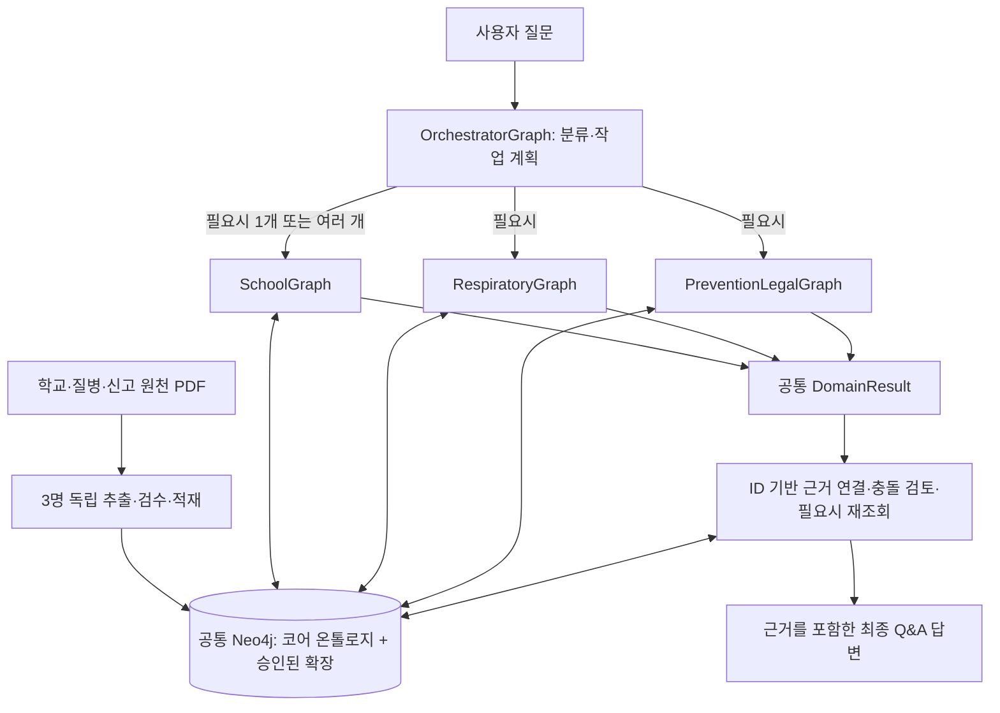
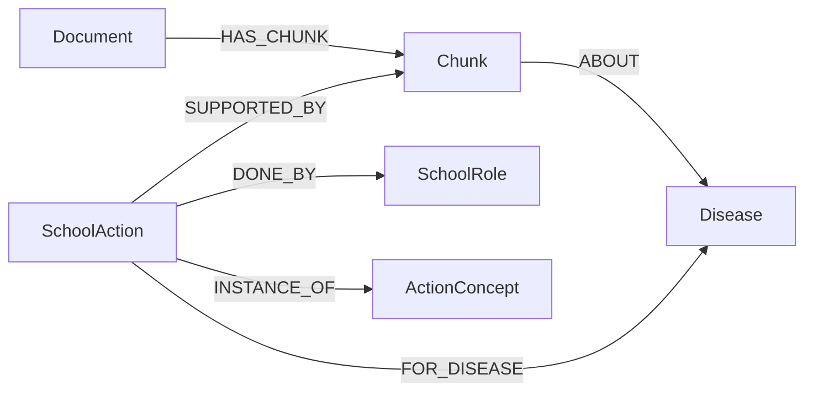

# 교육시설 감염병 근거 기반 대응 Q&A

> **GraphRAG + LangGraph 기반 학교 감염병 공식지침 탐색 서비스 — 프로젝트 제안서 및 실행계획서 v1.1**  
> 작성·개정 기준: 2026.11.02 | 개발·검증: 11.02~11.08 | 최종 발표: **11.09(월) 오후**  
> 핵심 산출물: **① LLM 개체·관계 추출 프롬프트·코드 ② Neo4j 지식그래프·스키마·시각화**  
> 추가 구현 목표: **단일 공통 Neo4j + 3개 전문 LangGraph + 복합 질문 오케스트레이션**  
> **v1.1 변경 범위:** v1.0의 서비스 목적·질병 우선순위·핵심 온톨로지·일정은 유지하고, 데이터/기능 분담·LangGraph·공통 계약·통합 평가 항목만 보강한다.

## 1. 프로젝트 개요

### 문제와 목표
학교에서 감염병 의심·확진 사례가 발생하면 교직원은 대응 행동, 수행 주체, 보고·연락, 등교중지·출결 기준을 여러 공식 문서에서 찾아야 한다. 학교 매뉴얼은 공통 절차를, 질병관리청 전문지침은 질병별 내용을, 법령과 출결 자료는 특정 의무·행정기준을 설명하므로 단일 검색만으로 필요한 근거가 연결되지 않는 경우가 있다.

**목표는 공식 문서에 근거한 정확한 Q&A 서비스**다. 단일 문서로 충분한 질문에는 원문을 직접 제시하고, 여러 문서의 학교 행동·역할·근거를 연결해야 하는 질문에는 지식그래프를 보강한다. 모든 답변은 확인된 문서명·판본·쪽수를 제공하며, 근거가 부족하면 단정하지 않는다.

**개발 원칙:** 3명 모두 자신의 담당 PDF에 대해 전처리→LLM 추출→정규화→Neo4j 적재→질의·검증을 독립 수행한다. **최종 데이터 저장소는 단일 공통 Neo4j**이며, 담당자별 LangGraph는 같은 DB를 조회하는 *기능별 전문 모듈*로 개발한다. 복합 질문은 필요에 따라 하나·둘·세 모듈을 선택·조합하되, 전체 답변은 상위 OrchestratorGraph가 근거를 확인하고 생성한다.

| 항목 | 범위 |
|---|---|
| 주요 사용자 | 초·중·고·특수학교 교직원(보건교사·담임교사·학교장 등) |
| 시연 기준 | **경기도 학교**를 우선 적용 범위로 설정하고 전국 공통 지침과 구분 |
| 서비스 형태 | **질문 입력 → LangGraph 라우팅·선택적 협업 → 근거 기반 답변 → 출처 확인**, 단일 Q&A 화면 |
| 그래프 대상 | **학교가 수행하거나 확인하는 행동**과 문서·질병·교직원 역할의 관계 |
| 서비스 밖 | 진단·치료 결정, 법적 의무의 자동 확정, 보건소·교육청 내부 업무, 개인정보 수집, NEIS 연동·자동 제출 |

### 대상 감염병 11종 및 구현 깊이

| 우선순위 | 대상 질병 | 구현 목표 |
|---|---|---|
| 1차 완주 | **성홍열** | 학교 공통 절차 + 성홍열 전문 근거 + 신고·보고 구분, 종단 간 시연 |
| 대표 확장 | **인플루엔자·수족구병·홍역** | 서로 다른 학교 행동·출결·신고 맥락을 활용한 질의와 근거 연결 |
| 기본 범위 | **코로나19·수두·유행성이하선염·백일해·마이코플라스마 폐렴·유행성각결막염·결핵** | 질병 식별·별칭·관련 문서 검색. 검증된 절차만 점진적으로 추가 |

결핵은 별도 관리체계가 방대하므로 첫 발표 시연의 심층 대상으로 삼지 않는다. 11개 질환 모두에 동일한 수준의 대응 규칙 자동화를 요구하지 않는다.

## 2. 데이터 구성과 사용 원칙

| 자료층 | 주요 원천 | 우선 활용 내용 |
|---|---|---|
| 학교 공통 절차 | 교육부 「학교 감염병 예방·위기대응 매뉴얼」, 경기도 「학교 감염병 예방관리 실무 가이드북」(2025.09) | 감염병 발생 대응, 교직원 역할, 등교중지·출결, NEIS 발생 보고 |
| 신고 정의·법령 | 「2026 법정감염병 진단·신고기준」, 감염병예방법·학교보건법 등 관련 법령 | 대상 질병, 신고 주체·대상·수신처의 구분, 법적 근거 |
| 질병 전문지침 | 2026 호흡기감염병, 예방접종 대상 감염병, 시설별 인플루엔자, 코로나19, 수족구병, 홍역 대응, 국가결핵관리지침 | 질병 특성·환자 관리·학교 관련 조치에 대한 보충 근거 |
| 보조 자료 | 2026 감염병 관리 사업 안내, 학교생활기록 관련 현행 지침 | 학교 보고·행정과 출결 안내의 교차 확인 |

### 3인 데이터 적재 책임과 검색 기능 분담

**자료 소유권은 적재·검수 책임을 뜻하며, 조회 권한을 뜻하지 않는다.** 세 LangGraph 모두 공통 DB의 승인된 모든 문서를 조회할 수 있다. 아래의 PDF 쪽수는 *전체 파일 분량*이며 실제 선택 추출량과 다르다.

| 담당 | 적재·검증 책임 PDF | 전체 PDF 쪽수 | 담당 LangGraph의 전문 기능 | 첫 독립 질문 |
|---|---|---:|---|---|
| **주승우 — SchoolGraph** | 교육부 학교 감염병 매뉴얼(230), 경기도 학교 실무가이드북(414) | **644** | 학교 대응 단계·수행 역할·등교중지·학교 행정 및 문서별 행동 비교 | “학교에서 유증상 학생이 발견되면 담임·보건교사는 각각 무엇을 확인하나?” |
| **송수림 — RespiratoryGraph** | 호흡기감염병(304), 시설별 인플루엔자(32), 코로나19(81), 감염병 관리 사업 안내(229) | **646** | 성홍열·인플루엔자 등 전문지침 검색, 학교 적용 범위·질병별 조건 확인 | “인플루엔자 발생 시 학교가 참고할 시설별 예방 조치는?” |
| **유종혁 — PreventionLegalGraph** | 예방접종 대상 감염병(315), 홍역(179), 수족구병(68), 진단·신고기준(237), 감염병예방법(59) | **858** | 홍역·수족구·예방접종 근거, 접촉자 안내, 신고·보고·의료기관 신고의 주체 구분 | “홍역 발생 시 학교 담당자의 업무와 신고 근거는?” |
| **후순위 확장(송수림)** | 국가결핵관리지침(674) 중 학교 관련 절 | **674** | 학교 결핵 사례·접촉자 조사 협조 관련 근거 | 필수 시연 완료 후 확장 |

12개 PDF는 **총 2,822쪽**(결핵을 제외한 1차 범위 2,148쪽)이며, 첫 주에는 각자 학교 관련 핵심 절과 표만 선택한다. 담당 문서의 PDF 파싱·LLM 추출·근거 검수·중복 없는 적재·로컬 질문 검증을 **모든 팀원이 직접 수행**해야 한다. 공통 도구를 제안하거나 공유할 수 있지만 특정 한 명의 파서가 완성되어야 다른 팀이 시작할 수 있는 구조는 피한다.

**수집 범위:** PDF 전체를 무조건 처리하지 않고 관련 절과 표를 우선 추출한다. 경기도 가이드북은 **인쇄 153~159쪽(대응 단계·역할), 194~200쪽(등교중지·NEIS)**을 우선 대상으로 한다. 전문지침은 질병별 각론과 학교에 직접 관계되는 절만 선정한다.

**자료 관리:** `source_manifest.csv`에 문서명·판본·게시일·시행일(해당 시)·발행기관·적용 지역·공식 URL·이용 조건·선정 쪽수를 기록한다. 게시 연도와 실제 개정판 연도는 구분한다. 법령의 현행성과 적용 여부는 원문 및 공식 법령정보로 확인하며, PDF의 부록 내용만으로 현행성을 확정하지 않는다.

**원문 품질:** 텍스트형 PDF는 구조 추출을 우선하고, 이미지형 페이지는 필요한 범위에만 OCR을 적용한다. 표는 머리글-행의 의미를 보존하고 PDF 쪽수와 인쇄 쪽수를 따로 기록한다. 재이용 조건이 불명확한 PDF 원본은 저장소에 무단 공개하지 않는다.

## 3. 서비스 기능 및 검색 흐름

| 기능 | 질문 예시 | 처리 방식 |
|---|---|---|
| 질병 사실 조회 | “인플루엔자의 잠복기는?” | 관련 **Chunk** 검색과 원문 인용 |
| 학교 대응 안내 | “성홍열 확진 학생 1명을 확인했어요. 학교가 확인할 일은?” | Chunk 검색 + **SchoolAction·SchoolRole** 조회 |
| 근거 연결·비교 | “보호자 연락 절차가 여러 문서에는 어떻게 나와 있나요?” | **ActionConcept**로 동일 행동을 묶고 출처별 조건·역할 표시 |
| 출결·행정 안내 | “등교중지 기간의 출석인정 서류는?” | 학교 가이드북·현행 출결 문서 검색 |
| 신고·보고 구분 | “성홍열과 홍역의 학교 신고·보고 기준은?” | 학교의 **보고·신고·통보**와 의료기관 신고를 구분하여 근거 제시 |

### LangGraph 기반 복합 질문 처리 원칙 (v1.1 신설)

**단일 공통 Neo4j에 저장된 데이터**를 각 전문 Graph가 서로 다른 방식으로 검색한다. 어느 Graph도 자기가 적재한 PDF만 검색하도록 제한하지 않는다. 단일 전문 기능으로 답할 수 있으면 하나만 호출하고, 서로 다른 검색 전략이나 근거 검증이 필요할 때만 여러 Graph를 호출한다.

| Graph | 주된 역할 | 필요한 경우 다른 자료를 어떻게 사용하는가 |
|---|---|---|
| `SchoolGraph` | 학교의 `SchoolAction`, `SchoolRole`, 대응 단계, `ActionConcept`를 검색 | 질병 전문지침·신고기준의 `Chunk`도 공통 DB에서 참조 |
| `RespiratoryGraph` | 호흡기 질병별 `Chunk`, 학교 대상 조치 및 적용 조건 검색 | 학교 매뉴얼의 `SchoolAction`과 연결된 근거도 검색 |
| `PreventionLegalGraph` | 홍역·수족구병·예방접종·신고/법령 근거 검색 | 교직원의 신고·보고 행동과 전문지침 근거를 교차 확인 |
| `OrchestratorGraph` | 질문 분해, 필요한 1~3개 전문 Graph 선택, 결과 연결·충돌 확인, 최종 답변 | 공통 ID를 활용한 추가 Neo4j 탐색과 원문 근거 검증 |



질의 호출은 **병렬 검색 → 결과 통합**을 1차 구현으로 하며, 필요한 경우 이전 Graph가 반환한 표준 ID를 다음 Graph의 검색 조건으로 전달하는 **순차 재검색**을 후속 확장으로 둔다. 서로 다른 Graph에서 유사한 답을 반환해도 `SchoolAction`의 출처·조건·담당·강도는 합쳐 버리지 않는다.

**검색 정책:** 질문마다 **Chunk 검색을 먼저 실행**한다. 학교 행동·수행 역할·문서 간 연결을 요청할 때만 Cypher로 그래프를 추가 조회한다. 그래프 조회가 실패하거나 적용 조건이 불명확하면 원문 확인 결과와 한계를 표시한다. 공통 학교 절차와 특정 질병에 명시된 조치는 답변에서 분리한다.

**최종 화면은 하나:** 질문 입력창, 간결한 답변, 행동별 담당·적용 조건·시점(원문에 있는 경우), 공식 문서·쪽수, 확인 필요 안내. 그래프 전체 시각화는 서비스 화면의 필수 요소가 아니라 기술 시연 자료로 제공한다.

### 공통 LangGraph 입출력 계약 (v1.1 신설)

각 팀원의 **내부 State·노드·엣지·모델·검색 알고리즘은 자유롭게 설계**한다. 대신 다른 Graph와 연결되는 함수 경계는 다음 형태로 통일한다. 아래 필드는 구현 전 팀 전체가 공유하는 *공통 인터페이스 제안*이며, 계약을 변경할 때는 버전·검증 코드·테스트를 함께 갱신한다.

| 계약 | 공통 필드 | 설명 |
|---|---|---|
| `QueryInput` | `question`, `region`, `allowed_document_ids` | 사용자 질문·적용 지역·접근 허용 문서 목록. **허용 목록은 담당자의 소유 문서 목록과 다르다.** |
| 선택 입력 | `task`, `preferred_document_ids`, `context_entity_ids`, `upstream_findings` | 분해한 하위 작업·우선 탐색 범위·앞선 Graph의 ID/근거 |
| `DomainResult` | `domain`, `status`, `findings`, `evidence`, `warnings` | 전문 Graph가 공통 형식으로 반환하는 주장·근거·검증 상태 |
| `Finding` | `claim`, `evidence_ids`, `action_ids`, `disease_ids`, `concept_ids` | Neo4j 전역 ID를 이용해 결과를 결합할 수 있는 최소 단위 |
| `Evidence` | `evidence_id`, `document_id`, `chunk_id`, `pdf_page`, `printed_page`, `excerpt` | 원문 위치를 확인할 수 있는 근거. 실제 인용문만 입력 |
| `OrchestratorState` | `question`, `selected_domains`, `domain_results`, `final_answer`, `warnings` | 전체 실행과 최종 통합을 위한 *상위 Graph만의* State |

`status`는 `ANSWERED`, `PARTIAL`, `INSUFFICIENT_EVIDENCE`, `ERROR` 등으로 통일하고, 근거가 불확실하거나 서로 충돌하면 `warnings` 및 확인 필요 항목에 명시한다. **개별 Graph는 자연어 완성 답변이 아니라 연결 가능한 `Finding + Evidence`를 기본 반환**한다. 단독 데모가 필요한 경우 같은 결과를 이용해 로컬 답변을 만들어도 된다.

- `allowed_document_ids`는 접근 제약이 필요한 때에만 적용하는 **공통 권한 범위**이고, `preferred_document_ids`는 해당 Graph가 **우선 검색할 자료**다. 우선순위를 문서 접근 제한으로 오용하지 않는다.
- 각 Graph는 표준화된 `Disease`, `SchoolRole`, `ActionConcept`, `Document`, `Chunk`, `SchoolAction` ID를 그대로 사용한다. 원문 위치가 없는 `Finding`은 확정 근거로 제시하지 않는다.
- 2개 이상 Graph를 병렬 실행하는 경우 결과를 분리된 키로 수집하거나 명시적 reducer를 사용하며, 서로의 내부 State를 공유하지 않는다.
- 단일 Graph가 공통 Neo4j에서 충분한 근거를 회수한다면 불필요한 다른 Graph 호출을 강제하지 않는다.

## 4. 핵심 온톨로지와 그래프 스키마

### 노드 6종 · 속성 25개

| 노드 | 필수·주요 속성 | 역할 |
|---|---|---|
| `Document` | `document_id`, `title`, `issuer`, `version`, `region`, `source_url` | 원본 자료의 특정 판본 |
| `Chunk` | `chunk_id`, `text`, `pdf_page`, `printed_page`, `section` | 검색·인용 가능한 원문 근거 |
| `Disease` | `disease_id`, `name`, `aliases` | 11개 질병 식별·표기 정규화 |
| `SchoolRole` | `role_id`, `name`, `aliases` | 학교 내부 수행 역할 |
| `SchoolAction` | `action_id`, `action_text`, `scope`, `when_text`, `timing_text`, `modality` | **특정 출처에 근거한 하나의 학교 행동** |
| `ActionConcept` | `concept_id`, `name` | 여러 문서에서 반복되는 **공통 행동 개념** |

`SchoolAction.scope`는 `COMMON`(근거로 확인된 공통 절차), `NAMED_DISEASES`(명시된 질병 대상), `UNKNOWN`(적용 범위 검토 필요)로 관리한다. `when_text`·`timing_text`는 원문 표현을 보존하며 **복잡한 인원·기간 조건을 자동 판정하지 않는다.** `modality`는 `MANDATORY / RECOMMENDED / DISCRETIONARY / UNSPECIFIED` 중 근거로 확인 가능한 값만 사용한다.

### 관계 6종

| 관계 | 연결 | 의미 |
|---|---|---|
| `HAS_CHUNK` | Document → Chunk | 문서의 원문 블록 |
| `ABOUT` | Chunk → Disease | 원문이 설명하는 질병 |
| `SUPPORTED_BY` | SchoolAction → Chunk | 학교 행동의 직접 근거 |
| `FOR_DISEASE` | SchoolAction → Disease | 명시적으로 적용되는 질병 |
| `DONE_BY` | SchoolAction → SchoolRole | 원문에 나타난 학교 수행 역할 |
| `INSTANCE_OF` | SchoolAction → ActionConcept | 문서 간 동일 행동 의미의 정규화 |



**행동 정규화 원칙:** 표현·목적이 같은 행동은 하나의 `ActionConcept`에 연결한다. 단, 문서마다 다른 **적용 조건·담당·시점·강도**를 가지면 `SchoolAction`은 출처별로 분리한다. `DONE_BY` 관계에는 원문이 명시한 역할인지 조정 가능한 *예시*인지 구별할 때만 `basis` 속성을 둔다. 문서별 차이를 자동으로 법적 충돌이라고 판정하지 않는다.

**검증 정보의 위치:** `review_status`, `source_chunk_id`, 추출 모델·프롬프트 버전, 오류 로그 등은 **중간 JSONL·검수표**에서 관리한다. 원문 근거가 검증된 행동만 Neo4j에 적재한다. 그래프에 없는 행동을 ‘의무가 존재하지 않음’으로 해석하지 않는다.

### 통합 DB의 스키마 확장 정책 (v1.1 신설)

**코어 스키마는 온톨로지 v3.0의 6개 노드·6개 관계를 기준선으로 유지**한다. 각 담당자는 자신의 검색 품질을 높이기 위해 전용 인덱스·Cypher·랭킹·내부 State를 자유롭게 실험할 수 있다. 그러나 **단일 공통 Neo4j에 새 노드·관계·속성을 추가하거나 기존 의미를 변경하는 일**은 다른 팀의 질의에 영향을 줄 수 있어 3인 합의 후 반영한다.

- 자유 실험: 본인 LangGraph의 상태값, 노드 연결, 프롬프트, 검색기, 후보 인덱스 및 쿼리(로컬/분리된 테스트 환경에서 검증).
- 공동 승인: 공통 DB의 신규 노드·관계·속성·인덱스, 표준 ID 사전 변경, 코어 의미 변경, 데이터 마이그레이션.
- 확장 채택 조건: **해결하려는 골든 질문 → 현재 스키마의 부족한 점 → 제안 변경 → 전후 검색·정확성 검증 → 롤백 방법**을 기록한다. 확장은 코어 스키마를 깨지 않는 가산 방식(additive)을 우선한다.
- 같은 행동도 `SchoolAction`은 원문별로 유지하고, 임의의 법률 조문 노드나 관리기관 노드를 *필수 구조*로 추가하지 않는다. 먼저 기존 `Chunk`와 `ActionConcept`로 해결 가능한지 확인한다.

## 5. 기술 구현 흐름 (M0~M9)

**두 파이프라인을 구분한다.** ① PDF 적재는 팀원별로 독립 수행하지만 최종 저장소는 **공통 Neo4j 한 개**이며, ② 질의는 세 개 전문 LangGraph가 공통 DB를 조회하고 상위 OrchestratorGraph가 필요에 따라 조합한다. 적재 흐름은 순수 Python 또는 LangGraph로 구현 가능하되, **모든 팀원이 적재 전 과정을 직접 경험**한다.

```text
[각자 PDF 적재] 문서/판본 → PDF·표·선택적 OCR → Chunk → LLM 추출
  → 스키마/원문 검증 → 정규화·ID 매핑 → 공통 Neo4j MERGE

[질의 실행] 사용자 질문 → OrchestratorGraph(분류·검색 계획)
  → SchoolGraph / RespiratoryGraph / PreventionLegalGraph (필요한 1~3개)
  → 공통 Neo4j의 Chunk·SchoolAction·공통 ID 조회
  → DomainResult(주장·근거·ID) → 결과 결합·원문 검증 → 최종 답변
```

| 단계 | 구현 작업 | 종료 산출물 |
|---|---|---|
| **M0** 범위·원천 | 11개 질병, 문서 판본·이용 조건, 대표 질문 확정 | `source_manifest.csv`, 범위 명세 |
| **M1** 전처리 | 문단·표 구조 추출, 선택적 OCR, 쪽수 보존 | `pdf_parser.py`, `blocks.jsonl` |
| **M2** 스키마 | 6노드·6관계, 속성·ID·허용 연결 정의 | `ontology.md`, 스키마 규약 |
| **M3** 프롬프트 | **학교 행동인지 선별**, 행동·근거·역할·질병 후보 추출 | 추출 프롬프트·수동 샘플 |
| **M4** 자동 추출 | 청크→LLM→JSON 검증, 원문 불일치 격리 | `extractor.py`, `steps_raw.jsonl` |
| **M5** 정규화 | 질병·학교 역할 별칭 및 **동일 행동 개념** 매핑 | 별칭·Concept 사전, 정규화 결과 |
| **M6** Neo4j 적재 | 각자 담당 PDF로 공통 스키마 적재, 고유 ID·`MERGE`, 출처 관계 구성·중복 검사 | 통합 Neo4j, 검증된 JSONL, 적재 코드·시각화 |
| **M7** 질의·화면 | 3개 전문 LangGraph를 각자 구현, 공통 `DomainResult` 적용, 단일/복합 질문 라우팅·결과 통합 | 3개 QueryGraph, OrchestratorGraph, Cypher, 단일 Q&A 화면 |
| **M8** 검증 | 개인별 골든 질문·독립 실행, 2/3개 Graph 혼합 질의, 오병합·오귀속·근거 누락 검토 | 개인·통합 검증표, 계약 테스트, 오류 수정 사례 |
| **M9** 통합 | 공통 DB 재적재·Graph 조합 회귀검증, 재실행·README, 시연·발표 자료 및 백업 | 최종 코드·결과·발표자료·통합 테스트 |

첫 수직 슬라이스는 **성홍열 확진 학생 1명 / 경기도 초등학교 / 초기 학교 대응**으로 설정한다. 관련 학교 절차와 성홍열 각론의 핵심 블록만으로 PDF→LLM→ER→**공통 Neo4j**→답변까지 연결하고, **11월 5일(목)** 완주 여부를 확인한다. 이때 `SchoolGraph + RespiratoryGraph`의 **2-Graph 조합 검색을 최소 통합 시연**으로 삼고, 신고 근거를 결합한 `PreventionLegalGraph`는 검증 상태에 따라 11월 6~7일 확장한다. 공통 파서가 늦어져도 수동 작성한 원문 블록 5~10개로 추출 프롬프트를 먼저 검증한다.

**독립 개발 게이트:** 3명이 각자 *자신의 담당 PDF만으로* 최소 1개 질문을 조회·인용할 수 있어야 한다. 그러나 통합 시 각 전문 Graph의 조회 대상은 **공통 Neo4j 전체**이며, 개발 단계의 자료 소유권이 검색 필터가 되어서는 안 된다.

## 6. 검증과 성공 기준

| 항목 | 확인 기준 |
|---|---|
| **원문 충실성** | 생성한 행동·담당·적용 조건·기한이 인용 청크에 존재하는가 |
| **신고 정확성** | 학교의 교육청 발생 보고, 학교장 등의 신고·통보, 의료기관 법정 신고를 혼동하지 않는가 |
| **정규화** | 같은 행동 개념을 연결하되 문서별 규칙 차이는 유지하는가 |
| **그래프 무결성** | 노드·관계 방향, 고유 ID, 재적재 중복, 출처 연결이 올바른가 |
| **답변 안전성** | 근거 부족·조건 불명확·자료 충돌을 확정 사실처럼 제시하지 않는가 |
| **근거 제시** | 문서명·판본·PDF 쪽수가 실제 원문과 일치하는가 |

### LangGraph 조합 검증 (v1.1 신설)

| 테스트 | 확인할 점 | 합격 기준 |
|---|---|---|
| **단독 기능** | `SchoolGraph`, `RespiratoryGraph`, `PreventionLegalGraph` 각각 독립 실행 | 자기 대표 질문에 근거·쪽수와 함께 응답하거나 근거 부족을 정확히 표시 |
| **2-Graph 조합** | 학교 공통 절차 + 성홍열 전문지침 | 서로 다른 문서의 `Finding`을 구분하고 공통 ID로 근거를 연결 |
| **3-Graph 조합** | 성홍열 학교 행동 + 질병별 정보 + 신고 근거 | 학교 보고와 의료기관 신고를 혼동하지 않고 원문별로 인용 |
| **조회 범위** | 자기가 적재하지 않은 문서도 검색 가능 | 전문 Graph의 우선 문서 설정이 접근 제한으로 작동하지 않음 |
| **State/계약** | 서로 다른 내부 State를 가진 Graph 조합 | 공통 입력·출력 스키마 검증 성공, 병렬 결과가 누락·덮어쓰기되지 않음 |
| **오류·충돌** | 하나의 Graph에서 근거 부족 또는 실행 오류 발생 | 실패 사실과 영향을 표시하고, 검증되지 않은 내용을 최종 답변에 사용하지 않음 |

**사람이 원문과 확인한 골든 질문 6~8개**를 우선 구축한다. 단일 사실 조회, 학교 대응·담당, 신고·보고 구분, 출결, 문서 간 행동 비교, 근거 부족 질문을 포함한다. 필수 시연은 **성홍열 학교 대응(2-Graph 이상)**과 **같은 행동의 다중 문서 근거 연결**이며, 이후 인플루엔자·수족구병·홍역 대표 질문으로 확장한다.

여유가 있으면 같은 질문 2~3개를 대상으로 **Chunk 검색만 사용한 답변과 그래프 보강 답변**을 비교한다. 필요한 행동의 누락, 잘못된 안내, 출처 적합성을 기록하며 검증되지 않은 성능 향상 수치를 주장하지 않는다.

## 7. 일정 및 완료 게이트

| 날짜 | 중점 작업 | 완료 기준 |
|---|---|---|
| **11/2 월** | M0 범위·문서 담당·코어 스키마·LangGraph 계약 확정, 샘플 시험 | 문서 목록·공통 ID·입출력 타입·수동 블록 샘플 |
| **11/3 화** | M1~M3 각자 PDF 청크·추출 프롬프트 및 QueryGraph 인터페이스 실험 | 담당자별 청크 JSONL·프롬프트·DomainResult 샘플 |
| **11/4 수** | M4~M6 각자 추출·검증·정규화 및 통합 DB 소량 적재 | 3인 독립 적재, 표준 ID/출처 검증, 중복 없는 MERGE |
| **11/5 목** | **성홍열 첫 통합 수직 슬라이스** | **실제 원문→공통 Neo4j→SchoolGraph+RespiratoryGraph→근거 답변** |
| **11/6 금** | 대표 질병·출결 자료 확장, 신고 Graph 결합·라우터 구현 | 단독/2-Graph/가능하면 3-Graph 질문 실행 |
| **11/7 토** | M7~M8 Orchestrator·다중 Graph 결과 통합·골든셋 검증 | 질문 6~8개·출처/상태/오류 경로 검토, 발표 초안 |
| **11/8 일** | M8~M9 재실행·발표자료·백업 | **저녁까지 개발 동결·시연 백업 확보** |
| **11/9 월** | 오전 리허설 / **오후 최종 발표** | 신규 기능 없이 안정적 시연 |

**범위 통제:** 11월 5일 수직 슬라이스가 완성되지 않으면 새로운 질병의 심층 추출과 추가 기능 구현을 중단하고, 원문·추출·정규화·적재 연결을 먼저 안정화한다.

## 8. 산출물과 위험 관리

**필수 제출:** (1) LLM 개체·관계 추출 프롬프트 및 실행 코드, 입력·출력 예시 (2) Neo4j 온톨로지 스키마, 적재 코드, Cypher 질의, 실제 그래프 시각화.  
**프로젝트 결과물:** 단일 Q&A 시연, 문서·청크 데이터, ER 매핑표, 골든셋·오류 검증표, 재현 가능한 README, 발표자료·실행 결과 캡처.

**LangGraph 추가 산출물(v1.1):** `SchoolGraph`·`RespiratoryGraph`·`PreventionLegalGraph` 코드 및 그래프 그림, `OrchestratorGraph`의 라우팅·병렬 결합 예시, 공통 `QueryInput/DomainResult` 스키마와 테스트, **공통 Neo4j를 세 Graph가 조회하는 시연**, 단독/2-Graph/3-Graph 질문의 원문 근거 추적 기록. LangGraph는 수업의 필수 제출물 두 가지를 대체하지 않는 **서비스 구현·심화 결과물**이다.

| 주요 위험 | 대응 |
|---|---|
| 표 붕괴·이미지형 PDF | 우선 처리 절 제한, 표 머리글 검토, 필요한 쪽만 OCR |
| 이용 조건·판본 불확실 | 이용 허용·원본 출처 확인, 판본을 문서별 관리, 무단 공개 금지 |
| 학교 행동의 오추출·법적 오해 | 근거 없는 행동 적재 금지, 신고·보고 분리, 원문과 공식 최신 기준 확인 |
| 문서 간 같은 행동의 오병합 | Concept만 공유하고 원문별 SchoolAction·조건·담당 보존 |
| LangGraph 간 State·출력 불일치 | 외부 입출력 계약 고정, 담당자별 내부 State 분리, 계약 테스트·어댑터 작성 |
| 공통 DB 스키마 충돌·조회 성능 저하 | 코어 6노드·6관계 동결, 개인 실험/공동 승인 구분, 전역 ID·인덱스 변경 검토 |
| 라우팅 과도·복합 결과의 근거 누락 | 단일 Graph로 충분하면 단독 호출, 필요한 모듈만 병렬 조회, 통합 검증·원문 재확인 |
| 일정 지연·시연 장애 | 11/5 수직 슬라이스 게이트, 11/8 코드 동결, JSON·Cypher·그래프 화면 백업 |

### 팀 합의·변경 관리 (v1.1 신설)

- **3인 공통 동결:** 온톨로지 v3.0의 기존 6노드·6관계 의미, 전역 ID, 원문 근거 형식, 공통 QueryInput/DomainResult, 공통 Neo4j 적재 규칙.
- **개별 변경 허용:** 팀원별 LangGraph State, 내부 노드·분기, LLM·프롬프트, Cypher·검색 전략, 문서 우선순위, 로컬 인덱스 실험.
- **공동 승인 대상:** 통합 DB의 신규 노드·관계·속성·공통 인덱스, 공통 ID 사전, 외부 입출력 계약, 데이터 삭제/마이그레이션.
- **통합 책임:** 코어 규격·통합 Orchestrator는 3인 공동 검증한다. 특정 팀원의 데이터 파이프라인 또는 노드 구현이 다른 팀원의 착수 조건이 되어서는 안 된다.
- **구현 우선순위:** 필수 M0~M9와 성홍열 2-Graph 시연을 우선한다. 복잡한 순차 재질의, 신규 법령 노드, 고급 GDS 및 UI 고도화는 검증 이후 선택한다.

> **서비스의 책임 범위:** 공식 문서에 있는 학교 대응 정보를 찾아 정리하는 **참고용 탐색 도구**이며, 환자 진단·격리 확정·법적 판단을 대신하지 않는다. 학생 이름·연락처·개인 건강정보는 입력받지 않는다.
