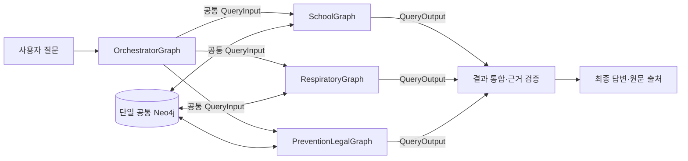
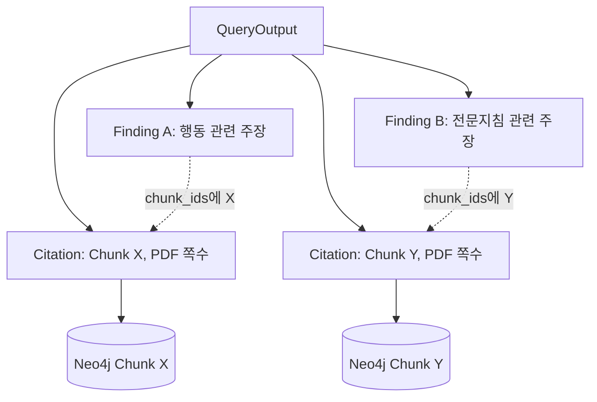

# 교육시설 감염병 GraphRAG — LangGraph 공통 입출력 계약 가이드

> **팀 공유·구현용 초안 v1.2 (2026-11-02)**  
> 기준: `교육시설_감염병_GraphRAG_프로젝트_계획서_v1.1.md`, `교육시설_감염병_GraphRAG_온톨로지_스키마_설명서_v3.0.md`  
> 대상: 주승우 `SchoolGraph`, 송수림 `RespiratoryGraph`, 유종혁 `PreventionLegalGraph`, 공통 `OrchestratorGraph`  
> 상태: **우선 이 규격으로 구현하고, 실제 테스트 결과에 따라 버전 변경**한다. 최종 승인 전까지는 제안 규격이다.

---

## 0. 1분 요약 — 무엇을 통일하나?

우리는 **하나의 공통 Neo4j**에 원문 청크·학교 행동·역할·질병을 저장한다. 각 팀원이 만든 **세 개의 전문 LangGraph는 같은 Neo4j를 조회**한다. 단일 질문은 하나의 Graph로, 복합 질문은 필요한 두세 Graph를 조합해 처리한다.

이를 위해 통일할 것은 **각 Graph의 내부 설계가 아니라, 서로 주고받는 입력과 출력**이다.

| 구분 | 비유 | 해야 하는 일 |
|---|---|---|
| `QueryInput` | 업무 요청서 | 어떤 질문을, 어떤 조건으로, 어떤 범위에서 검색할지 전달 |
| `Finding` | 확인한 사실/주장 카드 | Graph가 무엇을 알아냈는지 **원자적인 주장 단위**로 전달 |
| `Citation` | 증빙자료 위치표 | 그 주장이 어떤 PDF·청크·쪽수의 원문에 근거하는지 전달 |
| `QueryOutput` | 업무 결과 보고서 | Graph의 처리 상태와 `Finding`·`Citation`을 함께 반환 |
| `OrchestratorGraph` | 종합 담당자 | 결과를 연결·검증하고 최종 사용자 답변을 구성 |

**핵심 규칙:** *Finding은 내용, Citation은 증거, QueryOutput은 결과 봉투.*



여기서 **각자 다른 State, 노드 구성, LLM, 프롬프트, Cypher, 검색 알고리즘을 사용해도 된다.** 단, 외부의 `QueryInput`과 `QueryOutput`은 이 문서의 필드 이름과 의미를 지켜야 한다.

---

## 1. 왜 공통 계약이 꼭 필요한가?

### 1-1. 공통 계약이 없는 경우

- 주승우 Graph: `{"role":"보건교사", "answer":"..."}` 반환
- 송수림 Graph: `{"data":[...], "sources":[...]}` 반환
- 유종혁 Graph: `{"legal_text":"...", "references": [...]}` 반환

세 Graph 각각은 잘 동작하더라도 Orchestrator는 무엇이 **주장**이고 무엇이 **근거**인지 모른다. 결합할 때마다 새로운 파싱·프롬프트와 임의 매핑이 필요해진다. 특히 법령·신고와 같은 민감한 내용은 서로 다른 적용 조건을 누락하기 쉽다.

### 1-2. 공통 계약이 있는 경우

모든 Graph가 `QueryOutput` 안에 `findings`, `citations`, `status`를 반환한다. Orchestrator는 공통 규칙으로 다음을 수행한다.

1. 같은 `disease_id`·`concept_id`·`action_id`를 기준으로 관련 결과 찾기
2. 각 Finding의 `chunk_ids`가 실제 Citation과 Neo4j에 존재하는지 검증
3. 학교 공통 절차, 질병별 관리 내용, 법정 신고 주체를 구분해 답변 구성
4. 근거가 부족하거나 충돌이 의심되는 결과를 분리하고 경고 표시
5. 한 Graph가 실패해도 다른 Graph의 검증된 근거는 활용

**또 하나의 장점:** 팀원별 내부 구현이 바뀌어도 외부 계약이 같으면 Orchestrator를 다시 작성할 필요가 없다.

### 1-3. 공통 State와 입출력 계약은 다르다

- **내부 State**: 어떤 Graph *안*에서 여러 노드가 공유하는 작업 메모리. 각자 자유롭게 설계한다.
- **입출력 계약**: Graph *밖*의 다른 Graph가 이해할 수 있는 공통 데이터 구조. 3인이 동일하게 유지한다.
- **Neo4j 스키마**: 저장된 데이터의 노드·관계 구조. 현재 코어 온톨로지 v3.0을 따르고 변경은 합의한다.

즉, `SchoolGraph`의 `response_stage`, `RespiratoryGraph`의 `ocr_warnings`, `PreventionLegalGraph`의 `reporting_subject` 같은 전용 State는 **서로 알 필요가 없다**.

---

## 2. 이번 문서에서 확정 제안하는 명칭

v1.1 계획서에는 `DomainResult`, `Evidence`라는 명칭이 있고, 최근 설계 대화에서는 `QueryOutput`, `Citation`을 사용했다. 두 묶음을 **동시에 별도 객체로 만들지 말자.** 구현 혼란을 막기 위한 이번 초안의 정식 이름은 아래와 같다.

| 이번 초안의 정식 이름 | 기존 v1.1 표현 | 의미 |
|---|---|---|
| `QueryInput` | `QueryInput` | 전문 Graph 호출 입력 |
| `QueryOutput` | `DomainResult` | 전문 Graph 호출 출력 |
| `Citation` | `Evidence` | 원문 증거·쪽수·청크 |
| `Finding` | `Finding` | 증거가 연결된 하나의 주장 |
| `chunk_ids` | `evidence_ids` 또는 `chunk_ids` | Finding이 참조하는 **Citation의 `chunk_id` 목록** |

**결정:** 코드에서는 `QueryOutput`, `Citation`, `Finding`, `chunk_ids`를 사용한다. 기존 문서에 쓰인 `DomainResult`, `Evidence`는 이 개념의 설명상 별칭으로만 남긴다. `Evidence`와 `Citation`을 이중 저장하지 않는다.

별도로, 담당자 ID는 다음 세 값으로 통일한다.

- `school`: 주승우 / `SchoolGraph`
- `respiratory`: 송수림 / `RespiratoryGraph`
- `prevention_legal`: 유종혁 / `PreventionLegalGraph`

> 이 명칭 일원화는 **v1.1에서 v1.2로 제안하는 인터페이스 변경**이다. 기존 코드가 이미 v1.1 명칭을 사용했다면 한 번에 교체하거나, 임시 어댑터로 변환하고 이후 제거한다.

---

## 3. QueryInput — 다른 Graph에게 넘기는 '작업 요청서'

### 3-1. 필드별 설명

| 필드 | 필수 | 타입 | 쓰임 |
|---|---|---|---|
| `question` | ✅ | `str` | 최초 사용자 질문 원문. 도중에 의미를 임의 변경하지 않음 |
| `region` | ✅ | `"NATIONAL" \| "GYEONGGI"` | 답변의 지역 맥락. 경기도 전용 안내와 전국 지침을 구별 |
| `allowed_document_ids` | ✅ | `list[str]` | **접근이 허용된 문서의 전체 목록**. 담당자가 적재한 PDF만 넣는 필터가 아님 |
| `task` | 선택 | `str` | Orchestrator가 할당한 세부 작업. 예: “학교장·보건교사의 업무만 찾아줘” |
| `preferred_document_ids` | 선택 | `list[str]` | 우선적으로 검색할 문서. 검색 품질 힌트일 뿐 접근 제한이 아님 |
| `context_entity_ids` | 선택 | `list[str]` | 앞선 검색에서 확정된 공통 Neo4j 개체 ID. 순차 협업에 활용 |

**왜 `question` 외에 `task`가 있나?** 동일한 복합 질문이라도 학교 Graph에는 학교 역할 확인을, 법령 Graph에는 신고 주체 확인을 요청할 수 있기 때문이다. `question`은 동일하게 유지하고, `task`만 달리 전달한다.

**왜 `allowed_document_ids`와 `preferred_document_ids`가 따로 있나?** `allowed`는 권한/검색 가능 범위, `preferred`는 우선순위다. 학교 Graph도 호흡기 PDF를 검색할 수 있어야 하므로 담당자별 소유 문서로 `allowed`를 좁히면 안 된다.

**정책:** `allowed_document_ids=[]`는 '전체 허용'이 아니라 '허용된 문서 없음'을 의미한다. 전체 문서 사용 시 `source_manifest`에서 허용된 실제 문서 ID 목록을 넣는다. `preferred_document_ids`는 `allowed_document_ids`의 부분집합이어야 한다.

### 3-2. 예시 — 같은 질문에 각 Graph의 작업만 다르게 전달

다음은 **실제 대응 판단이 아니라 호출 구조를 설명하기 위한 예시**다.

```json
{
  "question": "경기도 초등학교에 성홍열 확진 학생이 발생했다면 학교 대응과 신고 근거는?",
  "region": "GYEONGGI",
  "allowed_document_ids": [
    "moe_school_manual_v3",
    "gyeonggi_school_guide_2025",
    "kdca_respiratory_2026",
    "kdca_diagnosis_reporting_2026"
  ],
  "task": "학교에서 수행하거나 확인할 대응 행동과 담당자를 찾아줘",
  "preferred_document_ids": [
    "moe_school_manual_v3",
    "gyeonggi_school_guide_2025"
  ],
  "context_entity_ids": ["Disease:SCARLET_FEVER"]
}
```

- 송수림 Graph: 같은 `question`, `region`, `allowed`를 받고 `task`만 `"성홍열 전문지침의 질병별 관리 내용을 찾아줘"`로 변경.
- 유종혁 Graph: `task`를 `"학교 신고·교육청 보고·의료기관 신고의 근거를 구분해줘"`로 변경.
- `context_entity_ids`는 `"Disease:SCARLET_FEVER"`, `"ActionConcept:CONTACT_GUARDIAN"`, `"SchoolAction:<실제 ID>"`처럼 `노드라벨:전역ID` 문자열 형식으로 통일한다.

### 3-3. QueryInput의 책임 범위

- Orchestrator 또는 직접 호출한 사용자가 입력을 만든다.
- 각 전문 Graph는 `allowed` 범위 밖의 자료를 검색·반환하지 않는다.
- 전문 Graph는 `preferred` 자료를 먼저 찾되 필요한 경우 다른 허용 문서를 검색한다.
- 특정 질문에서 충분한 근거가 없다면 검색 결과 없음도 정상 결과로 처리한다.
- 개인정보가 포함된 자유서술 입력을 저장하거나 재사용하지 않도록 별도 정책을 둔다.

---

## 4. Citation — '이 말의 원문이 정확히 어디 있나?'

### 4-1. Citation은 무엇인가?

`Citation`은 **LLM이 한 주장을 검증할 수 있는 실제 원문 위치표**다. 답변 문장이 아니라 원문 증거의 주소에 가깝다.

```python
class Citation(TypedDict):
    document_id: str
    chunk_id: str
    pdf_page: int
    printed_page: int | None
    excerpt: str
```

| 필드 | 예시 | 반드시 지킬 규칙 |
|---|---|---|
| `document_id` | `moe_school_manual_v3` | 공통 Neo4j의 실제 `Document.document_id`와 일치 |
| `chunk_id` | `moe_school_manual_v3:p0045:b02` | 공통 Neo4j의 실제 `Chunk.chunk_id`와 일치 |
| `pdf_page` | `45` | PDF 뷰어 기준 **1부터 시작하는 실제 쪽수** |
| `printed_page` | `41` 또는 `null` | 책에 인쇄된 쪽수. 다르면 따로 보관 |
| `excerpt` | `"<검증된 실제 원문 발췌>"` | 실제 PDF 원문에 존재하는 문장. 임의 생성·의역 금지 |

`Citation`에 `title`이나 기관명을 매번 복제할 필요는 없다. `document_id`로 `Document` 노드를 조회해 공식 문서명·발행기관·판본을 가져올 수 있다. UI에서는 문서명·판본·쪽수까지 표시한다.

**중요:** `Citation`은 `SUPPORTED_BY` 같은 관계 자체가 아니라, 그 관계가 최종적으로 가리키는 **검증 가능한 Chunk 근거**다.

### 4-2. Citation이 사용되는 곳

1. 전문 Graph가 자신의 `Finding`에 근거를 연결할 때
2. Orchestrator가 여러 Graph의 주장이 원문에 뒷받침되는지 검증할 때
3. 최종 UI의 문서명·판본·PDF 쪽수 링크를 만들 때
4. 품질 평가에서 “존재하지 않는 페이지·근거를 생성했는가?”를 검사할 때

**실제 원문을 확인하지 못한 경우에는 그럴듯한 Citation을 만들어내지 않는다.**

---

## 5. Finding — '그래서 무엇을 알아냈나?'

### 5-1. Finding은 무엇인가?

`Finding`은 **문서와 그래프를 탐색하여 확인한 하나의 핵심 주장**이다. `Citation`이 주소라면 `Finding`은 그 주소로 뒷받침되는 내용이다.

```python
class Finding(TypedDict):
    claim: str
    chunk_ids: list[str]
    action_ids: list[str]
    disease_ids: list[str]
    concept_ids: list[str]
```

| 필드 | 의미 |
|---|---|
| `claim` | 사용자 답변에 사용할 수 있는 **검증된 원자적 사실·행동 설명** |
| `chunk_ids` | 이 주장의 증거인 `Citation.chunk_id` 목록. 최소 1개 |
| `action_ids` | 관련 `SchoolAction` ID. 일반 질병 사실·법령 조회라면 `[]` 가능 |
| `disease_ids` | 연결할 수 있는 질병 ID. 예: `SCARLET_FEVER`; 확정되지 않으면 `[]` |
| `concept_ids` | 관련 `ActionConcept` ID. 예: `CONTACT_GUARDIAN`; 해당 없으면 `[]` |

### 5-2. 왜 Finding 하나에 큰 답변 전체를 넣으면 안 되나?

큰 문장을 하나의 Finding으로 만들면 `Citation` 여러 건 중 **어떤 근거가 어느 주장에 해당하는지** 알기 어려워진다.

- 나쁜 예: `"성홍열은 어떤 병이고, 학교는 누구에게 연락하고, 신고 기한은 얼마이며, 출결은 어떻게 처리한다."`
- 좋은 예: 질병 정의 / 학교 행동 / 신고 주체 / 출결 처리 **각각 별도 Finding**으로 분리

특히 신고·보고·통보처럼 법적 의미가 다른 내용은 무조건 분리한다. 학교 공통 조치와 특정 질병에만 명시된 조치도 따로 보존한다.

### 5-3. Finding과 Neo4j 노드는 같은 것이 아니다

- `SchoolAction`: **영구 저장된** 출처별 행동 데이터(특정 PDF의 학교 업무).
- `ActionConcept`: 여러 `SchoolAction`을 묶는 **공통 의미 노드**.
- `Finding`: 어떤 질문에 답하는 과정에서 위 노드 및 `Chunk`를 **검색·조합해 만든 일시적인 결과**.

Finding은 새 Neo4j 노드가 아니다. 즉, `Finding` 수가 늘어난다고 그래프 노드가 늘어나는 것은 아니다.

예를 들어 여러 문서에서 `"보호자에게 연락"`, `"보호자에게 알림"`을 찾아 공통 `ActionConcept:CONTACT_GUARDIAN`에 연결할 수 있지만, 서로 다른 출처의 `SchoolAction`을 합쳐서는 안 된다. 이 차이를 Finding과 Citation이 함께 보존해야 한다.

### 5-4. Finding ↔ Citation 연결 규칙

이번 초안에서는 ID를 더 늘리지 않기 위해 **`Finding.chunk_ids`가 `Citation.chunk_id`를 직접 참조**한다.



- Finding 한 개는 Citation 여러 건을 참조할 수 있다.
- Citation 하나를 여러 Finding이 재사용할 수 있다.
- 같은 `chunk_id`의 Citation은 결과에서 중복하지 않는다.
- 하나의 Finding이 **독립된 여러 사실**을 묶지 않도록 주의를 기울인다.
- 모든 Finding의 `chunk_ids`는 결과의 `citations`에 실제로 존재해야 한다.

---

## 6. QueryOutput — 전문 Graph가 돌려주는 '결과 보고서'

```python
class QueryOutput(TypedDict):
    domain: Literal["school", "respiratory", "prevention_legal"]
    status: Literal["ANSWERED", "PARTIAL", "INSUFFICIENT_EVIDENCE", "ERROR"]
    findings: list[Finding]
    citations: list[Citation]
    action_ids: list[str]
    warnings: list[str]
    answer: str
```

| 필드 | 역할 | 비고 |
|---|---|---|
| `domain` | 응답을 만든 전문 Graph 구분 | 문서를 적재한 담당자가 아니라 **수행한 검색 기능**의 ID |
| `status` | 처리 결과 상태 | 아래 공통 상태값 사용 |
| `findings` | 검증된 개별 주장 목록 | Orchestrator가 주요하게 소비 |
| `citations` | 각 주장을 뒷받침하는 원문 근거 모음 | `chunk_id` 중복 없이 반환 |
| `action_ids` | 이번 응답의 관련 행동 ID 총목록 | `findings[].action_ids`의 중복 제거 합집합 |
| `warnings` | 불확실성·제한·오류 정보 | 임상 판단/법적 의무를 단정하지 않기 위한 장치 |
| `answer` | 담당 Graph의 **독립 시연용 간략 요약** | 최종 사용자 답변은 Orchestrator가 따로 생성. 불필요하면 `""` 허용 |

### 6-1. `status` 의미를 반드시 통일

| 상태 | 뜻 | 결과 내용 |
|---|---|---|
| `ANSWERED` | 맡은 세부 작업 범위에서 충분한 근거가 있음 | 최소 1 Finding, 모든 Finding에 Citation 연결 |
| `PARTIAL` | 일부만 확인됨. 나머지는 근거 부족/범위 불명확 | 확인된 Finding만 반환, 빠진 부분은 `warnings`에 기록 |
| `INSUFFICIENT_EVIDENCE` | 확인 가능한 주장 없음 | `findings=[]`, `citations=[]`, `action_ids=[]`, 근거 부족 사유 기록 |
| `ERROR` | DB 연결/파서/LLM 등 실행 실패 | 가능하면 근거 없는 데이터 반환 금지, 오류 사유 기록. 재시도/대체 실행은 상위 정책 |

**중요:** `PARTIAL`은 일부 사실은 검증됐다는 뜻이고 `ERROR`는 시스템 실패다. 둘을 섞지 않는다. 서로 다른 문서가 충돌해 보이면 각 Finding과 Citation을 유지한 뒤 `warnings`에 기록하고 상위 검증 단계로 전달한다. 자동으로 법적 충돌 판정을 내리지 않는다.

### 6-2. 가상 QueryOutput JSON 예시

> **주의: 아래 문장과 인용문은 타입 이해를 위한 가상 샘플이며 실제 지침에서 검증한 조치가 아니다. PDF 검증 없이 이 내용을 사용자 답변이나 Neo4j에 적재해서는 안 된다.**

```json
{
  "domain": "school",
  "status": "ANSWERED",
  "findings": [
    {
      "claim": "[가상 예시] 상황 A에서 담당교사는 보호자 연락을 확인하도록 안내한다.",
      "chunk_ids": ["demo_manual:p0012:b01"],
      "action_ids": ["demo_manual:p0012:a01"],
      "disease_ids": [],
      "concept_ids": ["CONTACT_GUARDIAN"]
    }
  ],
  "citations": [
    {
      "document_id": "demo_manual",
      "chunk_id": "demo_manual:p0012:b01",
      "pdf_page": 12,
      "printed_page": 9,
      "excerpt": "[가상 원문] 상황 A에서는 담당교사가 보호자 연락 여부를 확인한다."
    }
  ],
  "action_ids": ["demo_manual:p0012:a01"],
  "warnings": [],
  "answer": "[로컬 데모용] 확인된 학교 행동 한 건이 있습니다."
}
```

읽는 순서:

1. `domain`: SchoolGraph가 검색했다.
2. `status`: 담당된 세부 질문에 답할 근거를 찾았다.
3. `findings[0].claim`: 확인된 주장의 내용이다.
4. `findings[0].chunk_ids[0]`: 해당 주장을 지지하는 청크 ID다.
5. `citations[0]`: 그 청크가 어느 문서의 몇 쪽인지 알려준다.
6. `action_ids`: 관련 학교 행동을 Neo4j에서 추가 조회할 수 있다.
7. `answer`: 단독 데모에서만 편의상 사용하고, 최종 답변은 상위 Orchestrator가 다시 구성한다.

---

## 7. 실제 복합 질문에서는 어떻게 이용하나?

가상의 사용자 질문: **“성홍열 확진 학생이 나왔다. 학교가 해야 할 일과 신고 관련 근거를 구분해줘.”**

| 단계 | 담당 | 입력 / 출력 |
|---|---|---|
| ① 질문 분해 | Orchestrator | `school`(학교 행동), `respiratory`(질병별 기준), `prevention_legal`(신고 주체·근거) 선택 |
| ② 공통 입력 전달 | Orchestrator → 3 Graph | `question`·`region`·전체 허용 문서 동일, `task`·`preferred_document_ids`는 서로 다르게 |
| ③ 검색 | 3 Graph → 공통 Neo4j | 각자 필요한 `Chunk`, `SchoolAction`, `Disease`, `ActionConcept` 조회 |
| ④ 결과 반환 | 3 Graph → Orchestrator | Graph마다 동일한 `QueryOutput` |
| ⑤ 통합 | Orchestrator | `Finding`의 질병/행동 개념 ID로 관련 내용 묶기. `Citation`으로 사실 근거 확인 |
| ⑥ 추가 검색(선택) | Orchestrator → Neo4j 또는 전문 Graph | 조건이 불명확하면 해당 ID·근거를 가지고 재조회 |
| ⑦ 최종 응답 | Orchestrator → 사용자 | 학교 행동 / 질병별 전문 안내 / 신고 주체·관련 법령을 **구분**해 제시 |

### 7-1. 병렬 검색과 순차 검색을 모두 지원하는 이유

- **병렬**: A/B/C가 질문을 받은 즉시 독립적으로 근거를 찾고 반환. 구현이 단순하고 빠름. 이번 프로젝트의 **우선 구현**.
- **순차**: A가 특정 `SchoolAction`/`ActionConcept`를 찾은 뒤 C에 `context_entity_ids`로 넘겨 추가 확인. 불명확한 복합 질문의 **후순위 확장**.

**주의:** 공통 Neo4j를 사용하더라도 *한 Finding이 다른 Finding을 법적으로 증명하는 것*은 아니다. 다른 전문지침의 적용 조건과 담당 주체는 개별 원문 근거로 확인해야 한다.

### 7-2. 왜 각 Graph의 `answer`를 이어 붙이면 안 되나?

같은 내용을 반복하거나 “학교 보고”와 “의료기관 신고”를 같은 의무로 혼합할 수 있기 때문이다. Orchestrator는 `answer`보다 **`findings + citations`를 우선** 읽고, 필요하면 공통 ID로 재조회한 뒤 사용자용 최종 답변을 구성한다.

---

## 8. Python 공통 타입 정의 — 팀원이 그대로 복사할 부분

다음 코드를 프로젝트 공통 파일(예: `contracts/query_contract.py`)에 하나만 정의하고 3명이 import해서 사용한다.

```python
from typing import TypedDict, Literal, NotRequired

Domain = Literal["school", "respiratory", "prevention_legal"]
Status = Literal["ANSWERED", "PARTIAL", "INSUFFICIENT_EVIDENCE", "ERROR"]
Region = Literal["NATIONAL", "GYEONGGI"]


class QueryInput(TypedDict):
    question: str
    region: Region
    allowed_document_ids: list[str]
    task: NotRequired[str]
    preferred_document_ids: NotRequired[list[str]]
    context_entity_ids: NotRequired[list[str]]


class Citation(TypedDict):
    document_id: str
    chunk_id: str
    pdf_page: int
    printed_page: int | None
    excerpt: str


class Finding(TypedDict):
    claim: str
    chunk_ids: list[str]
    action_ids: list[str]
    disease_ids: list[str]
    concept_ids: list[str]


class QueryOutput(TypedDict):
    domain: Domain
    status: Status
    findings: list[Finding]
    citations: list[Citation]
    action_ids: list[str]
    warnings: list[str]
    answer: str
```

### 8-1. 내부 State는 독립 확장

```python
from typing import TypedDict
from contracts.query_contract import QueryInput, QueryOutput


class SchoolState(TypedDict, total=False):
    # 외부 공통 계약과 연결되는 부분
    question: str
    region: str
    allowed_document_ids: list[str]
    task: str
    preferred_document_ids: list[str]
    context_entity_ids: list[str]

    # 주승우 개인 내부 State — 자유롭게 추가
    detected_roles: list[str]
    response_stage: str
    school_actions: list[dict]

    # 외부 반환은 최종 노드에서 공통 형식으로 변환
    result: QueryOutput
```

다른 팀원은 `RespiratoryState` 또는 `PreventionLegalState`에 원하는 검색 결과, 분류, 재시도, 문서 스코어 등을 자유롭게 넣으면 된다. 입력·출력 키를 직접 포함시키는 대신 **그래프 앞뒤 어댑터 노드**로도 구현할 수 있다.

### 8-2. Orchestrator의 어댑터 예시

```python
# 이미 compile된 school_graph, respiratory_graph 등을 가정한 의사코드에 가까운 예시.
# 각 하위 Graph는 QueryInput을 받고 QueryOutput을 반환하도록 구현/어댑터 구성한다.

def invoke_domain(graph, domain, request):
    result = graph.invoke(request)
    validate_query_output(result, request)  # 아래 검증 함수
    if result["domain"] != domain:
        raise ValueError("Graph domain mismatch")
    return result


def call_school(state):
    request = {
        "question": state["question"],
        "region": state["region"],
        "allowed_document_ids": state["allowed_document_ids"],
        "task": "학교 대응 행동과 담당자 확인",
        "preferred_document_ids": state["school_preferred_docs"],
    }
    output = invoke_domain(school_graph, "school", request)
    return {"school_result": output}
```

상위 Graph에는 `school_result`, `respiratory_result`, `prevention_legal_result`처럼 **분리된 키**로 결과를 저장하면 병렬 갱신 충돌을 피하기 쉽다. 결과를 하나의 리스트에 병합할 경우 LangGraph reducer를 명시한다.

---

## 9. 최소 유효성 검사 — 형태만 같아서는 부족하다

`TypedDict`는 정적 타입 힌트일 뿐, 실제 API/LLM 출력의 내용을 자동 검사해 주지 않는다. JSON/Pydantic 또는 아래와 같은 **런타임 검증**이 별도로 필요하다.

```python
def validate_query_output(result: dict, request: dict) -> None:
    required = {
        "domain", "status", "findings", "citations",
        "action_ids", "warnings", "answer",
    }
    if not required.issubset(result):
        raise ValueError(f"Missing keys: {required - set(result)}")

    if result["domain"] not in {"school", "respiratory", "prevention_legal"}:
        raise ValueError("Unknown domain")
    if result["status"] not in {
        "ANSWERED", "PARTIAL", "INSUFFICIENT_EVIDENCE", "ERROR"
    }:
        raise ValueError("Unknown status")

    allowed = set(request["allowed_document_ids"])
    citations = result["citations"]
    chunks = {}
    for c in citations:
        if c["document_id"] not in allowed:
            raise ValueError("Citation outside allowed documents")
        if c["chunk_id"] in chunks:
            raise ValueError("Duplicate citation chunk_id")
        if not isinstance(c["pdf_page"], int) or isinstance(c["pdf_page"], bool) or c["pdf_page"] < 1:
            raise ValueError("Invalid PDF page")
        if not isinstance(c["excerpt"], str) or not c["excerpt"].strip():
            raise ValueError("Empty citation excerpt")
        chunks[c["chunk_id"]] = c

    used_actions = set()
    for finding in result["findings"]:
        if not finding["claim"].strip() or not finding["chunk_ids"]:
            raise ValueError("Finding missing claim or sources")
        if not set(finding["chunk_ids"]).issubset(chunks):
            raise ValueError("Finding cites a missing chunk")
        used_actions.update(finding["action_ids"])

    if set(result["action_ids"]) != used_actions:
        raise ValueError("Top-level action_ids must match findings")
    if result["status"] in {"ANSWERED", "PARTIAL"} and not result["findings"]:
        raise ValueError("Answered/partial result requires a finding")
    if result["status"] in {"INSUFFICIENT_EVIDENCE", "ERROR"} and result["findings"]:
        raise ValueError("No unsupported findings on no-evidence/error result")
```

이 코드는 **기본적인 출력 구조 검사**이며, 실제 진실성 검증까지 끝내지는 못한다. 공통 Neo4j와 비교해 다음도 확인해야 한다.

- `document_id`, `chunk_id`가 실제로 존재하는가?
- `chunk_id`가 표시된 `document_id`의 `HAS_CHUNK`로 연결되는가?
- 원문 청크의 `pdf_page`가 반환값과 일치하는가?
- `excerpt`가 원문 청크에 실제로 포함되는가? (표 정규화 시 검수된 정규화 규칙 필요)
- `action_id`가 실제 존재하며, `SUPPORTED_BY` 관계로 해당 Chunk와 연결되는가?
- `disease_id`·`concept_id`가 실제 표준 사전에 등록되어 있는가?
- **가장 중요:** Finding의 주장·의무 강도·시점·담당이 정말 원문에서 뒷받침되는가? (골든셋/사람 검수)

---

## 10. 팀원별로 무엇을 구현하고 제출하나?

| 담당 | 개인 Graph 내부 자유 영역 | 공통 인터페이스로 반드시 제출 |
|---|---|---|
| 주승우 (`school`) | 단계 판단, 역할 추적, `SchoolAction`·`ActionConcept` 조회, NEIS 관련 청크 검색 | `QueryInput` 호출 지원, `QueryOutput` 반환, 실제 학교 매뉴얼 Citation, 단독 골든 질문 |
| 송수림 (`respiratory`) | 질병 식별, 전문지침 하이브리드 검색, 시설별 필터, OCR 예외 처리 | 같은 호출 계약, 질병 관련 Finding/Citation, 단독 골든 질문 |
| 유종혁 (`prevention_legal`) | 신고 유형 분류, 법령/접촉자 검색, 학교·의료기관 주체 구분 | 같은 호출 계약, 신고 주체를 구별한 Finding/Citation, 단독 골든 질문 |
| 공동 Orchestrator | 라우팅, 병렬/순차 호출, 공통 ID 기반 재검색, 최종 문장 생성·검증 | 1-Graph/2-Graph/3-Graph 테스트와 통합 평가표 |

각자 결과물에는 **대표 질문 3~4개, `QueryInput` 샘플, `QueryOutput` JSON 샘플, 실제 Citation 검증표**를 포함한다. 그래프 내부 코드까지 서로 같을 필요는 없다.

---

## 11. 최소 테스트 케이스 8개

| 번호 | 상황 | 통과 조건 |
|---|---|---|
| T1 | `SchoolGraph` 단독: 학교 유증상 학생 대응 | 학교 행동 Finding과 검증된 Citation 반환 |
| T2 | `RespiratoryGraph` 단독: 인플루엔자 전문지침 사실 질문 | 실제 질병 Chunk Citation, `action_ids=[]`도 허용 |
| T3 | `PreventionLegalGraph` 단독: 홍역 관련 신고 주체 구분 | 의료기관 신고를 학교 행동으로 잘못 매핑하지 않음 |
| T4 | 2-Graph: 성홍열 + 학교 대응 | 서로 다른 문서의 Finding과 Citation을 유지해 결합 |
| T5 | 3-Graph: 학교 행동 + 성홍열 전문정보 + 신고 근거 | 출처별 적용 조건·주체를 섞지 않고 통합 |
| T6 | 존재하지 않는 청크 ID를 Citation으로 반환 | **계약/DB 검증에서 실패** 처리 |
| T7 | 관련 근거가 없는 질문 | `INSUFFICIENT_EVIDENCE`, 사실·행동 지어내지 않음 |
| T8 | Graph 한 개 연결 오류 | 해당 영역 `ERROR`, 다른 영역이 검증한 사실만 제한적으로 사용 |

또한 두 Graph가 같은 `Chunk`를 인용하면 Citation은 최종 출력에서 한 번만 표시할 수 있다. **단, 두 Graph의 Finding 자체는 별도로 유지**하고 실제로 같은 의미인지 검증한 뒤 정리한다.

---

## 12. 나중에 수정하고 싶으면 어떻게 하나?

**변경해도 되는 것 (팀원 자유):** 내부 State, 내부 노드/엣지, 프롬프트, LLM 모델, 검색·랭킹 알고리즘, 검색 시 사용하는 Cypher.

**합의해야 하는 것:** `QueryInput`/`QueryOutput`의 필드명과 필수 여부, 상태값, `Citation`/`Finding`의 구조, 표준 ID 형식, 공통 Neo4j 코어 스키마 변경.

계약 변경 방식:

1. 어떤 질문·테스트에서 기존 계약이 부족한지 기록한다.
2. 가급적 **선택 필드를 추가**한다. 기존 필드의 삭제·이름 변경은 마지막 수단이다.
3. 예전 Graph도 동작할 수 있도록 어댑터/기본값을 고려한다.
4. 버전을 `v1.3` 등으로 올리고, 3인의 결과 샘플·검증 코드를 함께 업데이트한다.
5. 기존 T1~T8을 모두 재실행한다.

예를 들어 신고 주체 정보를 자주 사용하게 되면 `Finding`에 선택 필드인 `actor_role_ids` 또는 `actor_text`를 도입할 수 있다. 처음부터 모든 제도적 개념을 필수 필드로 늘리는 것보다는 **확인된 필요에 따라 추가하는 방식**을 추천한다.

---

## 13. 팀에 전달할 최종 합의 문구

> 우리 프로젝트의 최종 데이터베이스는 **공통 Neo4j 하나**입니다. 데이터 적재·검수는 각자 맡은 PDF로 수행하지만, 세 전문 LangGraph는 모두 공통 DB의 허용된 자료를 조회할 수 있습니다. LangGraph 내부 State·노드·검색 전략은 담당자가 자유롭게 설계합니다. 다만 다른 Graph와 협업할 수 있도록 **`QueryInput`과 `QueryOutput`의 필드 이름·의미는 공통으로 유지**합니다.  
> `Finding`은 **확인된 주장**, `Citation`은 **그 주장에 대한 PDF 원문 근거**, `QueryOutput`은 **둘을 묶은 결과**입니다. Orchestrator는 각 Graph의 자연어 답변을 단순 연결하지 않고, 표준 ID 및 원문 근거를 검증해 최종 답변을 생성합니다. 초기에는 이 v1.2 계약으로 구현하고, 실제 통합 테스트에서 문제가 확인되면 **버전을 올려 수정**하겠습니다.

---

## 참고·근거

- 프로젝트 내부 기준: `교육시설_감염병_GraphRAG_프로젝트_계획서_v1.1.md` (단일 Neo4j + 3개 전문 Graph + Orchestrator 및 공통 계약)
- 프로젝트 내부 기준: `교육시설_감염병_GraphRAG_온톨로지_스키마_설명서_v3.0.md` (6개 노드·6개 관계, 원문 출처 우선, 학교 행동과 일반 사실 구분)
- LangGraph 공식 문서 — [Subgraphs](https://docs.langchain.com/oss/python/langgraph/use-subgraphs) (부모/자식 State가 다를 경우 래퍼로 입출력 변환)
- LangGraph 공식 문서 — [Graph API](https://docs.langchain.com/oss/python/langgraph/graph-api) (State, 입출력 스키마, Reducer, 조건부 실행)

> **구현 주의:** 위 인터페이스는 우리 팀이 정의하는 애플리케이션 계약이다. LangGraph 라이브러리가 `Citation`·`Finding`이라는 필드를 자동 제공하는 것은 아니다.
